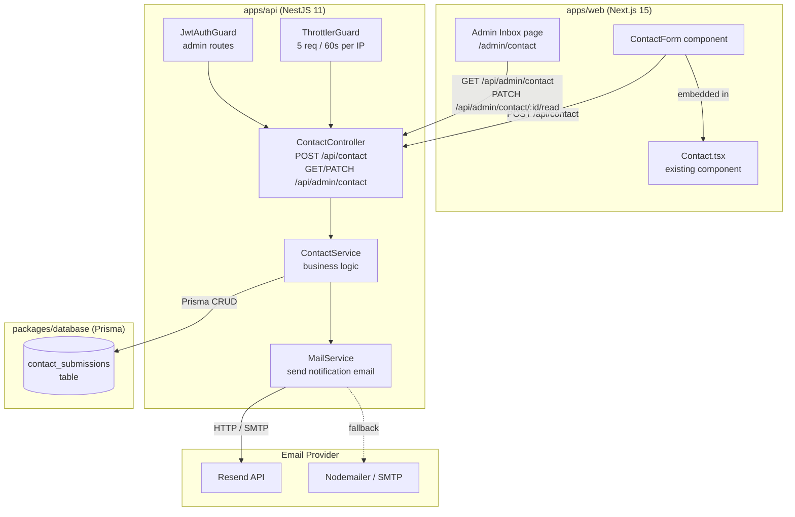

# Design Document: Contact Form with Email Integration

## Overview

This feature adds an interactive contact form to the jazz portfolio's existing Contact section. Visitors can send messages directly to the site owner via email, with submissions persisted to PostgreSQL for audit purposes and an admin inbox for reviewing messages in the CMS.

The implementation touches four layers:

1. **Database** — a new `contact_submissions` table in `packages/database`
2. **API** — a new `contact` NestJS module in `apps/api` with public and admin endpoints
3. **Mail Service** — a new `mail` NestJS module wrapping Resend (primary) or Nodemailer (SMTP fallback)
4. **Frontend** — a `ContactForm` React component embedded in the existing `Contact` portfolio component, plus an Admin Inbox page

The design follows all established project conventions: snake_case DB columns, UUID PKs, `{ data: T }` API responses, JWT-protected admin routes, next-intl i18n, and the jazz dark-gold visual theme.

---

## Architecture



### Key Design Decisions

**Single contact module** — Both the public submission endpoint and the admin inbox endpoints live inside `apps/api/src/contact/`. Splitting them would add indirection without benefit at this project's scale.

**Mail provider strategy via env vars** — The `MAIL_PROVIDER` env var (`resend` | `smtp`) selects the concrete transport at startup. Both are supported via a shared `MailProvider` interface with concrete `ResendProvider` and `NodemailerProvider` implementations injected by the `MailModule`. No third-party library beyond `resend` and `nodemailer` is needed.

**Persist-before-send** — The `ContactService` always writes the `contact_submissions` record first and only then calls `MailService`. If the DB write fails, the API returns HTTP 500 and no email is sent. If the email fails, the HTTP 201 still goes out with `emailDelivered: false`. This makes the submission record the source of truth.

**Honeypot in DTO** — The honeypot field is declared as an optional field in `CreateContactSubmissionDto`. class-validator checks it is empty; if non-empty the guard rejects with 400. This keeps the check in the same validation pipeline as all other field checks.

**HTML sanitization** — A lightweight `sanitize-html` (or equivalent) pass runs inside `ContactService.sanitize()` before validation passes, so that a payload like `<b>name</b>` reduces to `name` before max-length and empty checks fire. This happens server-side before persistence and before the email is composed.

**Retry with exponential-like fixed delay** — The `MailService` uses a simple `for` loop with `await sleep(5000)` for up to 3 retries (4 total attempts) on transient errors. This avoids needing an external queue or Bull/BullMQ at this project stage.

**Admin inbox: optimistic `isRead` update** — The inbox page applies an optimistic UI update (flipping `isRead` in local state immediately) and rolls back on API failure, matching the pattern common in the existing admin pages.

---

## Components and Interfaces

### Backend (apps/api)

#### Module layout

```
apps/api/src/
├── contact/
│   ├── contact.controller.ts
│   ├── contact.service.ts
│   ├── contact.module.ts
│   └── dto/
│       ├── create-contact-submission.dto.ts
│       └── contact-submission.dto.ts
└── mail/
    ├── mail.service.ts
    ├── mail.module.ts
    ├── interfaces/
    │   └── mail-provider.interface.ts
    └── providers/
        ├── resend.provider.ts
        └── nodemailer.provider.ts
```

#### ContactController

```
POST   /api/contact                        — public, throttled (5/60s)
GET    /api/admin/contact                  — JWT protected
PATCH  /api/admin/contact/:id/read         — JWT protected
```

#### ContactService (key methods)

```typescript
createSubmission(dto: CreateContactSubmissionDto): Promise<ContactSubmissionResponseDto>
listSubmissions(): Promise<ContactSubmissionDto[]>
markAsRead(id: string): Promise<ContactSubmissionDto>
```

Internal helper: `sanitize(text: string): string` — strips HTML tags from a string.

#### MailService (key methods)

```typescript
sendContactNotification(submission: ContactSubmission): Promise<void>
```

Internally retries up to 3 times on transient errors (connection refused, 429/500 from provider). Throws `MailDeliveryException` (a custom `HttpException` subclass) on exhausted retries or permanent failure.

#### MailProvider interface

```typescript
interface MailProvider {
  send(options: MailSendOptions): Promise<void>;
}

interface MailSendOptions {
  to: string;
  from: string;
  subject: string;
  text: string;
  html: string;
}
```

### Frontend (apps/web)

#### New files

```
apps/web/src/
├── components/portfolio/
│   └── ContactForm.tsx          — standalone form component
├── app/[locale]/admin/contact/
│   └── page.tsx                 — Admin Inbox page
└── i18n/messages/
    ├── en.json                  — contact namespace keys added
    ├── vi.json
    └── ja.json
```

#### ContactForm component API

```typescript
interface ContactFormProps {
  // No required props — uses useLocale() internally
}
```

Form state is managed with React `useState` hooks (no Zustand — the form is ephemeral and local). Submission calls `fetch('/api/contact', ...)` directly via the existing `ApiClient` helper.

#### Admin Inbox page

A `'use client'` page that:
1. On mount fetches `GET /api/admin/contact` with the JWT token from `useAuthStore`
2. Renders a list of submission cards (sender, subject, date, unread indicator)
3. Clicking a card selects it and renders the full message in a detail panel
4. A "Mark as read" button issues `PATCH /api/admin/contact/:id/read` with optimistic update

---

## Data Models

### Database: `contact_submissions` (Prisma model)

```prisma
model ContactSubmission {
  id          String   @id @default(uuid())
  senderName  String   @map("sender_name") @db.VarChar(100)
  senderEmail String   @map("sender_email") @db.VarChar(254)
  subject     String   @db.VarChar(200)
  messageBody String   @map("message_body") @db.VarChar(5000)
  isRead      Boolean  @default(false) @map("is_read")
  createdAt   DateTime @default(now()) @map("created_at")
  updatedAt   DateTime @updatedAt @map("updated_at")

  @@map("contact_submissions")
}
```

Notes:
- No `is_deleted` soft-delete flag — contact submissions are either read or unread; the admin can't delete them (no deletion endpoint in requirements).
- No JSONB multilingual fields — submission content is user-submitted plain text, not site content.
- `VarChar` constraints enforce the max-length limits at the DB layer as a secondary defence.

### DTO: `CreateContactSubmissionDto`

```typescript
class CreateContactSubmissionDto {
  @IsString()
  @IsNotEmpty()
  @MaxLength(100)
  @Transform(({ value }) => sanitizeHtml(value))
  name: string;

  @IsEmail()
  @MaxLength(254)
  email: string;

  @IsString()
  @IsNotEmpty()
  @MaxLength(200)
  @Transform(({ value }) => sanitizeHtml(value))
  subject: string;

  @IsString()
  @IsNotEmpty()
  @MinLength(10)
  @MaxLength(5000)
  @Transform(({ value }) => sanitizeHtml(value))
  message: string;

  // Honeypot — must be absent or empty
  @IsOptional()
  @IsEmpty()
  _hp?: string;
}
```

The `@Transform` decorators run `sanitizeHtml` (from the `sanitize-html` npm package) on each text field. After transformation, the `@IsNotEmpty()` decorator correctly catches inputs that were non-empty HTML and became empty strings after stripping.

### DTO: `ContactSubmissionDto` (response shape)

```typescript
interface ContactSubmissionDto {
  id: string;
  senderName: string;
  senderEmail: string;
  subject: string;
  messageBody: string;
  isRead: boolean;
  createdAt: string;   // ISO 8601 UTC
  updatedAt: string;   // ISO 8601 UTC
}
```

### DTO: `ContactSubmissionResponseDto` (POST /api/contact success payload)

```typescript
interface ContactSubmissionResponseDto {
  id: string;
  createdAt: string;    // ISO 8601 UTC
  emailDelivered: boolean;
}
```

### Translation namespace: `contact`

The following keys are added to each locale file under a top-level `"contact"` key:

```json
{
  "contact": {
    "sectionTitle": "Send a Message",
    "sectionSubtitle": "Drop me a line and I'll get back to you.",
    "labelName": "Your Name",
    "labelEmail": "Email Address",
    "labelSubject": "Subject",
    "labelMessage": "Message",
    "placeholderName": "Miles Davis",
    "placeholderEmail": "miles@jazzclub.io",
    "placeholderSubject": "Collaboration idea",
    "placeholderMessage": "Tell me what's on your mind...",
    "submit": "Send Message",
    "submitting": "Sending...",
    "successTitle": "Message Sent!",
    "successBody": "Thanks for reaching out. I'll get back to you soon.",
    "resetButton": "Send Another Message",
    "errorRequired": "This field is required.",
    "errorEmailInvalid": "Please enter a valid email address.",
    "errorMinLength": "Message must be at least 10 characters.",
    "errorMaxLengthName": "Name must be 100 characters or less.",
    "errorMaxLengthEmail": "Email must be 254 characters or less.",
    "errorMaxLengthSubject": "Subject must be 150 characters or less.",
    "errorMaxLengthMessage": "Message must be 5000 characters or less.",
    "errorRateLimit": "Too many messages sent. Please wait {seconds} seconds and try again.",
    "errorRateLimitGeneric": "Too many messages sent. Please try again later.",
    "errorValidation": "Some fields are invalid. Please check your input.",
    "errorServer": "Something went wrong on our end. Your message was not lost — please try again.",
    "charCountWarning": "{remaining} characters remaining.",
    "charCountLimit": "Character limit reached."
  }
}
```

### Shared types additions (`packages/shared`)

```typescript
// New types to add to packages/shared/src/types/index.ts

export interface ContactSubmissionDto {
  id: string;
  senderName: string;
  senderEmail: string;
  subject: string;
  messageBody: string;
  isRead: boolean;
  createdAt: string;
  updatedAt: string;
}

export interface CreateContactSubmissionResponseDto {
  id: string;
  createdAt: string;
  emailDelivered: boolean;
}
```

### Environment variables added

| Variable | Required | Description |
|---|---|---|
| `MAIL_PROVIDER` | Yes | `resend` or `smtp` |
| `MAIL_FROM` | Yes | Sender address (e.g. `noreply@jazzfolio.io`) |
| `MAIL_TO` | Yes | Owner's notification address |
| `RESEND_API_KEY` | If `MAIL_PROVIDER=resend` | Resend API key |
| `SMTP_HOST` | If `MAIL_PROVIDER=smtp` | SMTP server hostname |
| `SMTP_PORT` | If `MAIL_PROVIDER=smtp` | SMTP port (default 587) |
| `SMTP_USER` | If `MAIL_PROVIDER=smtp` | SMTP username |
| `SMTP_PASS` | If `MAIL_PROVIDER=smtp` | SMTP password |

These are added to `apps/api/.env.example` and validated in `env.validation.ts`.

---

## Correctness Properties

*A property is a characteristic or behavior that should hold true across all valid executions of a system — essentially, a formal statement about what the system should do. Properties serve as the bridge between human-readable specifications and machine-verifiable correctness guarantees.*

**Property Reflection:**

Before listing final properties, redundancies are eliminated:
- Req 1.3 and 6.1 describe the same success state transition — consolidated into **Property 1**.
- Req 1.4 and 6.4 overlap on error handling — consolidated with **Property 2** covering the input-preservation aspect.
- Req 1.6 and 7.1 both describe locale-driven text rendering — consolidated into **Property 3**.
- Req 3.5 and 3.6 are complementary halves of the same "email delivery flag" property — merged into **Property 7** (the emailDelivered flag accurately reflects the mail outcome).
- Req 5.1 and 3.3 both test persistence of submission data — consolidated into **Property 8**.
- Req 6.2 subsumes itself as a specific error code case — retained as **Property 6** (429 with optional retryAfter).
- Req 8.2, 8.3, 8.5 share the "reject bad input without persisting" pattern — the core behavior is captured by **Property 11** (honeypot) and **Property 12** (max lengths); 8.5 is redundant given those two.

---

### Property 1: Success state is locale-aware

*For any* supported locale (`en`, `vi`, `ja`), when the contact API returns HTTP 201, the ContactForm should hide all form fields and display a success message that contains translated text from that locale's `contact.successTitle` and `contact.successBody` keys, along with a visible reset control.

**Validates: Requirements 1.3, 6.1, 6.5**

---

### Property 2: Error responses re-enable the form and preserve input

*For any* error HTTP status (4xx or 5xx) or network timeout, the ContactForm should re-enable the submit button, display an error message in the active locale, and preserve the existing values of all form fields unchanged.

**Validates: Requirements 1.4, 6.4**

---

### Property 3: All form text is sourced from active locale translations

*For any* supported locale, all visible text in the rendered ContactForm (labels, placeholders, validation messages, button text, status messages) should match the corresponding string in that locale's translation file and should not be a raw translation key name.

**Validates: Requirements 1.6, 7.1, 7.5**

---

### Property 4: Required field validation fires on empty submit

*For any* combination of required fields (`name`, `email`, `subject`, `message`) left empty, attempting to submit the ContactForm should display an inline validation error message adjacent to each empty field without sending a request to the API.

**Validates: Requirements 2.1**

---

### Property 5: Invalid email triggers inline error on blur

*For any* string that is not a valid RFC 5322 email address, entering that string in the email field and then moving focus to another field should cause an inline validation error to appear adjacent to the email field.

**Validates: Requirements 2.2**

---

### Property 6: Message character count boundaries are enforced

*For any* message body string of length `n`:
- If `n < 10` and submit is attempted: an inline min-length error is shown.
- If `4500 ≤ n < 5000`: a character-count warning showing `(5000 - n)` remaining characters is displayed.
- If `n ≥ 5000`: the field rejects additional input and shows the limit-reached indicator.

**Validates: Requirements 2.3, 2.4, 2.5**

---

### Property 7: Validation error clears when field becomes valid

*For any* field that currently displays a validation error, entering a value that satisfies that field's validation rule should clear the error for that specific field only (other fields' errors remain unchanged).

**Validates: Requirements 2.6**

---

### Property 8: API validation rejects any incomplete or oversized payload

*For any* request body in which one or more required fields (`name`, `email`, `message`) are missing, empty, or invalid, or in which any field exceeds its maximum character length, the Contact API should return HTTP 400 with a response body that identifies the failing fields.

**Validates: Requirements 3.2, 8.3**

---

### Property 9: Submission persistence round-trip

*For any* valid submission payload, after the POST /api/contact call returns HTTP 201, querying the database for the returned `id` should yield a record with `senderName`, `senderEmail`, `subject`, `messageBody`, `isRead = false`, and a `createdAt` timestamp that matches the ISO 8601 value in the response.

**Validates: Requirements 3.3, 5.1**

---

### Property 10: emailDelivered flag accurately reflects mail outcome

*For any* valid submission:
- When the MailService delivers the email without error: the response is HTTP 201 with `emailDelivered: true`.
- When the MailService throws after retries: the response is still HTTP 201 (not 500) with `emailDelivered: false`.

**Validates: Requirements 3.5, 3.6**

---

### Property 11: DB failure prevents email and returns HTTP 500

*For any* valid submission payload where the database write throws an error, the Contact API should return HTTP 500 and the MailService `sendContactNotification` method should never be called.

**Validates: Requirements 3.8**

---

### Property 12: Notification email contains all submission fields

*For any* valid ContactSubmission record, the email sent by the MailService should contain the `senderName`, `senderEmail`, `subject`, `messageBody`, and `createdAt` (formatted as ISO 8601 UTC) in both the plain-text and HTML bodies.

**Validates: Requirements 4.1**

---

### Property 13: Mail retry exhausts before throwing

*For any* transient mail-provider error, the MailService should call the underlying provider's `send` method a total of up to 4 times (1 initial + 3 retries) with at least 5 seconds between each attempt, and only throw after all attempts are exhausted.

**Validates: Requirements 4.4, 4.5**

---

### Property 14: Admin inbox is sorted by createdAt descending

*For any* set of ContactSubmissions with distinct `createdAt` values, the `GET /api/admin/contact` endpoint should return them ordered from most recent to oldest.

**Validates: Requirements 5.2**

---

### Property 15: Each inbox row renders all required fields

*For any* array of `ContactSubmissionDto` objects, the rendered Admin Inbox should display the `senderName`, `senderEmail`, `subject`, and `createdAt` (formatted date) for every submission, and show the unread indicator if and only if `isRead` is `false`.

**Validates: Requirements 5.3, 5.8**

---

### Property 16: Mark-as-read round-trip

*For any* ContactSubmission with `isRead = false`, calling `PATCH /api/admin/contact/:id/read` should result in the database record for that `id` having `isRead = true` and the API returning the updated record.

**Validates: Requirements 5.6**

---

### Property 17: Rate limit error message includes retryAfter when present

*For any* HTTP 429 response from the Contact API, if the response body includes a `retryAfter` value the ContactForm should display that duration in the error message; if absent the message should still be shown but use the generic retry wording.

**Validates: Requirements 6.2**

---

### Property 18: HTML in submission fields is stripped

*For any* text field value containing HTML tags (e.g., `<script>`, `<b>`, ``), the value stored in the database and used in the notification email should not contain any HTML markup. Furthermore, if stripping HTML leaves the field empty, the API should return HTTP 400.

**Validates: Requirements 8.1, 8.6**

---

### Property 19: Non-empty honeypot causes HTTP 400 without side effects

*For any* submission in which the `_hp` honeypot field contains a non-empty string, the Contact API should return HTTP 400 without inserting a row into `contact_submissions` and without calling the MailService.

**Validates: Requirements 8.2, 8.5**

---

### Property 20: All locale files contain every contact translation key

*For any* translation key defined in the `"contact"` namespace, each of the three locale files (`en.json`, `vi.json`, `ja.json`) should contain a non-empty string for that key.

**Validates: Requirements 7.2**

---

## Error Handling

### API-layer errors

| Scenario | HTTP Status | Body |
|---|---|---|
| Honeypot field is non-empty | 400 | `{ statusCode: 400, message: "Invalid submission.", error: "BadRequest" }` |
| class-validator rejects a field | 400 | standard NestJS validation error listing field names |
| DB write fails | 500 | `{ statusCode: 500, message: "Internal server error", error: "InternalServerError" }` |
| Mail misconfiguration on startup | 503 on any submission | `{ statusCode: 503, message: "Email service is unavailable.", error: "ServiceUnavailable" }` |
| Rate limit exceeded | 429 | includes `retryAfter` seconds header and body field |
| Submission not found (admin PATCH) | 404 | standard not-found response |

All errors pass through the existing `HttpExceptionFilter` so the shape is consistent with the rest of the API.

### Mail Service errors

The `MailService` distinguishes two categories:

- **Transient** (`ECONNREFUSED`, provider HTTP 5xx, `429`): retry up to 3 times with a 5 s delay, then throw `MailDeliveryException`.
- **Permanent** (provider HTTP 400, 401, 403, invalid address): throw `MailDeliveryException` immediately without retrying.

`MailDeliveryException` is caught in `ContactService.createSubmission()`. The exception is logged via NestJS `Logger` and the `emailDelivered: false` flag is set in the response. It is never re-thrown to the HTTP layer.

### Frontend errors

| API response | ContactForm behaviour |
|---|---|
| Network timeout (>30 s) | Re-enable form, show `contact.errorServer`, preserve input |
| HTTP 400 | Re-enable form, show `contact.errorValidation` |
| HTTP 429 with `retryAfter` | Show `contact.errorRateLimit` with seconds; form re-enabled |
| HTTP 429 without `retryAfter` | Show `contact.errorRateLimitGeneric`; form re-enabled |
| HTTP 5xx | Re-enable form, show `contact.errorServer`, **preserve input** |

The 30-second timeout is implemented with `AbortController` + `AbortSignal.timeout(30000)`.

---

## Testing Strategy

This feature has pure business-logic functions (sanitisation, DTO validation, mail retry) that are excellent candidates for property-based testing. UI behaviour tests use React Testing Library. Integration tests cover the happy path end-to-end against a real (test) database.

### Property-Based Testing

The property-based testing library for this project is **fast-check** (TypeScript-native, works with Jest).

Each property test runs a minimum of **100 iterations**. Tests are tagged with the format:
`// Feature: contact-form-email, Property N: <short description>`

Properties suitable for PBT (from the Correctness Properties section):

| Property | Test file | What varies |
|---|---|---|
| P4 — Required field empty submit | `contact-form.pbt.test.tsx` | Which subset of required fields is empty |
| P5 — Invalid email triggers error | `contact-form.pbt.test.tsx` | Arbitrary non-email strings |
| P6 — Character count boundaries | `contact-form.pbt.test.tsx` | Message lengths across the 10/4500/5000 thresholds |
| P7 — Error clears when field valid | `contact-form.pbt.test.tsx` | Field type and valid value for each field |
| P8 — API rejects invalid payloads | `contact.service.pbt.spec.ts` | Missing fields, oversized strings |
| P9 — Submission persistence round-trip | `contact.service.pbt.spec.ts` | Arbitrary valid name/email/subject/message strings |
| P10 — emailDelivered flag | `contact.service.pbt.spec.ts` | Mail succeeds vs throws |
| P11 — DB failure prevents email | `contact.service.pbt.spec.ts` | Any valid payload |
| P12 — Email contains all fields | `mail.service.pbt.spec.ts` | Arbitrary submission content |
| P13 — Retry count exhausted | `mail.service.pbt.spec.ts` | Transient vs permanent error types |
| P14 — Admin sorted descending | `contact.service.pbt.spec.ts` | Any array of submissions with distinct dates |
| P15 — Inbox row renders fields | `admin-inbox.pbt.test.tsx` | Arbitrary arrays of ContactSubmissionDto |
| P16 — Mark-as-read round-trip | `contact.service.pbt.spec.ts` | Any valid submission id |
| P18 — HTML stripping | `contact.service.pbt.spec.ts` | Strings containing HTML tags |
| P19 — Honeypot rejects | `contact.service.pbt.spec.ts` | Non-empty honeypot strings |
| P20 — Translation key coverage | `i18n.pbt.test.ts` | All keys in the contact namespace |

### Unit Tests (Example-Based)

These cover specific scenarios and integration points not suitable for pure PBT:

- `ContactController` — public endpoint requires no auth (req 3.1), returns correct HTTP codes
- `MailService` — startup 503 when env vars missing (req 4.3), permanent error throws immediately
- `AdminInbox` page — optimistic read update rolls back on PATCH failure (req 5.7)
- `ContactForm` — honeypot field exists in DOM and is hidden (req 8.4)
- `ContactForm` — loading state disables button during submission (req 1.2)
- `Contact` component — both info cards and ContactForm render together (req 1.7)

### Integration Tests

Run against a test PostgreSQL database (same Docker setup as existing tests):

- `POST /api/contact` happy path creates DB record and calls mail service
- `POST /api/contact` rate-limit: 5th request succeeds, 6th returns 429
- `GET /api/admin/contact` returns 401 without JWT, correct data with JWT
- `PATCH /api/admin/contact/:id/read` flips isRead to true in DB

### Testing Tools

| Layer | Tool |
|---|---|
| API unit / PBT | Jest + `@nestjs/testing` + `fast-check` |
| Frontend unit / PBT | Jest + React Testing Library + `fast-check` |
| API integration | Jest + Supertest + real test DB |
| i18n key coverage | Jest + `fast-check` |
