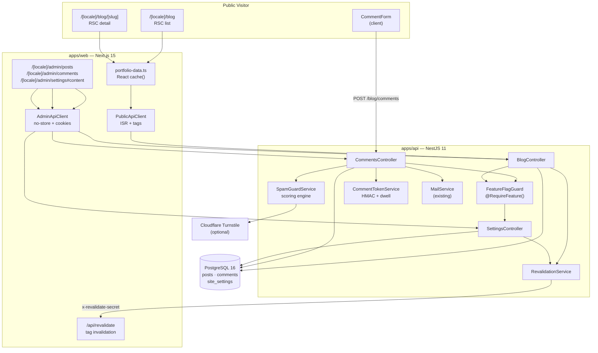
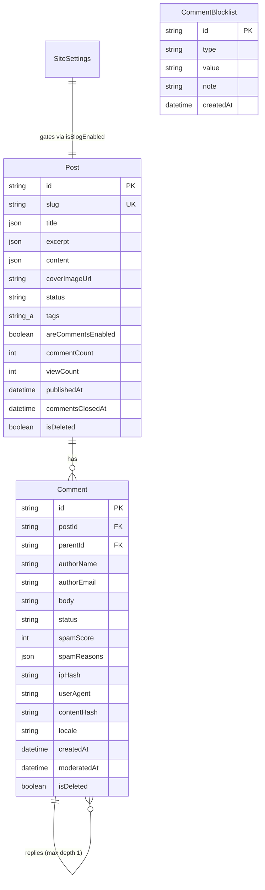
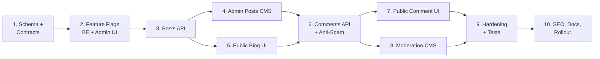

# 🎷 Blog / Posts + Comments — Implementation Plan

> **Scope:** Add a multilingual Blog/Posts module, a spam-resistant Comments system, and admin CMS feature flags that control whether either surface is visible publicly.
> **Status:** Planned (not yet implemented). Blog and Comments are listed as *Out of Scope (v1)* in [PROJECT_BIBLE.md](./PROJECT_BIBLE.md) and [.kiro/steering/product.md](../.kiro/steering/product.md) — this plan promotes them to v2.
> **Companion docs:** [PROJECT_BIBLE.md](./PROJECT_BIBLE.md) · [contact_form_implementation.md](./contact_form_implementation.md) · [refactor_and_performance.md](./refactor_and_performance.md)

---

## Table of Contents

1. [Goal](#1-goal)
2. [Guiding Principles](#2-guiding-principles)
3. [Architecture Overview](#3-architecture-overview)
4. [Key Design Decisions](#4-key-design-decisions)
5. [Database Schema](#5-database-schema)
6. [Shared Contracts](#6-shared-contracts)
7. [API Surface](#7-api-surface)
8. [Feature Flag Design](#8-feature-flag-design)
9. [Comment Security & Anti-Spam Architecture](#9-comment-security--anti-spam-architecture)
10. [Frontend Design](#10-frontend-design)
11. [Internationalization](#11-internationalization)
12. [Caching & Revalidation](#12-caching--revalidation)
13. [Implementation Phases](#13-implementation-phases)
14. [Correctness Properties](#14-correctness-properties)
15. [Error Handling Matrix](#15-error-handling-matrix)
16. [Testing Strategy](#16-testing-strategy)
17. [Environment Variables](#17-environment-variables)
18. [Dependencies to Add](#18-dependencies-to-add)
19. [Migration & Rollback](#19-migration--rollback)
20. [Operations Runbook](#20-operations-runbook)
21. [Legal / Privacy Considerations](#21-legal--privacy-considerations)
22. [Risk Register](#22-risk-register)
23. [Task Checklist](#23-task-checklist)
24. [Decision Log Entries to Append](#24-decision-log-entries-to-append)
25. [Docs to Update on Completion](#25-docs-to-update-on-completion)

---

## 1. Goal

Ship a first-class writing surface for the portfolio owner and a safe conversation surface for visitors, without regressing the existing portfolio, and with a kill switch the admin can flip from the CMS at any time.

Three deliverables:

| # | Deliverable | Summary |
|---|---|---|
| 1 | **Blog / Posts** | Multilingual posts (EN/VI/JA) authored in Markdown via the admin CMS, published at `/[locale]/blog` and `/[locale]/blog/[slug]`, SSR-rendered with ISR + cache tags, SEO metadata, RSS, sitemap. |
| 2 | **Comments** | Public, account-free commenting with **moderation-by-default** and a layered anti-abuse pipeline (feature gate → token/dwell → rate limit → honeypot → CAPTCHA → sanitize → heuristic scoring → duplicate detection → moderation queue). |
| 3 | **Admin feature flags** | `isBlogEnabled` and `areCommentsEnabled` in `site_settings`, exposed on a new **Content** tab of the admin Settings screen, enforced **both** in the UI and server-side. |

**Non-goals for this iteration:** rich-text WYSIWYG editor, user accounts / social login, comment editing by authors, likes/reactions, full-text search across posts, multi-author bylines, scheduled auto-publish via cron.

---

## 2. Guiding Principles

1. **Mirror what exists.** Every new module copies the shape of an existing one — `contact` for public writes, `categories` for admin CRUD, `settings` for flags. No new architectural patterns unless the security model demands it.
2. **Default deny.** Both flags ship `false`. Comments arrive `PENDING`, never auto-visible. A misconfigured deployment leaks nothing.
3. **Enforce flags on the server.** The existing `isContactFormEnabled` flag is frontend-only — `POST /api/contact` still accepts direct API calls. This plan **fixes that class of bug for blog/comments** with a reusable guard, and back-fills contact as a bonus task.
4. **Never trust, never render.** Comment bodies are stored and rendered as **plain text**. Post bodies are Markdown rendered through an allowlist sanitizer with raw HTML disabled. There is no `dangerouslySetInnerHTML` anywhere in this feature.
5. **Minimize PII.** Commenter IPs are stored as salted hashes, never raw. Emails are stored but never returned by any public endpoint.
6. **Uniform responses to attackers.** A spam-flagged comment gets the same `202 Accepted` as a clean one. Bots learn nothing about the filter.
7. **Zero new backend dependencies.** HMAC, hashing, and the Turnstile call all use Node 20 built-ins plus the already-installed `sanitize-html`.

---

## 3. Architecture Overview



### Request flow — publishing a post

```
Admin edits post -> PUT /api/blog/admin/posts/:id { status: PUBLISHED }
  -> BlogService validates slug uniqueness + required locales
  -> Prisma update (publishedAt = now() if first publish)
  -> RevalidationService POSTs { tag: 'posts' } to web /api/revalidate
  -> Next Data Cache purged -> next visitor gets fresh SSR page
```

### Request flow — submitting a comment

```
1. Visitor opens /[locale]/blog/[slug]
2. CommentForm mounts -> GET /api/blog/posts/:slug/comment-token   (no-store)
     <- { token, minDwellMs }        token = HMAC(postId | iat | nonce)
3. Visitor types, submits -> POST /api/blog/comments
     body: { postId, parentId?, token, authorName, authorEmail, body, _hp, _website, turnstileToken? }
4. Server pipeline (short-circuits on the first hard failure):
     a. FeatureFlagGuard        -> blog + comments enabled?        403
     b. ThrottlerGuard          -> <= 3 / 10 min per IP            429
     c. ValidationPipe          -> DTO shape, lengths, honeypots   400
     d. CommentTokenService     -> HMAC valid? dwell >= 4s?
                                   age <= 2h? nonce unused?        400
     e. TurnstileService        -> siteverify (if enabled)         400
     f. PostGate                -> post published + comments open
                                   + not past close window
                                   + under per-post cap            403 / 409
     g. IP budget               -> <= 5 / hour, <= 10 / day        429
     h. Blocklist               -> email / domain / ipHash / regex  -> silent SPAM
     i. sanitize-html           -> strip ALL tags from all fields
     j. Duplicate detection     -> contentHash seen before?         -> silent SPAM
     k. SpamGuardService        -> score 0..100
5. Persist Comment with status = APPROVED | PENDING | SPAM (per score + settings)
6. Fire-and-forget MailService notification to admin (PENDING/APPROVED only)
7. Respond 202 { status: 'PENDING_REVIEW' }  <- identical for SPAM
```

---

## 4. Key Design Decisions

### 4.1 Markdown for posts, plain text for comments

Post bodies are stored as Markdown per locale and rendered in an RSC with `react-markdown` + `remark-gfm` + `rehype-sanitize`, **without** `rehype-raw`. Raw HTML in the source is dropped, not escaped-and-rendered. Because rendering happens in a Server Component, no markdown parser ships to the browser on the public blog.

Comment bodies are **plain text only** — no Markdown, no autolinking, rendered inside a `<p className="whitespace-pre-wrap">`. This removes the entire XSS and link-spam class from the highest-risk input in the system. Links in comments are stripped to their text by the sanitizer and counted as a spam signal.

**Rejected:** storing pre-rendered HTML in the DB (a single sanitizer regression becomes permanent stored XSS), and a WYSIWYG editor (large bundle, HTML-in-DB, poor multilingual diffing).

### 4.2 Moderation by default, with an opt-in auto-approve

`site_settings.commentModerationMode` takes `ALL` (everything queues — default), `SPAM_ONLY` (clean comments auto-approve, flagged ones queue), or `CLOSED`. Starting at `ALL` means the blast radius of any filter bypass is "the admin sees junk in a queue," not "the public sees junk on the site."

### 4.3 No author website/URL field

The single largest incentive for comment spam is a followed backlink. This plan **does not offer a website field at all**. Any URL detected in the body raises the spam score, and rendered output carries `rel="nofollow ugc noopener noreferrer"` for the (few) links the admin themselves may add in post bodies.

### 4.4 Signed form token with a dwell-time floor

Instead of a session or CSRF cookie (which visitors don't have — the public site is cookie-free), the comment form fetches a short-lived HMAC token bound to the post. The token carries an issued-at timestamp, so the server can reject submissions that arrive faster than a human could type (`< 4s`) or long after the page was rendered (`> 2h`). Nonces are cached in memory for the token lifetime to block replay. This is stateless, cheap, and defeats the majority of naive form-posting bots without a CAPTCHA.

### 4.5 Cloudflare Turnstile as an optional, admin-toggleable layer

Turnstile is free, privacy-preserving, and needs no cookie banner. It is wired as an *optional* layer behind `isCommentCaptchaEnabled` + `TURNSTILE_SECRET_KEY`. The system is fully functional without it; the admin can switch it on when spam pressure rises. **Rejected:** reCAPTCHA (Google cookies / consent implications).

### 4.6 Salted IP hashes, never raw IPs

`ipHash = sha256(COMMENT_IP_HASH_SALT + clientIp)`, truncated to 32 hex chars. This supports per-IP budgets and blocklists while keeping the database free of directly-identifying network data. Rotating the salt intentionally invalidates all historical correlations.

### 4.7 Separate `/settings/admin/features` endpoint pair

The existing `GET/PUT /settings/admin/email` bundle is email-specific; hanging blog flags off it would be semantically wrong and would risk regressing a working screen. This plan adds a parallel `GET/PUT /settings/admin/features` pair and a new **Content** tab, leaving the email flow byte-for-byte untouched.

> A future cleanup could collapse both into a single `GET/PUT /settings/admin`. Deliberately deferred — it is a refactor, not a feature.

### 4.8 Reusable `FeatureFlagGuard` — and a fix for contact

A `@RequireFeature('blog' | 'comments')` decorator plus a guard reads cached settings and throws `403` (or `404` for content routes, to avoid confirming existence). Once it exists, applying it to `POST /api/contact` closes the pre-existing hole where the contact API accepts submissions while the form is switched off. Tracked as task 2.6.

### 4.9 Tags as a Postgres text array

`tags String[] @default([])` with a GIN index is enough for filtering and tag pages. A normalized `Tag` + join table adds two models and several joins for a portfolio-scale blog.

**Tradeoff accepted:** renaming a tag is an `UPDATE ... array_replace` maintenance script rather than a single-row edit.

### 4.10 One level of reply nesting

`Comment.parentId` is a self-relation, but the service rejects a reply whose parent already has a parent. Flat-plus-one keeps the UI readable on mobile, keeps queries to a single fetch, and removes unbounded-depth abuse.

---

## 5. Database Schema

### 5.1 ER Diagram



### 5.2 Prisma models (append to `packages/database/prisma/schema.prisma`)

```prisma
model Post {
  id                 String    @id @default(uuid())
  slug               String    @unique
  title              Json      @default("{\"en\": \"\", \"vi\": \"\", \"ja\": \"\"}")
  excerpt            Json      @default("{\"en\": \"\", \"vi\": \"\", \"ja\": \"\"}")
  content            Json      @default("{\"en\": \"\", \"vi\": \"\", \"ja\": \"\"}")
  coverImageUrl      String?   @map("cover_image_url")
  status             String    @default("DRAFT")
  tags               String[]  @default([])
  readingMinutes     Int       @default(0) @map("reading_minutes")
  areCommentsEnabled Boolean   @default(true) @map("are_comments_enabled")
  commentsClosedAt   DateTime? @map("comments_closed_at")
  commentCount       Int       @default(0) @map("comment_count")
  viewCount          Int       @default(0) @map("view_count")
  publishedAt        DateTime? @map("published_at")
  isDeleted          Boolean   @default(false) @map("is_deleted")
  createdAt          DateTime  @default(now()) @map("created_at")
  updatedAt          DateTime  @updatedAt @map("updated_at")
  comments           Comment[]

  @@index([isDeleted, status, publishedAt(sort: Desc)])
  @@index([status, publishedAt(sort: Desc)])
  @@index([tags], type: Gin)
  @@map("posts")
}

model Comment {
  id          String    @id @default(uuid())
  postId      String    @map("post_id")
  parentId    String?   @map("parent_id")
  authorName  String    @map("author_name") @db.VarChar(60)
  authorEmail String    @map("author_email") @db.VarChar(254)
  body        String    @db.VarChar(2000)
  status      String    @default("PENDING")
  spamScore   Int       @default(0) @map("spam_score")
  spamReasons Json      @default("[]") @map("spam_reasons")
  ipHash      String    @map("ip_hash") @db.VarChar(64)
  userAgent   String    @default("") @map("user_agent") @db.VarChar(400)
  contentHash String    @map("content_hash") @db.VarChar(64)
  locale      String    @default("en") @db.VarChar(5)
  moderatedAt DateTime? @map("moderated_at")
  isDeleted   Boolean   @default(false) @map("is_deleted")
  createdAt   DateTime  @default(now()) @map("created_at")
  updatedAt   DateTime  @updatedAt @map("updated_at")

  post     Post      @relation(fields: [postId], references: [id], onDelete: Cascade)
  parent   Comment?  @relation("CommentReplies", fields: [parentId], references: [id], onDelete: Cascade)
  replies  Comment[] @relation("CommentReplies")

  @@index([postId, status, createdAt])
  @@index([status, createdAt(sort: Desc)])
  @@index([ipHash, createdAt])
  @@index([contentHash])
  @@map("comments")
}

model CommentBlocklist {
  id        String   @id @default(uuid())
  type      String   // EMAIL | EMAIL_DOMAIN | IP_HASH | KEYWORD
  value     String   @db.VarChar(200)
  note      String   @default("") @db.VarChar(200)
  createdAt DateTime @default(now()) @map("created_at")

  @@unique([type, value])
  @@index([type])
  @@map("comment_blocklist")
}
```

### 5.3 `SiteSettings` additions

```prisma
model SiteSettings {
  // ... existing fields unchanged ...
  isBlogEnabled            Boolean @default(false) @map("is_blog_enabled")
  areCommentsEnabled       Boolean @default(false) @map("are_comments_enabled")
  commentModerationMode    String  @default("ALL")  @map("comment_moderation_mode")  // ALL | SPAM_ONLY | CLOSED
  isCommentCaptchaEnabled  Boolean @default(false) @map("is_comment_captcha_enabled")
  commentAutoCloseDays     Int     @default(0)     @map("comment_auto_close_days")   // 0 = never
  commentMaxPerPost        Int     @default(500)   @map("comment_max_per_post")
  commentSpamThreshold     Int     @default(60)    @map("comment_spam_threshold")    // >= => SPAM
  commentNotifyEmail       Boolean @default(true)  @map("comment_notify_email")
}
```

### 5.4 Status enumerations (string columns, validated in DTOs)

Matching the existing convention (`Category.type` is a plain string, not a Prisma enum):

| Column | Values |
|---|---|
| `posts.status` | `DRAFT` · `PUBLISHED` · `ARCHIVED` |
| `comments.status` | `PENDING` · `APPROVED` · `SPAM` · `REJECTED` |
| `site_settings.comment_moderation_mode` | `ALL` · `SPAM_ONLY` · `CLOSED` |
| `comment_blocklist.type` | `EMAIL` · `EMAIL_DOMAIN` · `IP_HASH` · `KEYWORD` |

Add matching TypeScript enums to `packages/shared/src/enums/index.ts` alongside `CategoryType`.

### 5.5 Migrations

| Order | Migration name | Contents |
|---|---|---|
| 1 | `<ts>_blog_settings_flags` | `ALTER TABLE site_settings ADD COLUMN` × 8, all with safe defaults |
| 2 | `<ts>_blog_posts` | `CREATE TABLE posts` + 3 indexes (incl. GIN on `tags`) |
| 3 | `<ts>_blog_comments` | `CREATE TABLE comments` + `comment_blocklist`, FKs, 4 indexes |

Split into three so the flag migration can ship and be verified independently of the content tables. All are additive — no existing column is touched, so rollback is a `DROP TABLE` / `DROP COLUMN` with zero data loss to existing features.

### 5.6 Seed additions (`packages/database/prisma/seed.ts`)

- Extend the `site_settings` upsert with the eight new fields (flags **off**).
- Add two demo posts (one `PUBLISHED`, one `DRAFT`) with EN/VI/JA content, upserted by stable slug — matching the existing `SEED_CATEGORIES` idempotent pattern.
- Add three demo comments on the published post: one `APPROVED`, one `PENDING`, one `SPAM`, so the moderation UI has content on a fresh clone.
- Put the literals in a new `packages/database/prisma/seed-blog-data.ts`, mirroring `seed-data.ts`.

---

## 6. Shared Contracts

All additions go to `packages/shared` and are the single source of truth for both apps.

### 6.1 `src/enums/index.ts`

```typescript
export enum PostStatus { DRAFT = 'DRAFT', PUBLISHED = 'PUBLISHED', ARCHIVED = 'ARCHIVED' }
export enum CommentStatus { PENDING = 'PENDING', APPROVED = 'APPROVED', SPAM = 'SPAM', REJECTED = 'REJECTED' }
export enum CommentModerationMode { ALL = 'ALL', SPAM_ONLY = 'SPAM_ONLY', CLOSED = 'CLOSED' }
export enum BlocklistType { EMAIL = 'EMAIL', EMAIL_DOMAIN = 'EMAIL_DOMAIN', IP_HASH = 'IP_HASH', KEYWORD = 'KEYWORD' }
```

### 6.2 `src/types/index.ts`

```typescript
// ---- Posts ----
export interface PostListItemDto {
  id: string;
  slug: string;
  title: LocalizedString;
  excerpt: LocalizedString;
  coverImageUrl: string | null;
  tags: string[];
  readingMinutes: number;
  commentCount: number;
  publishedAt: string | null;
}

/** Public detail — adds body, never exposes counters used for moderation. */
export interface PostDetailDto extends PostListItemDto {
  content: LocalizedString;
  areCommentsEnabled: boolean;
  commentsClosed: boolean;
}

/** Admin view — adds lifecycle + soft-delete state. */
export interface AdminPostDto extends PostDetailDto {
  status: PostStatus;
  viewCount: number;
  commentsClosedAt: string | null;
  isDeleted: boolean;
  createdAt: string;
  updatedAt: string;
}

export interface CreatePostRequest {
  slug: string;
  title: LocalizedString;
  excerpt: LocalizedString;
  content: LocalizedString;
  coverImageUrl?: string | null;
  tags?: string[];
  status?: PostStatus;
  areCommentsEnabled?: boolean;
}
export type UpdatePostRequest = Partial<CreatePostRequest>;

// ---- Comments ----
/** Public shape. NOTE: no email, no ipHash, no spam fields. */
export interface PublicCommentDto {
  id: string;
  parentId: string | null;
  authorName: string;
  body: string;
  createdAt: string;
  replies?: PublicCommentDto[];
}

export interface AdminCommentDto extends Omit<PublicCommentDto, 'replies'> {
  postId: string;
  postSlug: string;
  postTitle: LocalizedString;
  authorEmail: string;
  status: CommentStatus;
  spamScore: number;
  spamReasons: string[];
  ipHash: string;
  userAgent: string;
  locale: string;
  moderatedAt: string | null;
}

export interface CommentTokenDto { token: string; minDwellMs: number; }

export interface CreateCommentRequest {
  postId: string;
  parentId?: string | null;
  token: string;
  authorName: string;
  authorEmail: string;
  body: string;
  locale?: Locale;
  turnstileToken?: string;
  /** honeypots — must be absent/empty */
  _hp?: string;
  _website?: string;
}

export interface CreateCommentResponseDto {
  status: 'PENDING_REVIEW' | 'PUBLISHED';
  message: string;
}

export interface ModerateCommentRequest { status: CommentStatus; }
export interface BulkModerateRequest { ids: string[]; status: CommentStatus; }

// ---- Feature settings ----
export interface FeatureSettingsDto {
  isBlogEnabled: boolean;
  areCommentsEnabled: boolean;
  commentModerationMode: CommentModerationMode;
  isCommentCaptchaEnabled: boolean;
  commentAutoCloseDays: number;
  commentMaxPerPost: number;
  commentSpamThreshold: number;
  commentNotifyEmail: boolean;
  updatedAt: string;
}
export type UpdateFeatureSettingsDto = Partial<Omit<FeatureSettingsDto, 'updatedAt'>>;

export interface FeatureSettingsStatusDto {
  captchaConfigured: boolean;   // TURNSTILE_SECRET_KEY present
  tokenSecretConfigured: boolean;
  ipSaltConfigured: boolean;
  pendingCommentCount: number;
}
```

### 6.3 `src/types/index.ts` — extend the existing public settings shape

```typescript
export interface PublicSettingsDto {
  isContactFormEnabled: boolean;
  isBlogEnabled: boolean;
  areCommentsEnabled: boolean;
  isCommentCaptchaEnabled: boolean;
}
```

> `GET /settings/public` currently returns `{ isContactFormEnabled }`. Widening it is backward compatible — existing callers read one field and ignore the rest.

### 6.4 `src/api-routes.ts`

```typescript
  settings: {
    public: () => '/settings/public',
    adminEmail: () => '/settings/admin/email',
    adminEmailTest: () => '/settings/admin/email/test',
    adminFeatures: () => '/settings/admin/features',        // NEW
  },

  blog: {                                                    // NEW
    publicList: (params?: { page?: number; limit?: number; tag?: string }) => { /* URLSearchParams */ },
    publicBySlug: (slug: string) => `/blog/posts/${slug}`,
    publicTags: () => '/blog/tags',
    commentToken: (slug: string) => `/blog/posts/${slug}/comment-token`,
    publicComments: (slug: string, page?: number) => `/blog/posts/${slug}/comments`,
    submitComment: () => '/blog/comments',

    adminList: (params?: { page?: number; limit?: number; status?: string }) => { /* ... */ },
    adminCreate: () => '/blog/admin/posts',
    adminGet: (id: string) => `/blog/admin/posts/${id}`,
    adminUpdate: (id: string) => `/blog/admin/posts/${id}`,
    adminDelete: (id: string) => `/blog/admin/posts/${id}`,
    adminPublish: (id: string) => `/blog/admin/posts/${id}/publish`,
    adminUnpublish: (id: string) => `/blog/admin/posts/${id}/unpublish`,
  },

  comments: {                                                // NEW
    adminList: (params?: { page?: number; limit?: number; status?: string; postId?: string }) => { /* ... */ },
    adminModerate: (id: string) => `/admin/comments/${id}/moderate`,
    adminBulkModerate: () => '/admin/comments/bulk-moderate',
    adminDelete: (id: string) => `/admin/comments/${id}`,
    adminBlocklist: () => '/admin/comments/blocklist',
    adminBlocklistDelete: (id: string) => `/admin/comments/blocklist/${id}`,
  },
```

Follow the existing route-naming split: content resources nest admin under the resource (`/blog/admin/*`, like `categories`/`music`), while inbox-style moderation sits at the top level (`/admin/comments`, like `/admin/contact`).

`api-routes.test.ts` already exists — extend it with cases for the new builders, especially query-string assembly.

---

## 7. API Surface

### 7.1 Public endpoints

| Method | Route | Guard(s) | Throttle | Notes |
|---|---|---|---|---|
| GET | `/api/blog/posts` | `@RequireFeature('blog')` | global 100/min | Paginated, `PUBLISHED` + `isDeleted:false` only. Optional `?tag=`. Returns `PostListItemDto[]` — no `content`. |
| GET | `/api/blog/posts/:slug` | `@RequireFeature('blog')` | global | `404` if draft/archived/deleted. |
| GET | `/api/blog/tags` | `@RequireFeature('blog')` | global | Distinct tags with counts, published posts only. |
| GET | `/api/blog/posts/:slug/comments` | `@RequireFeature('blog')` | global | `APPROVED` only, threaded, paginated 20/page. |
| GET | `/api/blog/posts/:slug/comment-token` | `@RequireFeature('comments')` | **10 / 5 min** | `Cache-Control: no-store`. Returns `CommentTokenDto`. |
| POST | `/api/blog/comments` | `@RequireFeature('comments')` | **3 / 10 min** | Full anti-spam pipeline. Always `202`. |

**When the flag is off:** content routes return `404 Not Found` (do not confirm a hidden blog exists); the write route returns `403 Forbidden` with `COMMENTS_DISABLED`.

### 7.2 Admin endpoints (all `@UseGuards(JwtAuthGuard)` + `@ApiBearerAuth()`)

| Method | Route | Description |
|---|---|---|
| GET | `/api/blog/admin/posts` | Paginated, all statuses, `?status=` filter, includes soft-deleted when `?includeDeleted=true` |
| POST | `/api/blog/admin/posts` | Create (defaults to `DRAFT`) |
| GET | `/api/blog/admin/posts/:id` | Full `AdminPostDto` |
| PUT | `/api/blog/admin/posts/:id` | Update; recomputes `readingMinutes` |
| DELETE | `/api/blog/admin/posts/:id` | **Soft** delete (`isDeleted: true`) |
| PATCH | `/api/blog/admin/posts/:id/publish` | Sets `PUBLISHED`, stamps `publishedAt` on first publish, triggers revalidation |
| PATCH | `/api/blog/admin/posts/:id/unpublish` | Back to `DRAFT`, triggers revalidation |
| GET | `/api/admin/comments` | Moderation queue — `?status=PENDING` default, `?postId=` filter, paginated |
| PATCH | `/api/admin/comments/:id/moderate` | Set status; adjusts `Post.commentCount` in the same transaction |
| POST | `/api/admin/comments/bulk-moderate` | Up to 100 ids in one transaction |
| DELETE | `/api/admin/comments/:id` | Soft delete |
| GET/POST | `/api/admin/comments/blocklist` | List / add blocklist entry |
| DELETE | `/api/admin/comments/blocklist/:id` | Remove entry |
| GET | `/api/settings/admin/features` | `{ settings: FeatureSettingsDto, status: FeatureSettingsStatusDto }` |
| PUT | `/api/settings/admin/features` | Partial update; triggers `settings` tag revalidation |

Extend `GET /api/admin/stats` with `publishedPosts`, `draftPosts`, and `pendingComments` so the dashboard surfaces the moderation backlog.

### 7.3 Module layout (`apps/api/src`)

```
blog/
├── blog.module.ts
├── blog.controller.ts            # public post reads
├── blog-admin.controller.ts      # admin post CRUD
├── blog.service.ts
├── slug.util.ts                  # slugify + uniqueness + reading time
└── dto/
    ├── create-post.dto.ts
    ├── update-post.dto.ts
    └── post-response.dto.ts

comments/
├── comments.module.ts
├── comments.controller.ts        # public: token + list + submit
├── comments-admin.controller.ts  # moderation queue + blocklist
├── comments.service.ts
├── comment-token.service.ts      # HMAC issue/verify + nonce cache
├── spam-guard.service.ts         # scoring engine
├── turnstile.service.ts          # optional CAPTCHA verification
├── blocklist.service.ts
├── spam-rules.ts                 # weights + patterns (pure, unit-testable)
└── dto/
    ├── create-comment.dto.ts
    ├── moderate-comment.dto.ts
    └── comment-response.dto.ts

common/
├── feature-flag/
│   ├── feature-flag.guard.ts
│   ├── require-feature.decorator.ts
│   └── feature-flag.module.ts
├── client-ip.util.ts             # trust-proxy aware extraction
└── revalidation.service.ts       # POST -> web /api/revalidate
```

`SettingsService` gains a 30-second in-process cache (`getCachedSettings()`) so `FeatureFlagGuard` does not issue a DB query per request. The cache is invalidated synchronously inside `updateSettings()`.

---

## 8. Feature Flag Design

### 8.1 End-to-end flow (mirrors `isContactFormEnabled`, plus server enforcement)

```
site_settings.is_blog_enabled  (DB, default FALSE)
   │
   ├─► SettingsService.getCachedSettings()  (30s TTL, invalidated on write)
   │        │
   │        ├─► FeatureFlagGuard  ──► 404 / 403 on every blog + comment route
   │        └─► GET /api/settings/public ──► { isBlogEnabled, areCommentsEnabled, ... }
   │                    │
   │                    └─► web getPublicSettings()  [React cache() + tag 'settings']
   │                             ├─► Header: render "Blog" nav link
   │                             ├─► /[locale]/blog        : notFound() when false
   │                             └─► /[locale]/blog/[slug] : notFound() when false
   │
   └─◄ PUT /api/settings/admin/features   ◄── Admin > Settings > Content tab
              └─► invalidate cache + POST /api/revalidate { tag: 'settings' }
```

### 8.2 The guard

```typescript
// common/feature-flag/require-feature.decorator.ts
export type FeatureKey = 'blog' | 'comments' | 'contact';
export const FEATURE_KEY = 'requiredFeature';
export const RequireFeature = (feature: FeatureKey, opts?: { notFoundWhenOff?: boolean }) =>
  SetMetadata(FEATURE_KEY, { feature, notFoundWhenOff: opts?.notFoundWhenOff ?? false });
```

```typescript
// common/feature-flag/feature-flag.guard.ts  (sketch)
async canActivate(ctx: ExecutionContext): Promise<boolean> {
  const meta = this.reflector.getAllAndOverride<FeatureMeta>(FEATURE_KEY, [
    ctx.getHandler(), ctx.getClass(),
  ]);
  if (!meta) return true;

  const s = await this.settings.getCachedSettings();
  const enabled =
    meta.feature === 'blog'     ? s.isBlogEnabled :
    meta.feature === 'comments' ? s.isBlogEnabled && s.areCommentsEnabled
                                  && s.commentModerationMode !== 'CLOSED' :
    /* contact */                 s.isContactFormEnabled;

  if (enabled) return true;
  if (meta.notFoundWhenOff) throw new NotFoundException();
  throw new ForbiddenException(`FEATURE_DISABLED:${meta.feature}`);
}
```

Apply `notFoundWhenOff: true` on public **read** routes (don't confirm hidden content) and leave it `false` on **write** routes (a clear `403` is better UX for a legitimate visitor whose page was cached before the admin flipped the switch).

### 8.3 Admin UI — new **Content** tab

`apps/web/src/app/[locale]/admin/settings/page.tsx` currently switches between `security | email`. Add `content` as a third tab following the identical shape:

```
Settings
├── Security   (existing PasswordForm)
├── Email      (existing EmailSettingsForm)
└── Content    (NEW — ContentSettingsForm)
      ├── [toggle] Enable Blog                    -> isBlogEnabled
      ├── [toggle] Enable Comments                -> areCommentsEnabled   (disabled unless blog on)
      ├── [select] Moderation mode                -> ALL | SPAM_ONLY | CLOSED
      ├── [toggle] Require CAPTCHA (Turnstile)    -> isCommentCaptchaEnabled
      │            └─ warning badge when TURNSTILE_SECRET_KEY missing
      ├── [number] Auto-close comments after days -> commentAutoCloseDays (0 = never)
      ├── [number] Max comments per post          -> commentMaxPerPost
      ├── [slider] Spam threshold (0–100)         -> commentSpamThreshold
      ├── [toggle] Email me on new comments       -> commentNotifyEmail
      └── [Save Settings]  +  pending-queue badge  -> "12 comments awaiting review"
```

Reuse the exact toggle markup already in `EmailSettingsForm.tsx` (`sr-only peer` checkbox + pill div) and `MutationErrorBanner` for errors. New hook `useFeatureSettingsAdmin.ts` mirrors `useSettingsAdmin.ts`; new query key `adminKeys.settingsFeatures()`.

**Guardrails in the form:**
- Turning **Blog off** shows a confirmation note that the public route will 404 immediately.
- The Comments toggle is disabled (and visually dimmed) while Blog is off; saving with blog off force-sends `areCommentsEnabled: false`.
- Enabling CAPTCHA while `status.captchaConfigured === false` shows an inline warning and blocks save — a CAPTCHA that can't verify would reject every legitimate comment.

### 8.4 Public gating

```typescript
// apps/web/src/app/[locale]/blog/page.tsx  (RSC)
const settings = await getPublicSettings();
if (!settings.isBlogEnabled) notFound();
```

Header nav (`components/layout/Header.tsx`) receives `isBlogEnabled` from the `(portfolio)` layout — which already fetches profile — and conditionally renders the Blog link. `sitemap.ts` and the RSS route apply the same check and emit nothing when the flag is off.

---

## 9. Comment Security & Anti-Spam Architecture

### 9.1 Defense-in-depth layers

| # | Layer | Where | Blocks | Failure mode |
|---|---|---|---|---|
| 1 | Feature gate | `FeatureFlagGuard` | Everything when comments are off | `403 FEATURE_DISABLED:comments` |
| 2 | IP rate limit | `@Throttle({ limit: 3, ttl: 600000 })` | Burst flooding | `429` + `Retry-After` |
| 3 | Payload validation | `ValidationPipe` + DTO | Oversized/malformed input | `400` |
| 4 | Honeypots (×2) | DTO `@IsEmpty()` on `_hp`, `_website` | Naive form-fillers | `400` (indistinguishable from validation error) |
| 5 | Signed token + dwell | `CommentTokenService` | Direct API posting, replay, instant submits | `400 INVALID_SUBMISSION` |
| 6 | CAPTCHA (optional) | `TurnstileService` | Headless browsers, cheap farms | `400 CAPTCHA_FAILED` |
| 7 | Post gate | `CommentsService` | Comments on drafts, closed threads, capped posts | `403` / `409` |
| 8 | IP budget | DB count on `ipHash` | Slow-drip flooding across the throttle window | `429` |
| 9 | Blocklist | `BlocklistService` | Known-bad emails/domains/IPs/keywords | Silent `SPAM` |
| 10 | Sanitization | `sanitize-html` (all tags stripped) | XSS, HTML injection | Content neutralized |
| 11 | Duplicate detection | `contentHash` lookup | Copy-paste spam runs | Silent `SPAM` |
| 12 | Heuristic scoring | `SpamGuardService` | Link spam, gibberish, shouting, keyword stuffing | `SPAM` at/above threshold |
| 13 | Moderation queue | `status = PENDING` | Everything the filters missed | Human review |
| 14 | Plain-text rendering | Web RSC | Stored XSS, even if 10 fails | Text escaped by React |

Layers 1–8 are **hard failures** (request rejected). Layers 9, 11, 12 are **soft failures** — the comment is stored as `SPAM` and the visitor still receives `202`, so a spammer cannot A/B-test the filter.

### 9.2 Signed comment token

```typescript
// comment-token.service.ts (sketch)
issue(postId: string): CommentTokenDto {
  const payload = { p: postId, iat: Date.now(), n: randomUUID() };
  const raw = Buffer.from(JSON.stringify(payload)).toString('base64url');
  const sig = createHmac('sha256', this.secret).update(raw).digest('base64url');
  return { token: `${raw}.${sig}`, minDwellMs: MIN_DWELL_MS };
}

verify(token: string, postId: string): { ok: true } | { ok: false; reason: string } {
  // 1. split + timingSafeEqual on the HMAC          -> 'BAD_SIGNATURE'
  // 2. payload.p === postId                          -> 'POST_MISMATCH'
  // 3. now - iat >= MIN_DWELL_MS (4_000)             -> 'TOO_FAST'
  // 4. now - iat <= MAX_AGE_MS  (7_200_000)          -> 'EXPIRED'
  // 5. nonce not in replay cache; then insert        -> 'REPLAY'
}
```

- `MIN_DWELL_MS = 4000` — no human types a name, email, and a sentence in under four seconds.
- `MAX_AGE_MS = 2h` — bounds the replay cache and forces long-idle tabs to refetch.
- Replay cache: in-process `Map<nonce, expiry>` swept every 60s. The API runs as a single EC2 container today; if it is ever horizontally scaled, move this to Redis or a `comment_nonces` table (noted in §22).
- `COMMENT_TOKEN_SECRET` must be ≥ 32 chars, validated at boot in `config/env.validation.ts`.

### 9.3 Spam scoring rules (`spam-rules.ts`)

A pure function `scoreComment(input): { score: number; reasons: string[] }` — no I/O, trivially unit- and property-testable.

| Signal | Weight | Rationale |
|---|---|---|
| Contains ≥ 1 URL / `www.` / bare domain | +30 each (cap +60) | Links are the primary spam payload; the field has no legitimate need for them |
| Contains BBCode/anchor markup (`[url=`, `<a `) | +40 | Only ever appears in automated spam |
| Body length < 15 chars | +15 | "Nice post!" filler |
| Body length > 1500 chars | +10 | Wall-of-text pasting |
| Uppercase ratio > 0.6 (len > 20) | +15 | Shouting |
| Same character repeated > 8× | +15 | Gibberish/padding |
| Non-word character ratio > 0.35 | +20 | Obfuscated payloads |
| Body script does not match any supported locale | +20 | e.g. Cyrillic on an EN/VI/JA site |
| Keyword hit (casino, crypto, seo, viagra, loan, replica, …) | +25 each (cap +50) | Classic commercial spam |
| `authorName` contains a URL or > 40 chars | +30 | Name-field link injection |
| Disposable email domain (bundled list) | +20 | Throwaway identity |
| Email local-part is > 12 random-looking chars | +10 | Generated address |
| ≥ 3 comments from this `ipHash` in the last hour | +25 | Drip flooding |
| Author's previous comment was marked `SPAM` | +40 | Repeat offender |
| Author has ≥ 1 previously `APPROVED` comment | **−30** | Reputation credit |
| Reply to an `APPROVED` comment | −5 | Conversational context |

Final score is clamped to `0..100`.

```
score >= commentSpamThreshold (default 60)   -> SPAM   (silent, 202)
moderationMode === 'ALL'                     -> PENDING
moderationMode === 'SPAM_ONLY'               -> APPROVED
moderationMode === 'CLOSED'                  -> rejected by FeatureFlagGuard
```

Keep weights in one exported object so the admin-facing threshold slider stays meaningful and the rules can be tuned without touching service code.

### 9.4 Sanitization

Apply the same `@Transform` used by `CreateContactSubmissionDto`, on **every** free-text field:

```typescript
@Transform(({ value }) => sanitizeHtml(value as string, { allowedTags: [], allowedAttributes: {} }).trim())
```

Then, in the service, additionally:
- Normalize Unicode (`.normalize('NFKC')`) to defeat homoglyph evasion before scoring.
- Strip zero-width characters (`\u200B-\u200D\uFEFF`) — used to break keyword matching.
- Collapse runs of 3+ newlines to 2.
- Recompute `contentHash = sha256(postId + ':' + normalizedBody.toLowerCase())`.

> Sanitize **before** scoring, so the score reflects what will actually be stored.

### 9.5 Client IP extraction

The API sits behind Amplify/ALB, so `req.ip` is the proxy. Add `apps/api/src/common/client-ip.util.ts` that reads the **left-most untrusted** entry of `X-Forwarded-For`, and enable `app.set('trust proxy', 1)` in `main.ts`. Getting this wrong makes every visitor share one bucket — which would rate-limit the whole world together. Verify explicitly during Phase 9.

### 9.6 Privacy-preserving storage

```typescript
ipHash = createHash('sha256')
  .update(`${process.env.COMMENT_IP_HASH_SALT}:${clientIp}`)
  .digest('hex')
  .slice(0, 32);
```

- Raw IP never touches the database or logs.
- `userAgent` truncated to 400 chars.
- `authorEmail` stored for moderation and reply notification only; **excluded from every public serializer** — enforced by an explicit Prisma `select`, never `include`, and asserted by a test.

### 9.7 Admin notification

Reuse `MailService` with a new `sendCommentNotification()` template, fire-and-forget exactly like `ContactService.createSubmission()` (never block the 202 on SMTP). Send only for `PENDING`/`APPROVED` — never for `SPAM`, or a spam run becomes a mail-bomb on the admin's inbox. Add a simple in-process throttle: at most one notification per 5 minutes, batching the count ("3 new comments awaiting review").

### 9.8 Response uniformity

```typescript
// Identical response for PENDING and SPAM outcomes
return { status: 'PENDING_REVIEW', message: 'Your comment has been received and is awaiting review.' };
```

Only `SPAM_ONLY` mode with a clean score returns `{ status: 'PUBLISHED' }`. Never return the score, the reasons, or the assigned status to the client.

---

## 10. Frontend Design

### 10.1 New routes

```
apps/web/src/app/[locale]/
├── (portfolio)/
│   ├── blog/
│   │   ├── page.tsx                 # list — RSC, ISR 300s, tag 'posts'
│   │   ├── loading.tsx
│   │   ├── [slug]/
│   │   │   ├── page.tsx             # detail — RSC + generateMetadata + JSON-LD
│   │   │   └── loading.tsx
│   │   └── tag/[tag]/page.tsx       # filtered list
│   └── ...
└── admin/
    ├── posts/
    │   ├── page.tsx                 # list + status filter
    │   ├── new/page.tsx
    │   └── [id]/page.tsx            # editor
    └── comments/page.tsx            # moderation queue (split-pane, mirrors admin/contact)
```

Plus `apps/web/src/app/[locale]/blog/rss.xml/route.ts` and updates to `sitemap.ts`.

### 10.2 New components

| Component | Path | Type | Notes |
|---|---|---|---|
| `PostCard` | `components/blog/PostCard.tsx` | Server | Cover image (`next/image`), title, excerpt, tags, reading time, comment count |
| `PostList` | `components/blog/PostList.tsx` | Server | Grid + `ScrollReveal` wrapper, reuses jazz card styling |
| `PostBody` | `components/blog/PostBody.tsx` | Server | `react-markdown` + `remark-gfm` + `rehype-sanitize`; **no** `rehype-raw` |
| `PostMeta` | `components/blog/PostMeta.tsx` | Server | Date (locale-formatted), reading time, tags |
| `BlogPagination` | `components/blog/BlogPagination.tsx` | Server | Link-based (crawlable), mirrors the admin inbox pager visually |
| `CommentList` | `components/blog/CommentList.tsx` | Server | Threaded, one nesting level, `whitespace-pre-wrap` plain text |
| `CommentForm` | `components/blog/CommentForm.tsx` | Client | Mirrors `ContactForm.tsx` — manual `useState` validation, two honeypots, token fetch on mount, Turnstile widget when enabled, `429`/`Retry-After` handling |
| `PostEditor` | `components/admin/blog/PostEditor.tsx` | Client | Locale tabs (EN/VI/JA), Markdown textarea + lazy preview, slug auto-gen with manual override, cover upload via existing presign flow, tag chips |
| `PostList` (admin) | `components/admin/blog/AdminPostList.tsx` | Client | Status pills, publish/unpublish, soft delete |
| `CommentModerationPanel` | `components/admin/comments/CommentModerationPanel.tsx` | Client | Split-pane like `admin/contact`, status tabs, bulk select, spam score + reasons badge, one-click blocklist |
| `ContentSettingsForm` | `components/admin/settings/ContentSettingsForm.tsx` | Client | The flag panel from §8.3 |

Reuse existing primitives rather than inventing new ones: `ScrollReveal`, `MutationErrorBanner`, the jazz input/button class strings, and the `sr-only peer` toggle. There is no `components/ui` library in this codebase — do not start one as a side effect of this feature.

### 10.3 Markdown rendering safety

```tsx
// components/blog/PostBody.tsx — Server Component
import ReactMarkdown from 'react-markdown';
import remarkGfm from 'remark-gfm';
import rehypeSanitize, { defaultSchema } from 'rehype-sanitize';

const schema = {
  ...defaultSchema,
  attributes: {
    ...defaultSchema.attributes,
    a: [...(defaultSchema.attributes?.a ?? []), ['rel', 'nofollow ugc noopener noreferrer'], ['target', '_blank']],
    img: [['src'], ['alt'], ['title']],
  },
  protocols: { ...defaultSchema.protocols, src: ['https'], href: ['https', 'mailto'] },
};
```

Three properties this guarantees: `rehype-raw` is absent so inline HTML never reaches the tree; `protocols` blocks `javascript:` and `data:` URIs; image sources are restricted to HTTPS and further constrained by the existing `next.config.ts` `remotePatterns` (CloudFront only).

### 10.4 Admin data hooks

Add to `apps/web/src/hooks/admin/`, each mirroring `useCategoriesAdmin.ts`:

- `usePostsAdmin.ts` — list/create/update/delete/publish/unpublish, invalidates `adminKeys.posts()` + `adminKeys.stats()`
- `useCommentsAdmin.ts` — paginated queue, moderate, bulk-moderate, delete, blocklist CRUD; optimistic status update in the list cache like `useContactInbox.ts`
- `useFeatureSettingsAdmin.ts` — features query + save mutation

Extend `query-keys.ts`:

```typescript
  posts: () => [...adminKeys.all, 'posts'] as const,
  postList: (page: number, limit: number, status?: string) =>
    [...adminKeys.posts(), 'list', page, limit, status ?? 'ALL'] as const,
  postDetail: (id: string) => [...adminKeys.posts(), 'detail', id] as const,
  comments: () => [...adminKeys.all, 'comments'] as const,
  commentList: (page: number, limit: number, status: string) =>
    [...adminKeys.comments(), 'list', page, limit, status] as const,
  blocklist: () => [...adminKeys.comments(), 'blocklist'] as const,
  settingsFeatures: () => [...adminKeys.all, 'settings', 'features'] as const,
```

### 10.5 Admin navigation

Extend the hardcoded `menuItems` array in `apps/web/src/app/[locale]/admin/layout.tsx`:

```typescript
{ href: `/${locale}/admin/posts`,    label: 'Blog Posts', icon: '📝' },
{ href: `/${locale}/admin/comments`, label: 'Comments',   icon: '💬', badge: pendingCommentCount },
```

Insert both after `Inbox`. The Comments item carries a count badge fed by `useAdminStats()` so the moderation backlog is visible from every admin screen. Consider dimming (not hiding) both entries when the blog flag is off, so the admin can still prepare drafts before launch.

### 10.6 SEO

- `generateMetadata()` per post: localized title/description, canonical URL, `alternates.languages` for the three locales, OG/Twitter cards using `coverImageUrl`.
- JSON-LD `BlogPosting` injected as a `<script type="application/ld+json">` string in the RSC.
- `sitemap.ts`: append published posts × 3 locales with `lastModified: updatedAt`; emit nothing when the flag is off.
- RSS at `/[locale]/blog/rss.xml`, 20 most recent posts, `Cache-Control: s-maxage=3600`.
- `robots.ts`: keep `/admin` disallowed; nothing new to block.

---

## 11. Internationalization

Add two top-level namespaces to `apps/web/src/i18n/messages/{en,vi,ja}.json`. All three files must stay key-identical — `i18n.pbt.test.ts` already property-tests this, so a missing key fails CI.

```jsonc
{
  "blog": {
    "sectionTitle": "Journal",
    "readMore": "Read more",
    "readingTime": "{minutes} min read",
    "publishedOn": "Published {date}",
    "tags": "Tags",
    "allPosts": "All posts",
    "noPosts": "No posts yet. Check back soon.",
    "backToBlog": "Back to the journal",
    "commentCount": "{count, plural, =0 {No comments} one {# comment} other {# comments}}"
  },
  "comments": {
    "title": "Comments",
    "leaveComment": "Leave a comment",
    "reply": "Reply",
    "cancelReply": "Cancel reply",
    "labelName": "Name",
    "labelEmail": "Email",
    "labelBody": "Comment",
    "emailPrivacyNote": "Your email is never published. It is used only to notify you of replies.",
    "submit": "Post comment",
    "submitting": "Posting…",
    "successPending": "Thanks! Your comment is awaiting review.",
    "successPublished": "Thanks! Your comment is live.",
    "errorRequired": "This field is required.",
    "errorEmail": "Please enter a valid email address.",
    "errorTooShort": "Your comment is a little too short.",
    "errorTooLong": "Comments are limited to 2000 characters.",
    "errorRateLimit": "You're commenting too quickly. Please try again in {seconds}s.",
    "errorTooFast": "That was quick! Please take a moment and try again.",
    "errorCaptcha": "Verification failed. Please try again.",
    "errorClosed": "Comments are closed for this post.",
    "errorGeneric": "Something went wrong. Please try again.",
    "moderationNotice": "Comments are reviewed before appearing."
  }
}
```

Post **content** (title/excerpt/body) uses the existing JSONB + `getTranslation()` pattern — not message files. Where a locale is empty, `getTranslation()` falls back to `en`; the post list should mark such entries in the admin UI so gaps are visible.

Admin UI strings stay hardcoded English, consistent with every other admin screen today.

---

## 12. Caching & Revalidation

### 12.1 New cache tags

```typescript
// apps/web/src/lib/api-public.ts
export const CACHE_TAGS = {
  profile: 'profile',
  categories: 'categories',
  settings: 'settings',
  music: 'music',
  posts: 'posts',        // NEW — list, tags, sitemap, RSS
  comments: 'comments',  // NEW — approved comment threads
} as const;
```

The existing `/api/revalidate` route validates against `Object.values(CACHE_TAGS)`, so both tags become valid automatically.

### 12.2 Revalidation triggers

| Event | Tags to purge |
|---|---|
| Post created/updated/deleted | `posts` |
| Post published/unpublished | `posts` |
| Comment approved / rejected / deleted | `comments`, `posts` (comment count changes) |
| Feature settings saved | `settings`, `posts` |

### 12.3 `RevalidationService` (new, `apps/api/src/common/revalidation.service.ts`)

Today revalidation is manual. Add a small service that POSTs to the web app:

```typescript
async purge(tags: PublicCacheTag[]): Promise<void> {
  const url = this.config.get('WEB_REVALIDATE_URL');
  const secret = this.config.get('REVALIDATE_SECRET');
  if (!url || !secret) return;                       // no-op in local dev
  await Promise.allSettled(tags.map((tag) =>
    fetch(url, {
      method: 'POST',
      headers: { 'content-type': 'application/json', 'x-revalidate-secret': secret },
      body: JSON.stringify({ tag }),
      signal: AbortSignal.timeout(3000),
    }),
  ));
}
```

Fire-and-forget with `void ... .catch(log)`, exactly like the mail notification — a CDN purge failure must never fail an admin write. Worst case, the 300s ISR window heals it.

### 12.4 Per-route cache policy

| Route | Policy |
|---|---|
| `GET /blog` (web RSC) | `revalidate: 300`, tag `posts` |
| `GET /blog/[slug]` | `revalidate: 300`, tags `posts`, `comments` |
| Comment thread fetch | tag `comments` |
| `GET /blog/posts/:slug/comment-token` | `no-store` on both client and API (`Cache-Control: no-store, private`) |
| `POST /blog/comments` | `no-store` |
| Admin everything | `AdminApiClient` — already `no-store` + credentials |

The comment-token route **must not** be cached by any layer; a shared token would let one visitor's dwell time authorize another's submission. Set the header explicitly in the controller rather than relying on defaults.

---

## 13. Implementation Phases

> [!IMPORTANT]
> Each phase ends at a **checkpoint** that is independently verifiable and independently deployable. Both flags stay `false` in production until Phase 10, so every intermediate deploy is invisible to visitors.



---

### Phase 1: Schema & Shared Contracts ⏱️ ~3 hours

**Goal:** Every type and table exists; nothing is wired up yet.

**Tasks:**
1. Append `Post`, `Comment`, `CommentBlocklist` models and the eight `SiteSettings` columns to `schema.prisma`.
2. Generate three migrations (§5.5); inspect the SQL before applying — confirm the GIN index and that no existing column is altered.
3. Add enums, DTO interfaces, and `PublicSettingsDto` to `packages/shared`.
4. Add `blog`, `comments`, and `settings.adminFeatures` builders to `api-routes.ts`; extend `api-routes.test.ts`.
5. Create `seed-blog-data.ts`; extend `seed.ts` with settings columns, two posts, three comments.
6. Add the two new cache tags to `api-public.ts`.

**Checkpoint:** `pnpm db:migrate && pnpm db:seed && pnpm turbo run type-check build` is green; Prisma Studio shows the seeded posts and comments; the running app is behaviorally unchanged.

---

### Phase 2: Feature Flags — Backend + Admin UI ⏱️ ~5 hours

**Goal:** The admin can flip Blog/Comments switches that nothing consumes yet. Shipping the control plane first means the kill switch exists before there is anything to kill.

**Tasks:**
1. Add `getCachedSettings()` (30s TTL + invalidate-on-write) to `SettingsService`.
2. Add `getFeatureSettings()`, `updateFeatureSettings()`, `getFeatureStatus()`; widen `getPublicSettings()` to the new `PublicSettingsDto`.
3. Add `GET/PUT /settings/admin/features` with a `class-validator` DTO (`@IsIn` for the mode enum, `@Min/@Max` for numerics).
4. Build `common/feature-flag/` — decorator, guard, module. Unit-test the truth table.
5. Build `common/revalidation.service.ts`; call it from `updateFeatureSettings()`.
6. **Back-fill:** apply `@RequireFeature('contact')` to `POST /api/contact`, closing the pre-existing server-side gap.
7. Frontend: `useFeatureSettingsAdmin.ts`, `ContentSettingsForm.tsx`, third tab in the settings page, `adminKeys.settingsFeatures()`.
8. Update `getPublicSettings()` in `portfolio-data.ts` to the wider type, with all-false defaults in the catch branch.

**Checkpoint:** Toggling Blog in the CMS persists and round-trips; `GET /api/settings/public` reflects it; `curl -X POST /api/contact` returns `403` when the contact form is switched off; the CAPTCHA toggle refuses to save without `TURNSTILE_SECRET_KEY`.

---

### Phase 3: Posts API ⏱️ ~6 hours

**Goal:** Full post CRUD behind the flag, verifiable entirely from Swagger.

**Tasks:**
1. Scaffold the `blog/` module per §7.3.
2. `slug.util.ts`: slugify (unicode-aware, strips Vietnamese diacritics), uniqueness check with `-2` suffixing, `estimateReadingMinutes()` on the longest locale.
3. Public controller — list (paginated, tag filter), by-slug, tags; all `@RequireFeature('blog', { notFoundWhenOff: true })`. Explicit Prisma `select` — never leak `content` on the list route.
4. Admin controller — CRUD, publish/unpublish, soft delete, all `@UseGuards(JwtAuthGuard)`.
5. DTO validation: nested `LocalizedStringDto` (reuse the categories pattern), slug regex `^[a-z0-9]+(?:-[a-z0-9]+)*$`, max 8 tags of ≤ 30 chars each, `coverImageUrl` restricted to the CloudFront host.
6. `sanitize-html` `@Transform` on `title`/`excerpt` (all tags stripped). Leave `content` Markdown intact — it is admin-authored and sanitized at render.
7. Publish/unpublish call `RevalidationService.purge(['posts'])`.
8. Extend `StatsService` with post counts.

**Checkpoint:** Swagger at `/api/docs` shows the Blog tag; create → publish → `GET /api/blog/posts` returns it; drafts are absent from public routes; every public blog route 404s with the flag off.

---

### Phase 4: Admin Posts CMS ⏱️ ~8 hours

**Goal:** The admin can write and publish a trilingual post end to end.

**Tasks:**
1. `usePostsAdmin.ts` following `useCategoriesAdmin.ts` (aggregated `mutationError`, `clearMutationError`, invalidation of `posts` + `stats`).
2. `/admin/posts` list — status filter pills, publish/unpublish, soft delete with confirm, pagination, per-locale completeness indicators.
3. `/admin/posts/new` and `/admin/posts/[id]` — `PostEditor` with EN/VI/JA tabs, Markdown textarea, lazily-imported preview (`next/dynamic`, `ssr: false`), slug field auto-filled from the EN title until manually edited, tag chip input, cover upload through the existing presign flow (`uploadUrl` response field), per-post `areCommentsEnabled` toggle.
4. Unsaved-changes warning via `beforeunload`.
5. Add both nav entries to `menuItems`.
6. Dashboard cards for published/draft counts.

**Checkpoint:** A post authored in all three locales, with an uploaded cover, publishes successfully and is retrievable from the public API.

---

### Phase 5: Public Blog UI ⏱️ ~8 hours

**Goal:** The blog is readable, beautiful, fast, and gated.

**Tasks:**
1. Install `react-markdown`, `remark-gfm`, `rehype-sanitize` in `apps/web`.
2. Build `/[locale]/blog` (list, paginated, `notFound()` when the flag is off) and `/[locale]/blog/[slug]` (detail, `notFound()` for draft or flag-off).
3. Build `PostCard`, `PostList`, `PostBody`, `PostMeta`, `BlogPagination` with the jazz design tokens and `ScrollReveal`.
4. Tag route `/[locale]/blog/tag/[tag]`.
5. Header nav link, flag-conditional.
6. `generateMetadata` + JSON-LD; extend `sitemap.ts`; add the RSS route.
7. Add the `blog` i18n namespace to all three locales.
8. `loading.tsx` skeletons matching the existing `animate-pulse` style.

**Checkpoint:** Lighthouse ≥ 90 on the detail page; the blog page ships **no** markdown parser JS to the client (verify in the build output); switching the flag off makes `/en/blog` 404 within one revalidation cycle.

---

### Phase 6: Comments API + Anti-Spam Engine ⏱️ ~12 hours

**Goal:** The security core. Budget the most time here and do not compress it.

**Tasks:**
1. Scaffold the `comments/` module (§7.3).
2. `common/client-ip.util.ts` + `trust proxy` in `main.ts`. **Verify against a real deployed request** — a wrong value silently collapses all rate limiting.
3. `comment-token.service.ts` — HMAC issue/verify, dwell floor, expiry, nonce replay cache with a 60s sweep.
4. `turnstile.service.ts` — `siteverify` with a 3s timeout; **fail closed** (reject) when the CAPTCHA flag is on but the call errors.
5. `spam-rules.ts` — the pure scoring function from §9.3, with an exported weights object.
6. `spam-guard.service.ts` — composes rules with DB signals (IP history, prior status by email, duplicate `contentHash`).
7. `blocklist.service.ts` — CRUD plus an in-memory cached matcher.
8. `comments.service.ts` — the full pipeline of §3, transactional persist + `commentCount` increment on `APPROVED`.
9. `CreateCommentDto` — two honeypots, length bounds, `@IsEmail`, sanitize transforms, `@IsUUID` on ids.
10. Public controller: token (`10/5min`, `no-store`), thread list (`APPROVED` only, explicit `select` that omits email), submit (`3/10min`).
11. Admin controller: queue, moderate, bulk-moderate (≤ 100 ids, transactional), soft delete, blocklist CRUD.
12. `MailService.sendCommentNotification()` with the 5-minute batching throttle.
13. Env validation for `COMMENT_TOKEN_SECRET` (≥ 32) and `COMMENT_IP_HASH_SALT` (≥ 32).

**Checkpoint:** A scripted adversarial suite passes — instant submit rejected, replayed token rejected, forged token rejected, honeypot rejected, 4th comment in 10 min rate-limited, `<script>` payload stored inert, duplicate body silently flagged, link-heavy body scored above threshold, and the API response is byte-identical for clean vs. spam submissions.

---

### Phase 7: Public Comment UI ⏱️ ~6 hours

**Tasks:**
1. `CommentList` — threaded (one level), plain-text rendering, relative timestamps, `#comment-<id>` anchors.
2. `CommentForm` mirroring `ContactForm.tsx`: token fetch on mount, two honeypots (one `display:none`, one off-screen with `aria-hidden` + `tabIndex={-1}`), client-side dwell timer disabling submit for 4s, character counter, per-field validation, `429`/`Retry-After` handling, success/error banners.
3. Turnstile widget, lazily loaded and rendered only when `isCommentCaptchaEnabled`.
4. Reply affordance — inline form under the parent, hidden for depth-1 comments.
5. Moderation notice + email-privacy note above the form.
6. Closed-thread state when comments are disabled, closed, or capped.
7. Add the `comments` i18n namespace to all three locales.

**Checkpoint:** Keyboard-only submission works; screen readers do not encounter the honeypots; a real submission appears in the admin queue and becomes publicly visible only after approval.

---

### Phase 8: Comment Moderation CMS ⏱️ ~6 hours

**Tasks:**
1. `useCommentsAdmin.ts` with optimistic status updates.
2. `/admin/comments` split-pane, mirroring `admin/contact`: status tabs (Pending / Approved / Spam / Rejected) with counts, list pane, detail pane showing body, spam score with the triggered reasons, `ipHash`, user agent, locale, and the parent post link.
3. Bulk select + bulk approve/reject/spam.
4. "Block this author" / "Block this domain" / "Block this IP" one-click actions writing to the blocklist.
5. Blocklist management section.
6. Pending-count badge in the sidebar via `useAdminStats()`.
7. Approve/reject trigger `RevalidationService.purge(['comments', 'posts'])`.

**Checkpoint:** Approving a comment makes it public within one revalidation cycle; blocking a domain causes subsequent submissions from it to be silently filed as `SPAM`.

---

### Phase 9: Hardening, Tests & Observability ⏱️ ~8 hours

**Tasks:**
1. **Unit tests** (`apps/api`, mirroring `stats.controller.spec.ts`): `spam-rules` scoring table, `comment-token` verify branches, `feature-flag.guard` truth table, `slug.util` collision handling, `client-ip.util` XFF parsing.
2. **Property-based tests** with `fast-check` (already a web dependency; add to api): see §14.
3. **Integration tests**: the full comment pipeline against a test database.
4. **Security regression tests**: no public serializer returns `authorEmail`, `ipHash`, `spamScore`, or `spamReasons`; no public post route returns `DRAFT` content.
5. Structured logging for every rejection with a `reason` code (no PII, no raw IPs) so spam pressure is measurable.
6. Load-sanity: 200 concurrent reads on the blog list, confirm index usage via `EXPLAIN ANALYZE`.
7. Confirm `helmet` CSP does not block the Turnstile script; add the frame/script sources if it does.
8. Verify rate limits behave correctly behind the real proxy (not just locally).
9. Add a `POST /api/admin/comments/purge-spam` maintenance route (deletes `SPAM` older than 30 days) or document a manual SQL job.

**Checkpoint:** `pnpm turbo run lint type-check build test` green; the security regression suite passes; CI is green on a PR.

---

### Phase 10: SEO, Docs & Rollout ⏱️ ~4 hours

**Tasks:**
1. Verify sitemap, RSS, JSON-LD, and OG cards with real validators.
2. Update `PROJECT_BIBLE.md` — feature table, schema, endpoint tables, admin capabilities, env vars, decision log (§24).
3. Update `.kiro/steering/product.md` — move Blog and Comments out of *Out of Scope*.
4. Write `docs/blog_comments_walkthrough.md` in the `walkthrough.md` style.
5. Update `docs/task.md` with the new phases.
6. Set production env vars; run migrations against RDS; deploy API then web.
7. **Staged rollout:** enable Blog only → publish one post → verify → enable Comments in `ALL` moderation → soak for a week → consider `SPAM_ONLY`.

**Checkpoint:** The blog is live with one published post, comments are open in full-moderation mode, and the admin has received a test notification email.

**Total estimate: ~66 hours (~8–9 focused days).**

---

## 14. Correctness Properties

Properties for `fast-check`, in the style of `.kiro/specs/contact-form-email/design.md`. Each is tagged in the test file as `// Feature: blog-comments, Property N: ...`.

### Property 1: Sanitization is total
*For any* string input to `authorName`, `authorEmail`, `body`, `title`, or `excerpt`, the persisted value contains no `<`-initiated tag and no `javascript:` protocol.
**Validates:** XSS prevention across every text field.

### Property 2: Public serializers never leak private fields
*For any* comment record in any status, the object returned by the public thread endpoint has no `authorEmail`, `ipHash`, `spamScore`, `spamReasons`, `userAgent`, or `status` key.
**Validates:** PII minimization; §9.6.

### Property 3: Only approved comments are publicly visible
*For any* set of comments across all four statuses, the public thread contains exactly the `APPROVED`, non-deleted subset.
**Validates:** Moderation-by-default; §4.2.

### Property 4: Token verification is monotonic in time
*For any* token and any `t`, `verify` fails with `TOO_FAST` when `t - iat < MIN_DWELL_MS`, succeeds in `[MIN_DWELL_MS, MAX_AGE_MS]`, and fails with `EXPIRED` beyond — with no gaps or overlaps.
**Validates:** §9.2.

### Property 5: Token forgery is infeasible
*For any* payload mutation that leaves the signature untouched, `verify` returns `BAD_SIGNATURE`.
**Validates:** §9.2 HMAC integrity.

### Property 6: Spam score is bounded and monotonic
*For any* input, `score ∈ [0, 100]`; and appending an additional URL to a body never decreases the score.
**Validates:** §9.3 rule composition.

### Property 7: Response uniformity
*For any* two inputs that pass hard validation, one clean and one scoring above the threshold, the HTTP status and response body are identical.
**Validates:** §9.8 — no oracle for attackers.

### Property 8: Flag off implies no public content
*For any* blog or comment public route, when `isBlogEnabled` is false the response status is 404 or 403 and the body carries no post or comment data.
**Validates:** §8 server-side enforcement.

### Property 9: Reply depth is bounded
*For any* sequence of comment creations, no persisted comment has a parent that itself has a parent.
**Validates:** §4.10.

### Property 10: Comment count is consistent
*For any* sequence of moderation actions, `Post.commentCount` equals the number of `APPROVED`, non-deleted comments on that post.
**Validates:** Transactional counter integrity.

### Property 11: Slug uniqueness and URL safety
*For any* title in any locale (including Vietnamese diacritics and Japanese), the generated slug matches `^[a-z0-9]+(?:-[a-z0-9]+)*$` and is unique across non-deleted posts.
**Validates:** §7.3 `slug.util`.

### Property 12: i18n key parity
*For any* key in `en.json`, the same key exists in `vi.json` and `ja.json`.
**Validates:** §11 — already enforced by the existing `i18n.pbt.test.ts`; extend its fixtures to the new namespaces.

---

## 15. Error Handling Matrix

### API layer

| Scenario | Status | Body | Client-visible message |
|---|---|---|---|
| Blog flag off, public read | 404 | `{ statusCode: 404, message: 'Not Found' }` | Next.js `not-found.tsx` |
| Comments flag off, submit | 403 | `FEATURE_DISABLED:comments` | `comments.errorClosed` |
| Validation / honeypot filled | 400 | class-validator messages | `comments.errorGeneric` |
| Token invalid, forged, replayed, or expired | 400 | `INVALID_SUBMISSION` | `comments.errorGeneric` |
| Token dwell too short | 400 | `TOO_FAST` | `comments.errorTooFast` |
| CAPTCHA failed or unverifiable | 400 | `CAPTCHA_FAILED` | `comments.errorCaptcha` |
| Rate limit exceeded | 429 | Throttler default + `Retry-After` | `comments.errorRateLimit` with countdown |
| Post not found / unpublished | 404 | `Not Found` | `comments.errorClosed` |
| Comments closed or capped on post | 409 | `COMMENTS_CLOSED` | `comments.errorClosed` |
| Reply depth exceeded | 400 | `MAX_DEPTH` | `comments.errorGeneric` |
| Duplicate content | **202** | `PENDING_REVIEW` | `comments.successPending` (silent flag) |
| Spam score above threshold | **202** | `PENDING_REVIEW` | `comments.successPending` (silent flag) |
| Slug collision (admin) | 409 | `SLUG_TAKEN` | Inline field error in the editor |
| Missing `COMMENT_TOKEN_SECRET` | — | Boot failure | Fails fast at startup, not at request time |

Error bodies follow the existing `HttpExceptionFilter` shape (`{ statusCode, message, error }`) and are **not** wrapped in `{ data }`.

### Frontend

| Scenario | Handling |
|---|---|
| Token fetch fails on mount | Disable submit, show `comments.errorGeneric`, retry once after 3s |
| Network error on submit | Keep form state, show retry banner — never lose the visitor's text |
| `429` with `Retry-After` | Disable submit and show a live countdown |
| Post fetch fails (RSC) | Existing `error.tsx` boundary |
| Markdown render throws | Fall back to a `<pre>` of the raw text rather than crashing the page |

---

## 16. Testing Strategy

### Property-based (`fast-check`)

| Property | Test file |
|---|---|
| 1, 6 | `apps/api/src/comments/spam-rules.pbt.spec.ts` |
| 2, 3, 7 | `apps/api/src/comments/comments.serializer.pbt.spec.ts` |
| 4, 5 | `apps/api/src/comments/comment-token.pbt.spec.ts` |
| 8 | `apps/api/src/common/feature-flag/feature-flag.guard.pbt.spec.ts` |
| 9, 10 | `apps/api/src/comments/comments.service.pbt.spec.ts` |
| 11 | `apps/api/src/blog/slug.util.pbt.spec.ts` |
| 12 | `apps/web/src/i18n/i18n.pbt.test.ts` (extend existing) |

### Unit (example-based)

- `feature-flag.guard.spec.ts` — the full flag truth table including the comments-requires-blog dependency.
- `comment-token.service.spec.ts` — each rejection branch by name.
- `blocklist.service.spec.ts` — email vs. domain vs. IP vs. keyword matching, including case-insensitivity.
- `slug.util.spec.ts` — Vietnamese diacritics, Japanese titles, collision suffixing.
- `client-ip.util.spec.ts` — single IP, XFF chain, spoofed XFF, IPv6.
- `blog.service.spec.ts` — draft invisibility, soft-delete exclusion, publishedAt stamping once.
- `comments-admin.controller.spec.ts` — `JwtAuthGuard` overridden, mocked service (mirrors `stats.controller.spec.ts`).

### Integration

- Full submission pipeline against a test database: clean → `PENDING`; spammy → `SPAM`; duplicate → `SPAM`; blocklisted → `SPAM`.
- Moderation transitions keep `commentCount` correct.
- Flag toggle changes public route behavior within the cache TTL.
- Cascade: deleting a post removes its comments.

### Manual / adversarial checklist

- [ ] `curl` a comment with no token → rejected
- [ ] Replay a captured token twice → second rejected
- [ ] Submit 200ms after token issue → `TOO_FAST`
- [ ] Fill each honeypot → rejected
- [ ] `` in body → stored inert, renders as literal text
- [ ] `javascript:` link in post Markdown → stripped by `rehype-sanitize`
- [ ] 10 rapid submissions → `429` with `Retry-After`
- [ ] Comment on a `DRAFT` post by id → 404
- [ ] Reply to a reply → `MAX_DEPTH`
- [ ] Flag off mid-session → public route 404s, admin still functional
- [ ] Screen reader pass on the comment form (honeypots must be silent)
- [ ] Keyboard-only submission

### Tools

| Layer | Tool |
|---|---|
| API unit / integration | Jest + `@nestjs/testing` |
| Property-based | `fast-check` |
| Web i18n parity | Jest + `fast-check` (existing) |
| Manual security | `curl`, browser devtools |
| Perf | Lighthouse, `EXPLAIN ANALYZE` |

---

## 17. Environment Variables

### Backend (`apps/api/.env`) — new

| Variable | Required | Description |
|---|---|---|
| `COMMENT_TOKEN_SECRET` | Yes (when comments enabled) | HMAC key for form tokens, min 32 chars. **Distinct from `JWT_SECRET`.** |
| `COMMENT_IP_HASH_SALT` | Yes (when comments enabled) | Salt for IP hashing, min 32 chars. Rotating it resets all IP-based history. |
| `TURNSTILE_SECRET_KEY` | No | Cloudflare Turnstile server key. Required only when the CAPTCHA flag is on. |
| `WEB_REVALIDATE_URL` | No | e.g. `https://app.example.com/api/revalidate`. Omit to disable push revalidation (falls back to ISR). |
| `REVALIDATE_SECRET` | No | Must match the web app's value. |

### Frontend (`apps/web/.env`) — new

| Variable | Required | Description |
|---|---|---|
| `NEXT_PUBLIC_TURNSTILE_SITE_KEY` | No | Public Turnstile key; the widget renders only when this and the flag are both present. |

Add all backend entries to `apps/api/src/config/env.validation.ts` with conditional requirements, so a misconfigured deployment fails at boot rather than silently accepting unverified comments.

---

## 18. Dependencies to Add

### `apps/api`
**None.** HMAC and SHA-256 come from `node:crypto`, the Turnstile call uses global `fetch` (Node 20), and `sanitize-html` is already installed. Add `fast-check` to `devDependencies` for the property tests.

### `apps/web`

| Package | Purpose |
|---|---|
| `react-markdown` | Markdown → React elements, RSC-compatible |
| `remark-gfm` | Tables, strikethrough, task lists, autolinks |
| `rehype-sanitize` | Allowlist sanitizer (used **without** `rehype-raw`) |

Three packages, all rendered server-side on the public blog, so the client bundle for a post page is unchanged. The admin preview imports them through `next/dynamic` so they stay out of the main admin chunk.

> Deliberately **not** added: a WYSIWYG editor, `dompurify` (server-side sanitize covers it), a syntax highlighter (defer until a post actually needs code blocks — `rehype-highlight` can be added later without schema changes).

---

## 19. Migration & Rollback

### Forward

```bash
pnpm --filter @jazz-portfolio/database db:migrate   # local
# production: migrations run in deploy-api.yml after the container rebuild
```

Order matters: **API first** (new endpoints + guard), **web second** (consumes them). The widened `GET /settings/public` is additive, so an older web build against a newer API keeps working.

### Rollback

| Scenario | Action |
|---|---|
| Feature misbehaving in production | **Flip both flags off in the CMS.** No deploy needed — this is the first response to any incident. |
| Spam flood despite filters | Set moderation mode to `CLOSED`, then enable CAPTCHA, then re-open. |
| Bad code deploy | Revert the API container; the three migrations are additive and safe to leave in place. |
| Full removal | `DROP TABLE comments, comment_blocklist, posts;` then drop the eight `site_settings` columns. No existing feature depends on them. |

Because every migration is additive and both flags default to `false`, an incomplete rollout is inert rather than broken.

---

## 20. Operations Runbook

### Daily / weekly

| Task | Frequency | How |
|---|---|---|
| Review the pending queue | Daily while comments are open | `/admin/comments?status=PENDING` (sidebar badge shows the count) |
| Review the spam bucket for false positives | Weekly | Spam tab; approving a false positive is one click |
| Tune the threshold | Monthly | If false positives are common, raise it; if junk reaches the queue, lower it |
| Purge old spam | Monthly | `POST /api/admin/comments/purge-spam` (deletes `SPAM` older than 30 days) |

### Incident response

| Symptom | First action | Then |
|---|---|---|
| Spam flood | Moderation mode → `CLOSED` | Enable CAPTCHA, review the spam bucket for a common signal, add a blocklist entry, re-open |
| Legitimate comments rejected | Check `TOO_FAST` / `CAPTCHA_FAILED` rejection log counts | Raise `MIN_DWELL_MS` tolerance or disable CAPTCHA; verify `client-ip` extraction |
| Everyone rate-limited at once | Almost certainly broken IP extraction behind the proxy | Verify `trust proxy` and the XFF chain |
| Blog page 404s unexpectedly | Check `isBlogEnabled` in the CMS | Purge the `settings` tag via `/api/revalidate` |
| Stale posts after publishing | `RevalidationService` failing | Check `WEB_REVALIDATE_URL` / `REVALIDATE_SECRET`; ISR heals within 300s regardless |

### Monitoring signals worth logging

`comment.rejected` with a `reason` code, `comment.scored` with the numeric score, `comment.created` with the final status, `feature.blocked` with the feature key. All PII-free — no raw IPs, no email addresses, no comment bodies.

---

## 21. Legal / Privacy Considerations

1. **Email is collected but never published.** State this in the form (`comments.emailPrivacyNote`) and honor it in code with explicit Prisma `select` lists plus the Property 2 test.
2. **No cookies, no tracking.** The comment flow is cookie-free — the HMAC token is a request payload, not a cookie — so no consent banner is triggered. Turnstile is likewise cookie-free.
3. **IPs are pseudonymized at rest.** Only a salted hash is stored, which is a meaningful GDPR-friendliness improvement over raw IP logging.
4. **Right to erasure.** Admin soft-delete hides a comment; document a hard-delete SQL snippet for genuine erasure requests, and note that deleting the parent post cascades.
5. **Retention.** Spam is purged after 30 days. Consider a similar policy for `REJECTED`.
6. **Moderation transparency.** The form states that comments are reviewed before appearing — set expectations rather than letting a visitor think their comment vanished.
7. **Ownership of user content.** If the portfolio ever adds terms, note that submitting a comment grants a display license. Out of scope for code, worth a line in a future footer.

---

## 22. Risk Register

| # | Risk | Likelihood | Impact | Mitigation |
|---|---|---|---|---|
| 1 | Spam volume overwhelms manual moderation | Medium | Medium | Layered filters + auto-`SPAM` above threshold + blocklist + CAPTCHA escalation + `CLOSED` kill switch |
| 2 | Stored XSS via comment or post body | Low | **High** | Plain-text comments, allowlist Markdown sanitizer with raw HTML disabled, React escaping, Property 1 + 2 tests |
| 3 | Broken IP extraction behind the proxy collapses all rate limiting into one bucket | **Medium** | High | Dedicated `client-ip.util` + unit tests + explicit verification against a real deployed request in Phase 9 |
| 4 | Nonce replay cache lost on API restart / multi-instance scaling | Low today | Medium | Documented single-instance assumption; token expiry bounds the window; migrate to Redis or a `comment_nonces` table if the API is ever scaled out |
| 5 | Feature flag checked only client-side (the existing contact-form bug pattern) | Low | High | `FeatureFlagGuard` on every route + Property 8; contact back-filled in Phase 2 |
| 6 | Email addresses leak through an admin DTO reused publicly | Low | High | Separate `PublicCommentDto` / `AdminCommentDto` types, explicit `select`, Property 2 test |
| 7 | Comment table growth degrades post-page queries | Low | Medium | Indexes on `(postId, status, createdAt)`, pagination, denormalized `commentCount`, spam purge job |
| 8 | Markdown rendering bloats the client bundle | Low | Low | RSC-only rendering on public routes; `next/dynamic` for the admin preview; verify in the Phase 5 build output |
| 9 | Turnstile outage blocks all commenting | Low | Medium | Admin can disable CAPTCHA instantly from the CMS; 3s timeout prevents request hangs |
| 10 | Slug changes break existing inbound links | Medium | Low | Warn in the editor when editing a published post's slug; a redirect table is a documented future enhancement |
| 11 | Scope creep into accounts/reactions/search | Medium | Medium | Non-goals are explicit in §1; defer to a v3 plan |

---

## 23. Task Checklist

Copy into `docs/task.md` on kickoff. `[ ]*` marks tasks that can be deferred past the first launch.

```
- [ ] 1. Schema & Shared Contracts
  - [ ] 1.1 Prisma models: Post, Comment, CommentBlocklist
  - [ ] 1.2 SiteSettings: 8 new flag columns
  - [ ] 1.3 Three additive migrations, SQL reviewed
  - [ ] 1.4 Shared enums + DTOs + PublicSettingsDto
  - [ ] 1.5 ApiRoutes builders + api-routes.test.ts cases
  - [ ] 1.6 seed-blog-data.ts + seed.ts extension
  - [ ] 1.7 CACHE_TAGS: posts, comments

- [ ] 2. Feature Flags (backend + admin UI)
  - [ ] 2.1 SettingsService.getCachedSettings() with invalidation
  - [ ] 2.2 Feature settings service methods + DTO validation
  - [ ] 2.3 GET/PUT /settings/admin/features
  - [ ] 2.4 FeatureFlagGuard + @RequireFeature + unit tests
  - [ ] 2.5 RevalidationService
  - [ ] 2.6 Back-fill @RequireFeature('contact') on POST /api/contact
  - [ ] 2.7 useFeatureSettingsAdmin + ContentSettingsForm + Content tab
  - [ ] 2.8 Widen getPublicSettings() on the web side

- [ ] 3. Posts API
  - [ ] 3.1 blog module scaffold
  - [ ] 3.2 slug.util (slugify, uniqueness, reading time)
  - [ ] 3.3 Public controller (list, by-slug, tags) behind the flag
  - [ ] 3.4 Admin controller (CRUD, publish, unpublish, soft delete)
  - [ ] 3.5 DTO validation + sanitize transforms
  - [ ] 3.6 Revalidation on publish/unpublish
  - [ ] 3.7 Stats: publishedPosts, draftPosts

- [ ] 4. Admin Posts CMS
  - [ ] 4.1 usePostsAdmin hook
  - [ ] 4.2 /admin/posts list with status filter
  - [ ] 4.3 PostEditor (locale tabs, Markdown, lazy preview, slug, tags, cover)
  - [ ] 4.4 Unsaved-changes guard
  - [ ] 4.5 Sidebar nav entries
  - [ ] 4.6 Dashboard post cards

- [ ] 5. Public Blog UI
  - [ ] 5.1 Install react-markdown, remark-gfm, rehype-sanitize
  - [ ] 5.2 /blog list route + flag gate
  - [ ] 5.3 /blog/[slug] detail route + flag gate
  - [ ] 5.4 PostCard / PostList / PostBody / PostMeta / BlogPagination
  - [ ] 5.5 Tag route
  - [ ] 5.6 Header nav link (conditional)
  - [ ] 5.7 generateMetadata + JSON-LD + sitemap + RSS
  - [ ] 5.8 blog i18n namespace × 3 locales
  - [ ] 5.9 loading.tsx skeletons

- [ ] 6. Comments API + Anti-Spam
  - [ ] 6.1 comments module scaffold
  - [ ] 6.2 client-ip.util + trust proxy (verify on a real deploy)
  - [ ] 6.3 CommentTokenService (HMAC, dwell, expiry, nonce cache)
  - [ ] 6.4 TurnstileService (fail closed)
  - [ ] 6.5 spam-rules.ts scoring table
  - [ ] 6.6 SpamGuardService (rules + DB signals)
  - [ ] 6.7 BlocklistService
  - [ ] 6.8 CommentsService pipeline + transactional counter
  - [ ] 6.9 CreateCommentDto (2 honeypots, bounds, sanitize)
  - [ ] 6.10 Public controller (token, thread, submit)
  - [ ] 6.11 Admin controller (queue, moderate, bulk, blocklist)
  - [ ] 6.12 MailService.sendCommentNotification + batching throttle
  - [ ] 6.13 Env validation for the two new secrets

- [ ] 7. Public Comment UI
  - [ ] 7.1 CommentList (threaded, plain text)
  - [ ] 7.2 CommentForm (token, honeypots, dwell timer, counter, 429)
  - [ ] 7.3 Turnstile widget (conditional, lazy)
  - [ ] 7.4 Reply affordance with depth cap
  - [ ] 7.5 Moderation + privacy notices
  - [ ] 7.6 Closed/capped states
  - [ ] 7.7 comments i18n namespace × 3 locales

- [ ] 8. Moderation CMS
  - [ ] 8.1 useCommentsAdmin with optimistic updates
  - [ ] 8.2 /admin/comments split-pane + status tabs
  - [ ] 8.3 Bulk moderation
  - [ ] 8.4 One-click blocklist actions
  - [ ] 8.5 Blocklist management section
  - [ ] 8.6 Pending badge in the sidebar
  - [ ] 8.7 Revalidation on approve/reject

- [ ] 9. Hardening & Tests
  - [ ] 9.1 Unit tests (guard, token, rules, slug, ip)
  - [ ] 9.2 Property-based tests (Properties 1–11)
  - [ ] 9.3 Integration tests (full pipeline)
  - [ ] 9.4 Security regression tests (no PII leak, no draft leak)
  - [ ] 9.5 Structured rejection logging
  - [ ] 9.6 EXPLAIN ANALYZE on hot queries
  - [ ] 9.7 CSP vs. Turnstile
  - [ ] 9.8 Rate-limit verification behind the real proxy
  - [ ] 9.9* Spam purge maintenance route

- [ ] 10. SEO, Docs & Rollout
  - [ ] 10.1 Validate sitemap / RSS / JSON-LD / OG
  - [ ] 10.2 Update PROJECT_BIBLE.md
  - [ ] 10.3 Update .kiro/steering/product.md
  - [ ] 10.4 Write blog_comments_walkthrough.md
  - [ ] 10.5 Update task.md
  - [ ] 10.6 Production env vars + migrations + deploy
  - [ ] 10.7 Staged rollout (blog → comments in ALL mode → soak)
```

---

## 24. Decision Log Entries to Append

Add to the **Decision Log** table in [PROJECT_BIBLE.md](./PROJECT_BIBLE.md#decision-log):

| Date | Decision | Rationale |
|---|---|---|
| TBD | Blog posts as Markdown JSONB per locale | Consistent with the existing JSONB i18n pattern; safer than storing HTML; renders server-side with zero client JS |
| TBD | Comments stored and rendered as plain text | Eliminates the entire XSS/link-spam class on the highest-risk input |
| TBD | Moderation-by-default (`commentModerationMode = ALL`) | A filter bypass produces queue noise, not public junk |
| TBD | HMAC form token with a 4s dwell floor | Stateless bot deterrent for a cookie-free public site; no CAPTCHA required at low volume |
| TBD | Salted SHA-256 IP hashes, never raw IPs | Enables per-IP budgets and blocklists with minimal PII at rest |
| TBD | Uniform `202` for clean and spam-flagged comments | Denies attackers a feedback oracle for tuning payloads |
| TBD | Cloudflare Turnstile as an optional, admin-toggleable layer | Free, cookie-free, no consent banner; escalation path instead of a permanent tax on visitors |
| TBD | No author-website field | Removes the primary backlink incentive for comment spam |
| TBD | `FeatureFlagGuard` enforced server-side, with contact back-filled | Closes the class of bug where `isContactFormEnabled` was UI-only |
| TBD | Separate `/settings/admin/features` endpoint pair | Zero regression risk to the working email settings flow; single-endpoint consolidation deferred |
| TBD | Tags as a Postgres `text[]` with a GIN index | Portfolio-scale simplicity over a normalized tag table |
| TBD | One level of reply nesting | Readable on mobile, single-query fetch, no unbounded-depth abuse |

---

## 25. Docs to Update on Completion

| Doc | Update |
|---|---|
| [PROJECT_BIBLE.md](./PROJECT_BIBLE.md) | Key Features table (add Blog + Comments), remove both from *Out of Scope*, add `posts`/`comments`/`comment_blocklist` and the new `site_settings` columns to the schema section, add all endpoints to the three API tables, extend Admin Panel routes and capabilities, add the five new env vars, append the decision log rows from §24 |
| [.kiro/steering/product.md](../.kiro/steering/product.md) | Add Blog and Comments to Core Features; remove both from *Out of Scope (v1)* |
| [.kiro/steering/structure.md](../.kiro/steering/structure.md) | Add the `blog/` and `comments/` API modules and the new web route folders |
| [docs/task.md](./task.md) | Append the §23 checklist as new phases |
| [docs/walkthrough.md](./walkthrough.md) | Or a new `blog_comments_walkthrough.md` in the same style, with verification commands and results |
| [docs/perf-notes.md](./perf-notes.md) | Document the `posts` and `comments` cache tags and the push-revalidation path |
| [docs/database_design_deepdive.md](./database_design_deepdive.md) | Index rationale for the comment queries and the GIN tag index |
| [docs/DEPLOYMENT_RUNBOOK.md](./DEPLOYMENT_RUNBOOK.md) | Secret generation for `COMMENT_TOKEN_SECRET` / `COMMENT_IP_HASH_SALT`, Turnstile setup, the staged rollout procedure |
| **New:** `docs/comments_moderation_guide.md` | Short operator-facing guide: reading spam scores, tuning the threshold, using the blocklist, incident response (a distillation of §20) |
