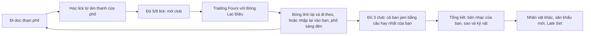
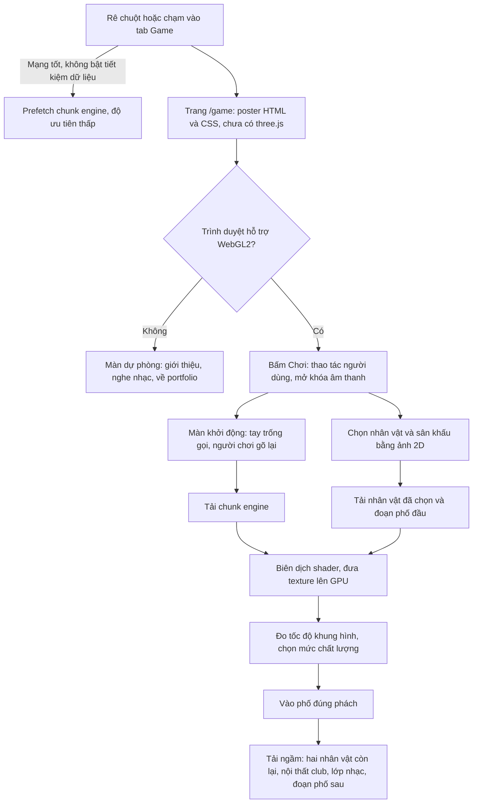
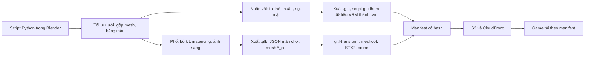

# Midnight Session: bản thiết kế game jazz

> **Trạng thái:** chủ dự án đã duyệt thiết kế ngày 2026-11-07. Các câu hỏi mở được giao cho Claude quyết định, ghi ở mục 17; chủ dự án đổi được bất kỳ quyết định nào. Tài liệu này là đầu vào cho `/ai-workflow spec`; mỗi spec `game-*` vẫn phải qua G0 riêng.
> **Quy ước số liệu:** mọi con số về thời gian, kích thước và điểm đều là **giá trị khởi đầu**, sẽ được đo và chỉnh qua playtest, chưa phải kết quả đo thực tế. Riêng số liệu ghi "bản thử Sayo" là số đo thật.
> **Lưu ý:** repo này công khai, nên tài liệu và spec cũng công khai.
> **Thay đổi so với bản trước:** lối chơi đổi sang "Tái hợp ban nhạc" (nhặt lick thay vì nhặt nốt, đối thủ là thành viên ban nhạc, câu của người chơi quay lại trong trận và trong màn jam), bản đồ đổi từ khu 3D tự do sang dãy phố đi ngang, phần art cập nhật theo kết quả bản thử Sayo, và 12 câu hỏi mở đã có quyết định (mục 17).

## 1. Tóm tắt

**Midnight Session** là game chạy trên web, nằm trong một tab của portfolio. Nhân vật và phố được dựng 3D, camera nhìn ngang như game đi cảnh (2.5D).

Đêm nay ban nhạc tan rã: hai thành viên lạc vào hai jazz club và thành **Bóng Lạc Điệu**, còn ở club cuối là Bóng của chính bạn. Chỉ tay trống còn ở lại, giữ nhịp cho cả khu phố. Người chơi chọn một trong ba nhạc công, chọn một sân khấu (Tokyo, làng quê...), rồi đi dọc dãy phố để học các **lick**: những câu nhịp ngắn mang âm thanh của phố, như tiếng vịt quạc hay chuông tàu. Đủ lick thì mở được club và đấu nhạc đối đáp kiểu *trading fours* với Bóng đang chiếm club. Thắng thì thành viên đó tỉnh lại, đi theo bạn, và phố có thêm nhạc cụ của họ. Thắng club cuối thì Bóng nhập lại vào bạn và sân khấu cuối phố mở màn jam: cả ban chơi một đoạn dựng từ những câu hay nhất của chính bạn.

Một phiên chơi kéo dài 5–10 phút, không cần tài khoản, và có thể thoát về portfolio bất cứ lúc nào.

### Bốn trụ cột thiết kế

| Trụ cột | Ý nghĩa khi ra quyết định |
|---|---|
| **Âm nhạc là phần thưởng** | Mỗi hành động tốt đều nghe được: lick vang đúng phách, câu của bạn được đối thủ chơi lại, ban nhạc đông dần thì nhạc nền dày thêm. |
| **Dễ vào, khó giỏi** | Gần như không có nốt sai, nên ai cũng nghe hay. Điểm cao mới đòi hỏi cảm nhịp. |
| **Chơi ngắn, muốn chơi thêm** | Trận đấu khoảng 1 phút, sân khấu vài phút, luôn có một mục tiêu gần kề. |
| **Tôn trọng người xem portfolio** | Vào chơi trong vài giây, thoát một chạm, trang portfolio không chậm đi. Không có cơ chế ép quay lại. |

## 2. Một phiên chơi điển hình

| Thời điểm | Người chơi làm gì | Cảm giác cần đạt |
|---|---|---|
| 0:00 | Bấm tab **Game**, thấy ảnh poster và nút **Chơi** ngay | Không phải chờ |
| 0:05 | Bấm **Chơi**. Tay trống đếm 1-2-3-4 rồi gọi "lặp lại tôi", người chơi gõ lại 4 nốt. Đây là một lượt Echo tí hon, chạy trong lúc game tải | Đã bắt đầu chơi dù đang tải |
| 0:20 | Chọn nhân vật và sân khấu bằng ảnh 2D | Được chọn và sở hữu |
| 0:35 | Ra đầu phố, nhạc chỉ còn tiếng trống lẻ loi | Tò mò, muốn đi |
| 0:45 | Đàn vịt quạc đúng phách; chạm vào là học được lick đầu tiên, nó vang lên ngay ô nhịp kế tiếp | Khám phá có thưởng |
| 1:30 | Đủ lick, vào club đầu. Bóng của một thành viên đang chơi lạc điệu. Đấu Trading Fours, trích lại lick vịt trong lượt Solo | Đỉnh căng thẳng đầu tiên |
| 2:30 | Thành viên tỉnh lại, đi theo bạn ra phố. Nhạc nền có thêm nhạc cụ của họ, đoạn phố đó sáng đèn, nhận kỷ vật | Thế giới thay đổi nhờ mình |
| 2:30–8:00 | Hai đoạn phố và hai club còn lại, tìm bí mật, dùng boost. Bóng ở club 2 mở lượt Solo bằng đúng câu solo hay nhất của bạn ở club 1. Club 3 là trận với Bóng của chính mình | Muốn hoàn thành, nghe tiếng mình vang lại |
| 8:00 | Màn jam cuối: cả ban chơi lại câu hay nhất của bạn. Tổng kết phát lại "bản nhạc của bạn", sao và kỷ vật | Thỏa mãn và thấy còn điều chưa mở |

## 3. Vòng chơi



### 3.1 Lick là gì

- **Một ô nhịp, chỉ có nhịp:** lick là danh sách vị trí gõ trên lưới 8 vị trí của một ô (móc đơn). Gõ nút nào cũng được, chỉ xét đúng vị trí.
- **Từ 3 đến 6 vị trí gõ**, để gõ lung tung khó trùng một lick. Ví dụ lick vịt: `. . x x . . x .`, tức quạc-quạc ở phách 2 và quạc ở phách 4.
- **Không trùng nhau, có nhịp lệch:** trong một sân khấu không có hai lick trùng vị trí gõ, và mỗi lick có ít nhất một vị trí nằm giữa hai phách, để gõ đều từng phách không thành trích dẫn. Ở Lounge, lick dễ hơn nhờ cửa sổ nhịp rộng và hình nhịp hiển thị, không có bản rút gọn riêng.
- **Nghe và nhìn được:** mỗi lick có tiếng đặc trưng của nguồn (vịt, chuông tàu, ếch) và một biểu tượng trong **sổ lick** trên màn hình, kèm hình nhịp dạng chấm.
- **Dùng ở đâu:** trích lại trong lượt Solo để được điểm thưởng (mục 6.2). Lick học được chỉ dùng trong phiên; sổ lick lưu lại những lick từng gặp để sưu tập.

### 3.2 Đi phố

Không có đồng hồ đếm ngược. Mỗi đoạn phố có 8 lick và cần 5 để mở club của đoạn đó, nên người chơi có thể bỏ qua các lick khó. Các cách học lick:

- **Đi và lắng nghe:** nguồn lick phát tiếng theo nhịp và có âm thanh định hướng. Chạm vào nguồn là học được.
- **Bục theo nhịp:** bục hiện ra theo phách, nhảy lên đúng lúc để tới nguồn lick trên ban công hay mái nhà.
- **NPC ngân nga:** gõ lại một ô nhịp NPC vừa ngân để học lick của họ.
- **Bí mật theo nhân vật:** chỗ chỉ đến được bằng kỹ năng riêng, luôn là phần thưởng thêm, không bao giờ chặn đường chính.

Lick vừa học vang lên từ đầu ô nhịp kế tiếp, nên chơi lung tung vẫn nghe như đang chơi nhạc.

**Di chuyển theo nhịp, không bắt buộc:** nhảy và dùng kỹ năng đúng phách (trong cửa sổ OK của mức khó) thì cao hơn hoặc xa hơn và có hiệu ứng; lệch nhịp vẫn nhảy bình thường. Không bao giờ phải vừa di chuyển vừa canh nhịp mới đi tiếp được.

## 4. Nhân vật

Cả ba nhạc công chơi được dùng chung bộ xương và bộ animation. Khác biệt nằm ở di chuyển và luật chấm điểm, không ảnh hưởng khả năng phá đảo.

| Nhân vật | Vai trò | Kỹ năng di chuyển | Thế mạnh khi đấu | Kỹ năng đấu |
|---|---|---|---|---|
| **Ren** (sax, tự tin) | Lead | **Blue Note Dash:** lướt nhanh, đúng nhịp thì xa hơn | Thưởng theo chuỗi chính xác | Giữ nốt để luyến: rủi ro, nhiều điểm |
| **Sayo** (hát, tươi vui) | Vocal | **Scat Leap:** nhảy đôi rồi lượn ngắn, hình thức lượn chốt cùng thiết kế mới | Thưởng khi đi đúng hướng giai điệu | Tiếng vọng: lặp lại nốt hay nhất |
| **Aki** (contrabass, trầm) | Rhythm | **Walking Stomp:** dậm đất tạo bục nhảy, mở lối | Thưởng khi giữ nhịp đều | Nhịp dẫn: hiện nhịp phụ, điểm tối đa thấp hơn |

Về độ khó, Aki hợp người mới, Sayo ở mức giữa, Ren dành cho người thích điểm cao. Game gợi ý như vậy ở màn chọn nhân vật, không ép.

Ngoại hình cả ba sẽ được đổi trước khi rig, xem rủi ro ở mục 16. Vai trò, kỹ năng và tính cách ở trên giữ nguyên.

### 4.1 Ban nhạc và Bóng Lạc Điệu

| Vai | Là ai | Xuất hiện ở đâu |
|---|---|---|
| **Bạn** | Một trong Ren, Sayo, Aki | Cả phiên |
| **Tay trống** | Thành viên duy nhất chưa bị lạc. Ở MVP chỉ có hình 2D, không có model 3D | Chân dung ở màn khởi động; ngoài phố không hiện, tiếng trống vọng từ sân khấu jam cuối phố; trong club và màn jam là bóng ngược sáng sau bộ trống 3D |
| **Bóng ở club 1 và 2** | Hai nhạc công bạn không chọn, theo thứ tự Aki, Sayo, Ren (người dễ đấu hơn đứng trước) | Club 1 và 2; thắng thì đi theo bạn |
| **Bóng ở club 3** | Bóng của chính nhân vật bạn chọn | Club 3; thắng thì Bóng nhập lại vào bạn, đoạn phố cuối sáng đèn và sân khấu jam mở |

- **Bóng là cùng một model:** chỉ đổi bảng màu sang tông tối và thêm viền sáng, không phải dựng model mới. Khi thắng, bảng màu đổi về bản gốc ngay trước mắt người chơi. Bóng ở club 3 dùng lại đúng model bạn đang điều khiển, nên không phải tải thêm.
- **Người đi theo:** tối đa 2, đi thành hàng sau bạn và nhún theo phách, chờ ở cửa club khi bạn vào đấu.
- **Ban nhạc khi đoàn tụ:** trống, hai thành viên và bạn, tức một nhóm bốn người không có piano.
- **Phong cách câu gọi của từng Bóng**, là dữ liệu nên không tốn thêm art:

| Bóng | Phong cách |
|---|---|
| Aki | Nhịp đều, nhiều phách đơn, kiểu walking bass |
| Sayo | Giai điệu lên xuống rõ, nhiều chuỗi nốt liền |
| Ren | Câu dài, nhiều móc đơn và nghịch phách |
| Bóng của bạn | Phong cách của nhân vật bạn chọn; mở lượt Solo bằng câu solo của bạn ở club 2 |

Chọn nhân vật khác thì gặp Bóng khác và ban nhạc nghe khác, nên có thêm lý do chơi lại.

## 5. Sân khấu

Mọi sân khấu dùng chung một khuôn: một dãy phố nhìn ngang dài khoảng 250–350 m, chia ba đoạn. Mỗi đoạn có 8 lick và kết thúc ở một club, cuối phố là sân khấu jam. Phố có 2–3 tầng đi lại (mặt đường, ban công, mái nhà), 1 địa danh, 1 cơ chế đặc trưng, 3 bí mật theo nhân vật, 1 kỷ vật hiếm và bản nhạc riêng. Vì vậy, thêm sân khấu chủ yếu là việc làm art, nhạc và dữ liệu lick, ít phải viết code mới.

Camera nhìn ngang nên chỉ cần dựng mặt tiền và một phần bên hông nhà; cảnh xa là các lớp ảnh 2D trượt chậm hơn (parallax).

| | **Hồ Làng** (làng quê, sân khấu đầu tiên) | **Ngõ Neon** (Tokyo, sân khấu thứ hai) | Phố Cổ (Hà Nội, sau) | Bến Cảng (New Orleans, sau) |
|---|---|---|---|---|
| **Không khí** | Hoàng hôn, đom đóm | Đêm mưa nhẹ, neon | Chiều tối, đèn lồng | Đêm hội |
| **Dãy phố** | Công viên nhỏ, bờ hồ, cầu gỗ, ruộng, trạm xe buýt | Nhà cao tầng, ngã tư, dây điện, máy bán hàng, đường tàu trên cao | Nhà ống, xe máy, quán cà phê, hồ | Ban công sắt, bến thuyền |
| **Địa danh** | Hồ có đàn vịt; chòi nhạc cuối phố là sân khấu jam | Đền Shinto nép giữa các tòa nhà, có cổng torii | Hồ giữa phố | Đoàn diễu hành |
| **Club** | Nhà kho cũ, ga xe lửa bỏ hoang, chòi ven hồ | Jazz kissa dưới tầng hầm, quán dưới gầm cầu tàu, sân thượng | Cà phê gác xép, sân trong, nhà hát nhỏ | Quán cũ, thuyền, sân sau |
| **Cơ chế đặc trưng** | **Đàn vịt:** vịt con đi theo khi bạn nhảy đúng phách | **Nhịp thành phố:** đèn qua đường đổi mỗi 8 ô, tàu chạy mỗi 16 ô | **Dòng xe:** xe chạy theo nhịp, băng qua đúng lúc | **Sân khấu di động:** chạy theo đoàn diễu hành |
| **Ren** | Lướt qua cầu gãy | Lướt qua đường đúng lúc đèn đổi | Lướt qua dòng xe | Bắt kịp đoàn diễu hành |
| **Sayo** | Lượn qua hồ đến đảo nhỏ | Lượn giữa hai sân thượng | Lượn qua các ban công | Lượn từ ban công xuống thuyền |
| **Aki** | Dậm đất tạo gợn sóng, lộ ra lick của ếch | Dậm làm máy bán hàng rơi lon, tiếng lon lăn thành một lick | Dậm mở gác xép | Dậm hạ cầu thang |
| **Âm nền và lick** | Ếch, chuông gió, vịt quạc đúng phách 2 và 4, xe buýt phanh | Chuông qua đường đúng giọng, tiếng tàu, mưa trên mái tôn | Còi xe, tiếng rao, thìa khuấy cà phê | Kèn đồng xa xa, mái chèo |
| **Chất nhạc** | Bossa, ballad nhẹ, khoảng 84 BPM | Bebop pha city pop, khoảng 124 BPM | Slow swing | Second-line |
| **Độ khó** | Dễ nhất | Khó hơn | Trung bình | Khó |

**Phương án đã cân nhắc:** giữ khu 3D đi tự do như bản trước, vẫn dùng lick và ban nhạc. Cách này cho cảm giác tự do và đẹp hơn, nhưng tốn thêm art nhìn từ mọi hướng, camera, va chạm và joystick ảo, và khó chơi trên điện thoại.

### Hồ Làng và đàn vịt

- Vịt mẹ dẫn đàn bơi vòng quanh hồ, thỉnh thoảng lật đuôi hoặc rũ cánh.
- Mỗi lần bạn nhảy hoặc dùng kỹ năng đúng phách ở gần hồ, một vịt con lên bờ và xếp hàng theo sau, tối đa 5 con.
- Đưa đủ đàn về hồ sẽ nhận kỷ vật hiếm **Còi Vịt**. Không có hành động đúng phách nào trong 8 ô thì vịt con quay về hồ, không bị phạt gì.
- Vịt quạc đúng phách 2 và 4 nên trở thành một nhạc cụ vui trong nhạc nền, và là nguồn của lick đầu tiên.

### Ngõ Neon và ngôi đền

- Đền là **vùng lặng** giữa thành phố: nhạc nhỏ lại, chỉ còn tiếng gió, không có lick. Rung chuông nhận bùa may mắn, là một boost dùng trong phiên.
- Không đặt trận đấu, nhân vật phản diện hay trò đùa trong khuôn viên đền, để giữ sự tôn trọng với văn hóa thật.
- Không dùng tên quán, logo hay nhãn hiệu có thật ở mọi sân khấu.

## 6. Trận đấu Trading Fours

*Trading fours* là khi hai nhạc công thay phiên nhau solo mỗi người 4 ô nhịp. Đối thủ là **Bóng Lạc Điệu**, một thành viên ban nhạc đang chiếm club, hoặc Bóng của chính bạn ở club 3 (mục 4.1). Tay trống ngồi sau bộ trống, ngược sáng, giữ nhịp cho cả hai bên.

**Cấu trúc:** 3 lượt, mỗi lượt đối thủ 4 ô và bạn 4 ô. Ở 96 BPM, mỗi ô dài 2,5 giây, nên một trận khoảng 60 giây.

| Lượt | Tên | Đối thủ chơi gì | Bạn làm gì | Người chơi học được |
|---|---|---|---|---|
| 1 | **Echo** | Câu soạn sẵn theo phong cách của Bóng | Lặp lại đúng nhịp đối thủ vừa chơi | Nghe và đáp |
| 2 | **Answer** | Câu soạn sẵn | Giữ nhịp, nhưng đi ngược hướng giai điệu của đối thủ | Đối thoại âm nhạc |
| 3 | **Solo** | Club 1: câu soạn sẵn. Từ club 2: mở đầu bằng **ô Solo hay nhất của bạn ở club trước** (mục 6.1) | Chơi tự do 4 ô, trích lick nếu muốn | Ngẫu hứng, khoảng lặng, nghe ý mình quay lại |

**Điều khiển:** 4 nút (`D F J K` trên bàn phím, 4 vùng chạm trên điện thoại). Mọi nút đều phát nốt trong thang blues của bản nhạc, nên **không có nốt sai về cao độ**, chỉ có đúng hay lệch nhịp. Nút xếp từ thấp đến cao: `D` thấp nhất, `K` cao nhất.

### 6.1 Câu của bạn quay lại

Tin đồn về solo của bạn lan dọc phố: từ club 2, Bóng mở lượt Solo bằng ô hay nhất trong lượt Solo của bạn ở club trước, để bạn nghe ý tưởng của mình được đáp lại như trong trading fours thật. Nguồn là phần chơi tự do, nên đây đúng là câu của bạn, không phải câu gọi bạn vừa chép lại. Làn nhịp hiện nhãn "Câu của bạn" để người chơi nhận ra.

- **Nguồn:** ô Solo hay nhất ở club trước, chọn theo quy tắc ở mục 6.4. Chỉ lấy các lần gõ đạt OK trở lên, đưa về vị trí gần nhất trên lưới 8 vị trí của ô.
- **Ô 1:** giữ nguyên vị trí gõ và nút, như bạn đã chơi.
- **Ô 2:** giữ vị trí gõ, đảo hướng giai điệu bằng cách đổi nút `D`↔`K` và `F`↔`J`.
- **Ô 3 và 4:** câu soạn sẵn theo phong cách của Bóng.
- **Dự phòng:** ở club 1, hoặc khi club trước không có ô Solo đủ điều kiện, Bóng dùng câu soạn sẵn cho cả 4 ô. Lượt Solo không bắt người chơi lặp lại câu này, nên câu khó hay dễ không đổi độ khó của trận.

### 6.2 Trích dẫn

Trong lượt Solo, chơi lại một lick đã học là một **trích dẫn**: tiếng đặc trưng của lick (vịt quạc, chuông tàu) vang ở phách 1 của ô sau, khán giả reo và biểu tượng lick trong sổ sáng lên.

- **Xét từng ô:** một ô là trích dẫn của lick L khi mỗi vị trí của L có một lần gõ trong cửa sổ Great (đã nhân hệ số của mức khó), và có không quá 1 lần gõ ngoài các vị trí đó. Lick phải bắt đầu từ đầu ô.
- **Nhiều lick cùng khớp:** chọn lick có nhiều vị trí gõ hơn; bằng nhau thì chọn lick có ít lần gõ thừa hơn; vẫn bằng thì chọn lick học trước.
- **Điểm thưởng:** mỗi lick khác nhau được trích cộng 5 điểm, tối đa 2 lick mỗi trận. Cùng một lick trích nhiều lần chỉ tính một lần.
- **Không bắt buộc:** không trích dẫn vẫn đạt được 3 sao. Ô được nhận là trích dẫn không bị xét tiêu chí "không lặp một nút" của Cảm nhạc.

### 6.3 Chấm điểm và kết quả

| Thành phần | Tỉ trọng | Cách tính |
|---|---|---|
| Nhịp | 60% | Perfect ±45 ms, Great ±90 ms, OK ±140 ms |
| Hướng giai điệu | 25% | Đi lên hay đi xuống có khớp yêu cầu không |
| Cảm nhạc | 15% | Lượt Solo: có đa dạng nhịp, có khoảng lặng, không lặp một nút |
| Trích dẫn | Thưởng thêm | +5 mỗi lick, tối đa +10, cộng ngoài thang 100 |

**Kết quả:** 1–3 sao theo tổng điểm. Đạt từ 1 sao là thắng: Bóng tỉnh lại thành thành viên ban nhạc. Thua không mất gì: có nút **Chơi lại take này** ngay lập tức. Không có thanh máu để bị loại giữa trận, vì dừng nhạc giữa bài rất mất hứng.

### 6.4 Màn jam cuối

Thắng đủ 3 club thì cả ban lên sân khấu jam cuối phố chơi một đoạn 8 ô, không chấm sao.

- **Ô 1–2:** thành viên ở club 1 chơi lại ô hay nhất của bạn ở club 1 bằng nhạc cụ của họ, bạn đáp lại một ô.
- **Ô 3–4:** thành viên ở club 2 làm như vậy với ô hay nhất của bạn ở club 2.
- **Ô 5–6:** bạn chơi lại ô hay nhất của mình ở club 3, làn nhịp hiện gợi ý; cả ban đáp lại bằng chính câu đó.
- **Ô 7–8:** cả ban cùng chơi để kết bài.
- **Ô hay nhất:** ô trong lượt Solo của club đó có ít nhất 3 lần gõ đạt OK trở lên và điểm nhịp cao nhất (gần lưới nhất). Hòa thì lấy ô sớm hơn. Không có ô nào đủ điều kiện thì dùng ô soạn sẵn. Quy tắc này dùng chung với mục 6.1.
- **Bản nhạc của bạn:** các lần gõ của màn jam được lưu dưới dạng dữ liệu, không ghi âm, và phát lại ở màn tổng kết bằng chính bộ âm của game.

## 7. Độ khó

| Mức | Cửa sổ nhịp | Câu gọi của đối thủ | Hỗ trợ | Dành cho |
|---|---|---|---|---|
| **Lounge** | ×1,4 | Phách đơn, 3–4 nốt | Hiện vị trí nốt | Mọi người, mặc định |
| **Session** | ×1,0 | Có móc đơn, 5–7 nốt | Hiện nhịp, ẩn vị trí nốt ở lượt sau | Có chút kinh nghiệm |
| **Late Set** | ×0,8 | Swing, nghịch phách | Chỉ có âm thanh | Mở sau khi xong sân khấu |

**Đường cong độ khó:**

- **Trong một sân khấu:** club sau nhanh hơn club trước, khoảng 84 → 96 → 108 BPM, và thêm dần nghịch phách.
- **Giữa các sân khấu:** Hồ Làng dễ nhất, Tokyo khó hơn.
- **Hỗ trợ âm thầm:** thua 2 lần liên tiếp thì đề xuất nới cửa sổ nhịp thêm 15%, người chơi có thể từ chối. Có ghi trên màn tổng kết để điểm cao vẫn công bằng.
- **Nguyên tắc 3 lần:** cơ chế mới luôn được giới thiệu an toàn, sau đó thử thách nhẹ, rồi mới thử thách thật.

**Hướng dẫn bằng cách chơi:** không có màn đọc chữ dài. Màn khởi động lúc tải game là một lượt Echo tí hon với tay trống, đã dạy gõ nhịp. Lick đầu tiên nằm ngay đầu phố, và trận đầu tiên có lượt Echo rất dễ.

## 8. Vì sao người chơi muốn chơi tiếp

| Khoảng thời gian | Động lực | Cách làm |
|---|---|---|
| Vài giây | Phản hồi tức thì | Lick vang đúng phách, đèn và người đi theo nhún theo nhịp, chuỗi combo |
| Vài phút | Mục tiêu gần | "Còn 2 lick nữa là mở club", ban nhạc đông thêm, nhạc nền dày thêm rõ rệt |
| Một phiên | Hoàn thành | 3 club, cả ban đoàn tụ, màn jam cuối, sao từng club |
| Nhiều phiên | Sưu tập và làm chủ | Album kỷ vật, sổ lick, 3 sao, Late Set, bí mật của từng nhân vật, điểm cao cá nhân |

**Thứ giữ người chơi ở lại:**

- **Sự tò mò:** mỗi nhân vật thấy một lối đi mà nhân vật khác không tới được, và gặp những Bóng khác ở club, nên có lý do chơi lại.
- **Bất ngờ nhỏ:** có xác suất nhận kỷ vật hiếm, và chắc chắn nhận sau một số lần nhất định để không ai chơi mãi mà chẳng được gì.
- **Chia sẻ:** màn tổng kết tạo một ảnh thẻ gồm nhân vật, sân khấu, số sao và hình nhịp của câu hay nhất trong "bản nhạc của bạn".
- **Jam of the Day (sau MVP):** thử thách ngắn tạo theo ngày, chỉ để chơi cho vui. Bỏ lỡ không mất gì.

**Những thứ cố tình không làm, vì đây là portfolio:** điểm danh hằng ngày, đếm ngược tạo áp lực, chuỗi ngày bị mất nếu nghỉ, quảng cáo, mua bằng tiền, tiền ảo, thông báo đẩy.

## 9. Phần thưởng: tách thành ba loại

| Loại | Tồn tại bao lâu | Mục đích |
|---|---|---|
| **Boost trong phiên** | Hết sân khấu là hết | Tạo khoảnh khắc thú vị ngay lúc chơi |
| **Kỷ vật** | Vĩnh viễn, lưu trên máy | Sưu tập và trang bị |
| **Hiệu ứng trên web** | Tùy người chơi bật hoặc tắt | Mang dấu ấn của game ra portfolio |

### 9.1 Boost trong phiên

Nhặt được trong sân khấu, hiệu ứng thể hiện ngay **xung quanh nhân vật**.

| Boost | Cách nhận | Hiệu ứng nhìn thấy | Tác dụng |
|---|---|---|---|
| Bùa may mắn | Rung chuông đền | Vòng sáng ấm quanh người | Tha một lỗi mỗi lượt đấu |
| Đèn neon | Quán đêm Tokyo | Dấu chân neon theo nhịp | Lướt xa hơn |
| Đom đóm | Bụi cỏ ven hồ | Đom đóm bay quanh, soi nguồn lick ẩn | Thấy nguồn lick từ xa |
| Khói xanh | Quán jazz | Vòng khói mỗi khi combo 8 | Nhân đôi điểm cảm nhạc ở lượt Solo |
| Đàn vịt | Nhảy đúng phách ở hồ | Vịt con đi thành hàng phía sau | Càng nhiều vịt, điểm càng cao |

### 9.2 Kỷ vật

Mang được **1 bùa** vào mỗi sân khấu (MVP), mở 2 ô về sau. Mỗi bùa có một đánh đổi nhỏ để việc chọn trở nên thú vị.

| Kỷ vật | Nguồn | Hiệu ứng | Đánh đổi |
|---|---|---|---|
| Còi Vịt | Đưa đủ đàn vịt về hồ | Vịt đi theo ở mọi sân khấu | Không có |
| Máy Đếm Nhịp Hỏng | 3 sao một club | +20% điểm | Tắt hiện nhịp |
| Mèo Vẫy | Bí mật ở Tokyo | Rõ hơn khi có kỷ vật ở gần | Không có |
| Bùa Nhịp Vàng | Late Set | Lượn lâu hơn (Sayo), dậm rộng hơn (Aki), lướt xa hơn (Ren) | Giảm 10% cửa sổ nhịp |
| Đĩa than | Mỗi club | Mở bài trong máy nghe nhạc của game | Không có |
| Đồ lưu niệm | Mỗi sân khấu | Trưng trên kệ trong album | Không có |

Tổng số dự kiến khoảng 6–8 kỷ vật mỗi sân khấu. Mỗi nhân vật có một trang phục phụ mở được bằng 3 sao toàn bộ sân khấu.

### 9.3 Hiệu ứng trên portfolio

Đây là điểm khác biệt của game so với một mini-game thông thường, nhưng nó không được làm hỏng trải nghiệm của người chỉ đến xem portfolio.

**Nguyên tắc bắt buộc:**

- **Tắt mặc định.** Khách lần đầu không thấy gì khác. Người chơi tự bật trong màn album, và tắt được bất cứ lúc nào.
- **Chỉ lưu trên máy** của người chơi, đọc sau khi trang đã mount để không gây lỗi hydrate.
- **Không ảnh hưởng nội dung và tốc độ:** không làm xê dịch bố cục, code hiệu ứng tải riêng và chỉ tải khi đã bật.
- **Tự tắt** khi `prefers-reduced-motion` được bật, như `PortfolioShell` đang làm.

| Hiệu ứng | Điều kiện mở | Gắn vào đâu trong code hiện có |
|---|---|---|
| Nốt nhạc khi cuộn đổi màu theo sân khấu | Hoàn thành một sân khấu | `ScrollNotesEffect` |
| Khói nền đổi sắc | Boost Khói xanh, 3 sao | `SmokeEffect` |
| Đĩa than riêng ở màn intro | Đĩa than hiếm | `JazzLoader`, `TurntableScene` |
| Vịt con đi dọc chân trang | Còi Vịt | Thành phần mới trong `Footer` |
| Màu nhấn theo sân khấu | Hoàn thành sân khấu | Thêm token CSS, giữ nguyên hai theme của `themeStore` |

## 10. Liên kết với portfolio

- **Club là nội dung:** mặt tiền mỗi club có áp phích trưng một phần của chủ nhân: Experience, Skills, Contact. Bấm vào mở đúng phần đó trên portfolio. Dữ liệu lấy từ API công khai sẵn có, không nhập lại.
- **Lối tắt cho nhà tuyển dụng:** nút thoát về portfolio luôn hiển thị, và không có gì trong game chặn nội dung portfolio.
- **Máy nghe nhạc:** `MusicPlayer` nằm trong `(portfolio)/layout.tsx`, nên vào `/game` nó sẽ unmount và nhạc của site dừng. Quay về portfolio không tự phát lại nhạc, người xem bấm phát như thường.
- **Tab Game:** thêm vào `navLinks` trong `Header`, bật hoặc tắt bằng `isGameEnabled` trong CMS, như blog (quyết định 6, mục 17).
- **Không index:** trang `/game` luôn có `robots` noindex và không vào sitemap, vì đây là ứng dụng, không phải nội dung cần tìm kiếm. Công cụ tìm kiếm vẫn tập trung vào portfolio.

## 11. Cơ chế tải khi bấm vào game

**Ý tưởng chính:** người chơi không bao giờ phải nhìn một thanh tải trống. Thời gian tải được biến thành phần khởi động: một lượt Echo tí hon với tay trống, vừa dạy cách chơi vừa hiệu chỉnh độ trễ.



| Bước | Tải gì | Người chơi thấy | Mục tiêu |
|---|---|---|---|
| **Vào trang** | HTML, CSS, poster | Poster, nút Chơi, nút Tiếp tục nếu có save | Gần như tức thì |
| **Bấm Chơi** | Chunk engine | Tay trống gọi, gõ lại theo nhịp, tiến độ thật | Có phản hồi trong 100 ms |
| **Chọn** | Ảnh chân dung và bưu thiếp 2D | Chọn nhân vật và sân khấu trong lúc 3D tải ngầm | Không phải chờ |
| **Vào phố** | Nhân vật đã chọn, đoạn phố đầu, lớp trống | Tiến độ theo số byte thật | Khoảng 20 giây trên 4G |
| **Trong lúc chơi** | Hai nhân vật còn lại (cũng là Bóng ở club), nội thất club, các lớp nhạc, đoạn phố sau | Không thấy gì, tải trước khi đến gần | Không khựng |

**Chi tiết kỹ thuật cần giữ đúng:**

- **Mở khóa âm thanh:** gọi `AudioContext.resume()` ngay trong sự kiện bấm **Chơi**, vì trình duyệt chặn âm thanh trước đó. Đây là lý do cần một nút Chơi thật, không tự động vào game.
- **Màn khởi động không cần 3D:** chỉ dùng âm thanh và DOM, nên chạy được ngay khi chunk engine còn đang tải.
- **Tải theo lựa chọn:** nhân vật đã chọn và đoạn phố đầu tải trước. Hai nhân vật còn lại chỉ cần trước club đầu, nên tải ngầm khi đã vào phố. Bóng ở club 3 dùng lại model của bạn với bảng màu khác, không phải tải thêm.
- **Tiến độ thật:** tính theo byte qua luồng `fetch`, không dùng thanh tải giả.
- **Lần sau nhanh hơn:** file có tên chứa hash, phục vụ từ CloudFront với cache lâu dài. Người quay lại hầu như không phải tải lại.
- **Lỗi mạng:** thử lại theo từng file, kèm nút thử lại rõ ràng. Save không bao giờ bị ảnh hưởng.
- **Thoát game:** dừng render, gọi `dispose` cho geometry và texture, trả lại WebGL context, đóng `AudioContext`, để portfolio không bị nặng sau khi chơi.
- **Khi chuyển tab:** tạm dừng cả render lẫn nhạc, quay lại có đếm nhịp rồi mới chơi tiếp. Xử lý cả `webglcontextlost`.

**Hiệu chỉnh độ trễ:** màn khởi động đo độ lệch giữa nhịp và thao tác gõ để bù trừ. Tai nghe Bluetooth có thể trễ đáng kể, nên giá trị này được lưu lại và chỉnh lại được trong phần cài đặt.

## 12. Công nghệ

### 12.1 Lựa chọn

| Hạng mục | Đề xuất | Lý do | Điều kiện đổi |
|---|---|---|---|
| Hiển thị 3D | `three` + `@react-three/fiber` (đã có trong repo) | Không thêm nền tảng mới, dùng chung kiến thức với `TurntableScene` | |
| Tiện ích 3D | `@react-three/drei`, chỉ import phần cần | Peer dependency khớp fiber 9 và React 19 | Đo bundle, bỏ nếu nặng |
| Nhân vật | `@pixiv/three-vrm`, tải file `.vrm` | Có sẵn MToon, viền, biểu cảm và spring bone. Bản thử Sayo chạy được với bản 3.5.5 | Nếu bundle nặng: chỉ dùng `@pixiv/three-vrm-materials-mtoon` và `@pixiv/three-vrm-springbone` |
| Va chạm | Tự viết: hộp chữ nhật trên mặt phẳng di chuyển, bục một chiều, dữ liệu xuất từ Blender | Nhân vật chỉ đi trên một mặt phẳng, không cần vật lý thật, không tải thêm WASM | Thêm `three-mesh-bvh` nếu cần va chạm với lưới phức tạp |
| Âm thanh | Web Audio API với lớp lập lịch mỏng và bộ phát sample; nhạc là dữ liệu nốt (quyết định 2) | Một đồng hồ `AudioContext.currentTime` cho nhạc nền, lick và nốt người chơi; đổi tempo từng club và thêm lớp nhạc mà không cần file mới | Dùng Tone.js nếu tự viết bộ phát sample quá tốn công, sau khi đo kích thước |
| Trạng thái | `zustand` (đã có), vòng lặp game đọc trực tiếp ngoài React | Tránh render lại React 60 lần mỗi giây | |
| Giao diện | DOM, Tailwind, `next-intl` | Có sẵn i18n và trợ năng; dễ làm hơn UI vẽ trong 3D | |
| Làn nhịp | Vẽ trong WebGL | Đồng bộ khung hình với đồng hồ âm thanh | |
| Hậu kỳ | Mặc định không dùng; Bloom cho máy mạnh | Rất tốn trên điện thoại | `postprocessing` yêu cầu `three` dưới 0.188, cần ghim phiên bản khi nâng cấp |
| WebGPU | Chưa dùng | WebGL2 đã đủ cho phong cách toon | Xem lại khi cần |

Kích thước tải thật của các thư viện chưa được đo; sẽ đo bằng script `analyze` có sẵn của `apps/web`.

### 12.2 Phối hợp 2D và 3D

| Lớp | Cách làm | Tạo bằng |
|---|---|---|
| Nhân vật | 3D đầy đủ, có rig. Bóng là bản đổi bảng màu, không phải model riêng | Blender |
| Mặt tiền phố | 3D low-poly, ghép từ bộ kit, instancing. Chỉ dựng mặt trước và một phần bên hông vì camera nhìn ngang | Blender |
| Đạo cụ nhiều | `InstancedMesh`: đèn, cây, máy bán hàng | Blender |
| Động vật, xe, tàu | Mô hình nhỏ, chuyển động bằng code: vịt nhấp nhô, lắc lư, tàu chạy theo đường | Blender + code |
| Cảnh xa | Nhiều lớp ảnh 2D trượt parallax: đường chân trời Tokyo, núi | Render từ Blender rồi chỉnh |
| Hiệu ứng | Sprite atlas: biểu tượng lick, khói, đom đóm, mưa | Vẽ 2D hoặc render |
| Giao diện | HTML/CSS, SVG | Thiết kế 2D |
| Chân dung, bưu thiếp | Ảnh render từ Blender | Blender |
| Tay trống | Chân dung 2D và bóng ngược sáng vài khung hình, render từ một model tĩnh dựng như bộ xem hình, không cần rig | Blender |

### 12.3 Từ Blender lên web



- **Trạng thái nhân vật hiện tại:** bộ dựng xem hình của ba nhân vật chưa có rig. Bản thử Sayo (thiết kế cũ, kết quả ở mục 15) đã có rig, biểu cảm và spring bone ở 16.220 tam giác, trong mục tiêu 15.000–20.000. Các mảnh đã gộp thành 2 mesh nhưng chưa nối liền với nhau, và thiết kế vẫn phải đổi.
- **Xuất tự động, đã kiểm chứng ở bản thử:** chạy `blender --background` với script. Blender 5.2.3 xuất `.glb`, sau đó script tự ghi thêm dữ liệu VRM 1.0 (`VRMC_vrm`, `VRMC_springBone`, `VRMC_materials_mtoon`) và texture bóng vào file. Không cần VRM Add-on, xuất lại được bất cứ lúc nào. Mới kiểm chứng với three-vrm 3.5.5, chưa thử trình xem VRM khác.
- **Toon shader không tự sang web:** material node của Blender không xuất qua glTF. Nhân vật dùng MToon qua three-vrm, thông số MToon do script xuất ghi thẳng vào file. Sân khấu dùng `MeshToonMaterial` với `gradientMap`.
- **Bảng màu thay cho texture vẽ tay:** mỗi màu của nhân vật là một ô 8×8 trong ảnh 64×64, cộng một bảng màu bóng cho `shadeMultiplyTexture`, lấy mẫu kiểu nearest. Bản thử Sayo có 28 ô màu và 4 material. Đổi bảng màu là tạo được Bóng hay trang phục phụ mà không thêm model.
- **Viền đen:** dùng viền của MToon, theo màu từng material. Script xuất game đã bỏ modifier Solidify; script xem hình vẫn còn dùng.
- **Mặt:** giữ mắt và miệng dạng lưới đặt sát mặt như bản thử, biểu cảm (chớp mắt, cười, há miệng) bằng shape key, mục tiêu ≤ 2.500 tam giác cho mặt ở bản chính; bản rút gọn của người đi theo dùng mặt đơn giản hơn (quyết định 10).
- **Vệt sáng trên tóc:** bản thử thêm vòng cạnh quanh dải sáng và tô các mặt trong dải bằng một ô màu riêng của bảng màu, không cần thuộc tính đỉnh.
- **Lưới để chuyển động:** da liền ở cổ, vai, khuỷu, háng và gối, đủ vòng cạnh ở khớp. Lưới rời như bộ dựng hiện tại sẽ gãy khi gập.
- **Animation:** mọi nhân vật dùng chung bộ xương, clip tách khỏi từng file nhân vật, ví dụ dạng `.vrma`, để không tải lặp. Đi, chạy, nhảy lấy từ mocap Quaternius Universal Animation Library bản miễn phí (CC0), không dùng Mixamo (quyết định 9), rồi chuyển sang bộ xương chung bằng script. Keyframe bằng script chỉ dùng cho động tác chơi nhạc và phần chỉnh kỹ năng. Mỗi nhạc cụ (sax, giọng, contrabass) cần clip chơi nhạc riêng, dùng cả khi nhân vật là người chơi, là Bóng hay chơi trong màn jam.
- **Chuyển động trong game:** trộn clip bằng `AnimationMixer` và `crossFadeTo`, tốc độ di chuyển khớp nhịp bước để chân không trượt. Thêm lớp phụ: thở, nhún theo phách, mắt nhìn, chớp mắt. Tóc, đuôi và khăn dùng spring bone. Bản thử cho thấy thông số spring hiện quá cứng, phải chỉnh.
- **Nén nhân vật:** `gltf-transform` có thể làm mất dữ liệu VRM, nên chỉ đưa vào đường ống nhân vật nếu qua được phép thử ở Giai đoạn 0. Nếu không, giảm texture và gộp mesh trong Blender trước khi xuất. Bản thử Sayo chưa nén đã là 1,16 MB, trong ngân sách 5 MB.
- **Dữ liệu màn chơi đặt ngay trong Blender:** dùng empty đặt tên theo quy ước cho điểm xuất phát, nguồn lick, bục theo nhịp, cửa club và đường đi của NPC, rồi xuất ra JSON riêng, vì `gltf-transform optimize` xóa node rỗng. Hộp va chạm đặt tên `*_col` và xuất ở file riêng, không chạy qua `optimize` vì lệnh này có thể gộp mesh. Nhà thiết kế chỉnh màn chơi mà không cần sửa code.
- **Ánh sáng:** bake vào texture hoặc màu đỉnh, rẻ cho điện thoại, phù hợp không khí đêm. Mỗi đoạn phố cần hai trạng thái, tối và sáng đèn sau khi thắng club; đổi bằng màu phát sáng của đèn và cửa sổ, không bake hai lần.
- **Lưu file nguồn:** nguồn thật của art là các script Python trong `.art-source` (đã git-ignore khỏi repo công khai). Chúng được lưu ở một repo GitHub riêng tư; file `.blend`, `.glb`, `.vrm` là sản phẩm dựng lại được nên không lưu (quyết định 8).
- **Phục vụ file:** S3 và CloudFront, cần cấu hình CORS cho loader. Bộ giải mã KTX2 và meshopt cũng phải được phục vụ cùng nguồn.

### 12.4 Cấu trúc code

```text
apps/web/src/
├── app/[locale]/game/        route riêng, ngoài (portfolio)
│   ├── page.tsx              poster và nút Chơi, không có three.js
│   ├── layout.tsx
│   ├── loading.tsx
│   └── error.tsx
├── game/
│   ├── core/                 TypeScript thuần, không phụ thuộc three hay React, Jest test được
│   │   ├── clock.ts          đổi thời gian âm thanh sang phách
│   │   ├── judge.ts          chấm nhịp
│   │   ├── lick.ts           định nghĩa lick, kiểm tra dữ liệu, nhận diện trích dẫn
│   │   ├── call.ts           câu gọi soạn sẵn, câu mở lượt Solo dựng từ ô hay nhất của người chơi
│   │   ├── jam.ts            chọn ô hay nhất, dựng màn jam, dữ liệu "bản nhạc của bạn"
│   │   ├── roster.ts         đội hình: ai là Bóng ở club nào, ai đi theo
│   │   ├── scoring.ts        điểm, sao, điểm thưởng trích dẫn
│   │   ├── difficulty.ts     mức khó, hỗ trợ
│   │   ├── progression.ts    mở khóa, sao
│   │   ├── rewards.ts        kỷ vật, boost
│   │   └── save.ts           save có version và migrate
│   ├── audio/                lập lịch, bộ phát sample, lớp nhạc
│   ├── engine/               canvas, nhân vật, người đi theo, va chạm 2D, camera đi ngang, chất lượng
│   ├── stages/               dữ liệu từng sân khấu: lick, bản nhạc dạng nốt
│   └── ui/                   HUD, sổ lick, menu, album
└── stores/gameStore.ts
```

- **Tải động:** `dynamic(() => import(...), { ssr: false })` như `TurntableScene` đang làm, để không tăng First Load JS chung của portfolio (hiện khoảng 102 kB theo báo cáo build).
- **Chia nhỏ:** logic tách khỏi đồ họa để mọi AC về điểm, nhịp, lick, câu gọi, đội hình, mở khóa và save có test Jest.

## 13. Ngân sách hiệu năng

Đây là mục tiêu, sẽ đo trên máy thật ở Giai đoạn 0.

| Chỉ số | Máy tính | Điện thoại |
|---|---|---|
| Khung hình | 60 fps | 30 fps trở lên |
| Tam giác trên màn hình | ≤ 300.000 | ≤ 120.000 |
| Draw call | ≤ 150 | ≤ 80 |
| Nhân vật 3D cùng lúc trên màn hình | Bạn và tối đa 2 người đi theo | như máy tính |
| Phần dành cho nhân vật | ≤ 60.000 tam giác, ≤ 30 draw call | ≤ 45.000 tam giác, ≤ 24 draw call |
| Texture nhân vật | 2K | 1K |
| DPR tối đa | 1,5 (như `TurntableScene`) | 1,25 |
| Mỗi nhân vật (.vrm) | ≤ 5 MB | như máy tính |
| Mỗi sân khấu (3D, texture) | ≤ 15 MB | bản 1K ≤ 8 MB |
| Nhạc mỗi sân khấu | ≤ 8 MB | như máy tính |
| Chunk JS của game (gzip) | ≤ 500 KB | như máy tính |
| First Load của portfolio | **Không tăng** | **Không tăng** |

**Nhiều nhân vật trên màn hình:** bản thử Sayo tốn 16.220 tam giác và 8 draw call cho một nhân vật (đo trên máy tính). Ba nhân vật bản đầy đủ là khoảng 49.000 tam giác, vượt phần dành cho nhân vật trên điện thoại. Vì vậy người đi theo dùng bản rút gọn, khoảng 8.000 tam giác (tổng khoảng 32.000), và trên điện thoại có thể tắt spring bone hoặc viền của họ. Màn jam có 3 nhân vật 3D và tay trống 2D, không có đạo cụ phố, nên dùng chung ngân sách tổng.

**Mức chất lượng tự động:** đo thời gian khung hình vài giây đầu rồi chọn Thấp, Vừa hoặc Cao, người chơi đổi lại được. Hạ dần theo thứ tự: bloom, đổ bóng, DPR, số đạo cụ, chi tiết người đi theo, độ phân giải texture.

## 14. Yêu cầu chung

- **Ngôn ngữ:** toàn bộ chữ qua `next-intl`, đủ en, vi, ja.
- **Thiết bị:** bàn phím và điện thoại cảm ứng từ MVP, tay cầm để sau. Điện thoại chơi ngang.
  - **Bàn phím:** ngoài phố `A`/`D` hoặc mũi tên để đi, `Space` để nhảy, `Shift` để dùng kỹ năng; trong club `D F J K`.
  - **Điện thoại:** ngoài phố, nửa trái màn hình để đi (chạm giữ bên trái hoặc bên phải của vùng này), nửa phải để nhảy (chạm) và dùng kỹ năng (vuốt lên); trong club là 4 vùng chạm. Không có joystick ảo.
  - Đường chính không bao giờ bắt vừa di chuyển vừa canh nhịp; chỉ một số lick và bí mật phụ cần nhảy đúng phách.
- **Chuyển động nhân vật:** phải tự nhiên. Chân không trượt khi đi và chạy, chuyển động tác không giật, khớp không gãy hay xẹp, tóc, đuôi và khăn có quán tính, khi đứng yên vẫn thở và chớp mắt. Chủ dự án duyệt trên bản chạy thử.
- **Trợ năng:** đổi phím, tạm dừng mọi lúc, làn nhịp phân biệt bằng cả hình dạng lẫn màu, chỉnh riêng âm lượng, giảm chuyển động và nhấp nháy. Chơi được khi không có âm thanh ở mức Lounge: lick hiện hình nhịp dạng chấm, trích dẫn có phản hồi bằng hình.
- **Lưu trữ:** chỉ dùng `localStorage`, có version và migrate, bọc `try/catch`. Không có tài khoản, không gửi dữ liệu cá nhân, không có bảng xếp hạng ở MVP. "Bản nhạc của bạn" chỉ là dữ liệu các lần gõ, không ghi âm.
- **Bản quyền:** nhạc và asset phải tự làm hoặc có license được kiểm tra từng món. Nhạc game là dữ liệu nốt phát bằng bộ sample trống, contrabass, sax và giọng scat; mỗi bộ sample và tiếng động phải được kiểm license trước khi dùng. Bài trong CMS là bản hoàn chỉnh nên chỉ làm phần thưởng nghe trong game.

## 15. Lộ trình và cách chia việc

Thứ tự này ưu tiên kiểm tra rủi ro lớn nhất trước: art lên web, rồi độ vui của trận đấu, sau cùng mới dựng nội dung.

| Giai đoạn | Nội dung | Điều kiện qua giai đoạn |
|---|---|---|
| **0. Thử đường ống art** | Đổi thiết kế cả ba nhân vật. Đưa Ren thành `.vrm` với lưới liền, đi, chạy, nhảy bằng clip mocap. Đủ năm phép thử: xuất VRM bằng Blender chạy nền, nén VRM bằng gltf-transform, rig khớp gập, FPS trên điện thoại thật với 3 nhân vật cùng lúc, độ tự nhiên của chuyển động | Nhìn đúng phong cách trên web, số liệu trong ngân sách trên 1 máy tính và 1 điện thoại, chuyển động được chủ dự án chấp nhận, cả năm phép thử đã có kết quả và đã chọn nhánh xuất |
| **1. Khung game** `game-shell` | Tab Game, poster, tải trước, màn khởi động với tay trống, chọn nhân vật, save, cài đặt | Vào được game, thoát sạch, First Load của portfolio không tăng |
| **2. Trận đấu** `game-duel` | Route `/game` tối thiểu và công tắc `isGameEnabled`, đồng hồ âm thanh, bộ phát sample và một bản nhạc dạng nốt, hiệu chỉnh, chấm điểm, lick và trích dẫn, câu mở Solo dựng từ solo của người chơi, 2 trận liền nhau bằng khối xám với 3 lick cài sẵn (trận thứ hai để nghe câu của mình quay lại) | 5 người chơi thử: hầu hết tự hiểu cách chơi và muốn chơi lại, nhận ra câu của mình quay lại, và thấy trích dẫn đáng làm |
| **3. Đi phố** `game-explore` | Kiểm tra WebGL2 và màn dự phòng, trình tải asset theo manifest, mức chất lượng, dọn dẹp và mất WebGL context (chuyển từ `game-shell`), điều khiển đi ngang, camera, va chạm 2D, nguồn lick, sổ lick, người đi theo, 1 đoạn phố và 1 club ở dạng xám rồi hoàn thiện | Đi từ đầu phố đến khi mở club không cần hướng dẫn, trên cả bàn phím và điện thoại |
| **4. MVP** | 3 nhân vật, tay trống 2D, Bóng của chính bạn ở club 3, Hồ Làng đủ 3 đoạn phố và 3 club, nhạc lớp, màn jam cuối, tổng kết phát lại bản nhạc của bạn, chạy trên điện thoại (quyết định 4) | Một phiên hoàn chỉnh 5–10 phút, đạt ngân sách, sẵn sàng phát hành |
| **5. Phần thưởng** `game-artifacts` | Boost, kỷ vật, album, hiệu ứng trên web | Tắt mặc định được kiểm chứng, không ảnh hưởng portfolio |
| **6. Mở rộng** | Sân khấu thứ hai, Late Set, Jam of the Day, sân khấu khác | Xét theo phản hồi |

### 15.1 Kết quả bản thử Sayo (Giai đoạn 0, đã làm một phần)

Bản thử làm với Sayo theo thiết kế cũ, chỉ đo trên máy tính, nên chưa thay được phần làm với Ren ở trên.

| Phép thử | Kết quả |
|---|---|
| Xuất VRM bằng Blender chạy nền | **Đạt**, theo cách tự ghi dữ liệu VRM (mục 12.3). three-vrm 3.5.5 đọc đúng biểu cảm, spring bone, MToon và viền |
| Nén bằng gltf-transform | Chưa thử |
| Rig khớp gập | Một phần: 55 xương, mới thử bằng tư thế viết bằng code. Lưới vẫn gồm mảnh rời, chưa đạt yêu cầu da liền |
| FPS trên điện thoại | Chưa đo |
| Độ tự nhiên của chuyển động | Chưa đạt: chưa có mocap; spring bone quá cứng, tóc gần như không đung đưa |

**Số đo:** 16.220 tam giác (thân 13.324, mặt 2.896), 4 material, 8 draw call, 8 chuỗi spring bone, file `.vrm` 1,16 MB.

### 15.2 Chia việc theo `/ai-workflow`

- Mỗi hạng mục `game-*` là một spec riêng: `/ai-workflow spec game-shell docs/game/midnight-session.md`.
- **Thứ tự spec:** `game-duel` làm trước `game-shell`, vì kiểm độ vui là rủi ro lớn hơn. `game-duel` tự có route `/game` tối thiểu và công tắc `isGameEnabled` để mời người chơi thử; `game-shell` bọc lại màn chơi đó, không viết lại. Spec ở `specs/game-duel/` và `specs/game-shell/`.
- Thứ tự theo hợp đồng dữ liệu: `game/core` → engine → UI → hiệu ứng trên web.
- `Header.tsx`, `apps/web/src/i18n/messages/*.json` và `Footer.tsx` là file dùng chung, gom vào một task nối cuối cùng. Công tắc `isGameEnabled` thuộc `game-duel` và có task nối riêng vì chạm vào file dùng chung: cột mới trong `schema.prisma` kèm migration, `FeatureSettingsDto` và `PublicSettingsDto` trong `packages/shared`, DTO cập nhật ở API, `ContentSettingsForm` và `notFound()` ở trang `/game`; hợp đồng ở `specs/game-duel/api.md`. Prop `isGameEnabled` của `Header` thuộc `game-shell`. Cập nhật cài đặt đã tự làm mới tag `settings`, nên không cần thêm revalidation.
- Giai đoạn 0 và phần art không phải việc code, nên theo dõi riêng, nhưng là điều kiện để bắt đầu Giai đoạn 3. Giai đoạn 1 và 2 không cần art nên làm song song được.

**Một số tiêu chí nghiệm thu mẫu cho spec:**

- Khi người xem chỉ duyệt portfolio và chưa tương tác với tab Game, chunk engine của game không được tải, và First Load JS chung không tăng.
- Khi bấm Chơi, `AudioContext` ở trạng thái `running`.
- Với độ lệch 40 ms ở mức Session, nốt được chấm Perfect; 100 ms được chấm OK.
- Khi độ lệch vượt cửa sổ OK, nốt được chấm Miss và trận vẫn tiếp tục.
- Mọi lick trong dữ liệu một sân khấu có từ 3 đến 6 vị trí gõ, có ít nhất một vị trí nằm giữa hai phách, và không có hai lick trùng vị trí gõ.
- Khi trong một ô của lượt Solo người chơi gõ đúng mọi vị trí của một lick đã học trong cửa sổ Great và có không quá 1 lần gõ thừa, ô đó là trích dẫn và trận được cộng 5 điểm; trích cùng lick đó lần nữa không cộng thêm.
- Ở club 2, khi ô Solo hay nhất của người chơi ở club 1 có từ 3 lần gõ đạt OK trở lên, ô 1 trong lượt Solo của đối thủ có đúng vị trí gõ và nút của ô đó, còn ô 2 có cùng vị trí gõ với nút `D`↔`K` và `F`↔`J` đã đổi chỗ.
- Ở club 1, hoặc khi club trước không có ô Solo nào đủ điều kiện, cả 4 ô trong lượt Solo của đối thủ là câu soạn sẵn.
- Khi người chơi chọn Aki, Bóng ở club 1 là Sayo và ở club 2 là Ren; nhân vật được chọn không bao giờ là Bóng ở club 1 và 2.
- Bóng ở club 3 luôn là nhân vật người chơi đã chọn, với bảng màu Bóng.
- Khi `isGameEnabled` tắt (mặc định), `/game` trả về 404 và `Header` không có tab Game; `sitemap.xml` không bao giờ có `/game`.
- Khi save ở version cũ được mở, nó được migrate và không mất kỷ vật.
- Khi save hỏng, game khởi động với save mới và không báo lỗi trắng màn hình.
- Khi `prefers-reduced-motion` bật hoặc người chơi chưa bật hiệu ứng, portfolio không hiển thị hiệu ứng từ game.

## 16. Rủi ro

| Rủi ro | Mức | Cách giảm |
|---|---|---|
| Art không đạt khi lên web, hoặc tốn quá nhiều thời gian. Dãy phố đi ngang giảm phần môi trường vì chỉ dựng mặt tiền, nhưng mỗi nhân vật phải làm kỹ hơn: 3 nhân vật có rig, mỗi nhạc cụ cần clip chơi nhạc, và người đi theo cần bản rút gọn | Cao | Giai đoạn 0 làm đầu tiên; Bóng là đổi bảng màu; tay trống là 2D và Bóng club 3 dùng lại model của bạn, nên không có model thứ tư; nếu chậm thì đặt người làm bộ kit phố (quyết định 3) |
| Thiết kế nhân vật hiện quá giống nhân vật của một tác phẩm đã phát hành, trong khi game sẽ công khai. Đây là nhận xét từ ảnh, không phải kết luận pháp lý | Cao | Đổi kiểu tóc, màu và trang phục trước khi rig, khi mới chỉ phải sửa script |
| Rig: lưới rời gập xấu ở khớp, dễ phải làm lại. Bản thử Sayo vẫn là lưới rời | Cao | Làm Ren với lưới liền ở Giai đoạn 0, soi các khớp gập trước khi làm các nhân vật còn lại |
| Chuyển động chưa tự nhiên: clip mocap lệch khi chuyển sang bộ xương chung, động tác chơi nhạc hơi cứng vì phải keyframe, spring bone cứng như bản thử | Cao | Dùng mocap cho đi, chạy, nhảy; chỉnh spring bone; thử trên Ren ở Giai đoạn 0, chủ dự án duyệt trước khi làm các nhân vật còn lại |
| Nhạc dựng từ sample nghe kém tự nhiên, nhất là giọng scat; bộ sample cần license rõ ràng | Trung bình | Dựng bộ phát sample ngay ở Giai đoạn 2, chủ dự án nghe duyệt; thu riêng bộ âm tiết scat; nếu không đạt thì đặt người thu các lớp chính (quyết định 2) |
| Độ trễ âm thanh trên điện thoại và tai nghe Bluetooth | Cao | Hiệu chỉnh, thử sớm ở Giai đoạn 2 trên nhiều máy |
| Nhiều nhân vật trên màn hình làm điện thoại chậm | Trung bình | Ngân sách riêng ở mục 13, bản rút gọn cho người đi theo, đo 3 nhân vật cùng lúc ở Giai đoạn 0, có phương án dự phòng ở quyết định 4 |
| Câu dựng từ solo của người chơi nghe không hay, hoặc trích dẫn bị nhận nhầm khi gõ bừa | Trung bình | Chỉ dùng 2 ô của người chơi rồi trở về câu soạn sẵn, ngưỡng 3 lần gõ; lick có nhịp lệch và không trùng nhau, giới hạn gõ thừa; thử ở Giai đoạn 2 trước khi làm art |
| iOS giới hạn bộ nhớ, dễ mất WebGL context | Trung bình | Ngân sách riêng, xử lý context lost, thử trên iPhone thật |
| Phạm vi nở ra vì nhiều sân khấu | Trung bình | Phát hành với 1 sân khấu; khuôn sân khấu cố định |
| Game kéo chậm portfolio | Trung bình | Route riêng, tải động, so sánh bằng `analyze` trước mỗi lần phát hành |
| Nội dung văn hóa bị hiểu sai (đền thờ) | Thấp | Quy tắc ở mục 5, nhờ người am hiểu xem lại |

## 17. Quyết định

Ngày 2026-11-07, chủ dự án giao cho Claude quyết định các câu hỏi mở. Mỗi mục ghi lựa chọn, lý do chính và khi nào nên đổi. Chủ dự án đổi được bất kỳ mục nào; đổi mục nào thì sửa lại các phần tài liệu nhắc đến mục đó.

1. **Sân khấu đầu tiên: Hồ Làng.** Ngõ Neon là sân khấu thứ hai.
   - **Lý do:** 84 BPM hợp với trận đầu của người mới, đàn vịt cho lick đầu tiên dễ nhận ra, và cảnh thiên nhiên (cây, nước, cỏ) dựng bằng script nhanh hơn nhà cao tầng.
   - **Đổi khi:** muốn ấn tượng thị giác mạnh hơn cho người xem portfolio và chấp nhận làm thêm bộ kit đô thị.
2. **Nguồn nhạc: nhạc viết dưới dạng dữ liệu nốt, phát bằng bộ sample nhạc cụ qua Web Audio.** Claude viết các mẫu nhạc (walking bass, nhịp trống swing, câu kèn), chủ dự án nghe duyệt.
   - **Lý do:** mỗi club một tempo (84, 96, 108 BPM), lớp nhạc phụ thuộc thành viên nào đã tỉnh, và nốt của người chơi phải hợp giọng với nhạc nền. Stem thu sẵn phải làm lại cho từng tempo; dữ liệu nốt thì đổi tempo và thêm lớp không tốn gì, file nhỏ, và chạy chung một đồng hồ với bộ chấm nhịp.
   - **Chỗ yếu:** giọng scat của Sayo. Thu riêng một bộ âm tiết ngắn (chủ dự án tự thu hoặc đặt người), vì sample giọng miễn phí hiếm và khó kiểm license.
   - **Bộ sample:** chọn và kiểm license từng bộ ở Giai đoạn 2, ưu tiên CC0.
   - **Đổi khi:** chủ dự án nghe thấy nhạc sample kém tự nhiên. Khi đó đặt người thu các lớp chính, vẫn giữ bộ phát sample cho nốt của người chơi và lick.
3. **Art sân khấu: tự dựng bằng script Blender,** theo bộ kit mặt tiền dùng chung bảng màu với nhân vật.
   - **Lý do:** camera nhìn ngang nên chỉ cần mặt tiền; phong cách và bảng màu đồng nhất với nhân vật; asset mua thường lệch phong cách và có điều khoản cấm phân phối file nguồn. Đạo cụ phụ có thể lấy từ bộ asset CC0 sau khi đổi sang bảng màu chung.
   - **Đổi khi:** ở Giai đoạn 3, đoạn phố đầu tiên hoàn thiện quá chậm hoặc nhìn không đạt. Khi đó đặt người làm bộ kit.
4. **Điện thoại: phải chạy tốt từ MVP,** với điều kiện phép thử điện thoại ở Giai đoạn 0 đạt.
   - **Lý do:** đường link portfolio và ảnh thẻ chia sẻ thường được mở trên điện thoại; điều khiển và dãy phố đi ngang đã được chọn một phần vì điện thoại.
   - **Máy tham chiếu:** điện thoại thật của chủ dự án và một máy Android tầm trung.
   - **Dự phòng nếu không đạt 30 fps ở mức Thấp:** trên điện thoại, người đi theo chỉ hiện ở màn jam, DPR 1,0, tắt viền của đạo cụ. Nếu vẫn không đạt, MVP ưu tiên máy tính; điện thoại vẫn chơi được nhưng hiện lời khuyên chơi trên máy tính.
5. **Bài hát mở khóa: chỉ nghe trong game ở MVP.**
   - **Lý do:** không phải sửa API hay `MusicPlayer`.
   - **Đổi khi:** sau MVP muốn đưa nhạc của game ra máy nghe nhạc của site.
6. **Bật tắt game: cột `isGameEnabled` trong cài đặt site, mặc định tắt, chỉnh trong CMS như blog.**
   - **Lý do:** repo đã có sẵn đường này cho blog: cột `isBlogEnabled` trong `SiteSettings`, `FeatureSettingsDto`, `ContentSettingsForm`, prop của `Header`, kiểm tra ở trang và `sitemap.ts`, và cập nhật cài đặt tự làm mới tag `settings`. Bật tắt không cần deploy lại. Dùng biến môi trường thì phải sửa file `.env`, việc mà quy ước của repo cấm agent làm.
   - **Không dùng `FeatureFlagGuard`:** guard này bảo vệ route API, còn game chưa có route API nào. Khi game có API (ví dụ bảng xếp hạng) thì thêm `@RequireFeature`.
7. **Tên gọi: giữ *Midnight Session*, tên sân khấu và tên nhân vật.** Tên *Midnight Session* giữ nguyên chữ Latinh ở cả ba ngôn ngữ. Các tên khác qua `next-intl`:

   | vi | en | ja |
   |---|---|---|
   | Bóng Lạc Điệu | Off-Key Shadows | 調子はずれの影 |
   | Hồ Làng | Village Pond | 村の池 |
   | Ngõ Neon | Neon Alley | ネオン横丁 |
   | Ren, Sayo, Aki | Ren, Sayo, Aki | レン、サヨ、アキ |

   - Tên tiếng Nhật cần người bản ngữ xem lại trước khi phát hành.
   - **Đổi khi:** thiết kế nhân vật mới không còn hợp với tên cũ.
8. **Nơi lưu nguồn art: một repo GitHub riêng tư cho `.art-source`.**
   - **Nội dung:** script Python, clip mocap, ảnh tham chiếu và báo cáo đo. `.blend`, `.glb`, `.vrm` dựng lại được từ script nên không lưu; nếu sau này có file chỉnh tay thì lưu bằng Git LFS trong repo đó.
   - **Lý do:** có lịch sử phiên bản, có bản sao ngoài máy, không tốn tiền, và repo công khai vẫn không chứa nguồn art.
   - **Việc của chủ dự án:** đồng ý tạo repo riêng tư khi bắt đầu Giai đoạn 0.
9. **Clip chuyển động: Quaternius Universal Animation Library bản miễn phí (CC0), không dùng Mixamo.**
   - **Lý do:** CC0 nên lưu và chuyển đổi tự do; Mixamo không cho phân phối lại file gốc, dễ vướng với repo công khai. Không thư viện nào có động tác chơi sax, hát hay kéo contrabass, nên phần đó keyframe bằng script.
   - **Đổi khi:** bản miễn phí thiếu động tác cần, như nhảy đôi hay lượn của Sayo. Khi đó mua bản Pro.
   - **Việc của chủ dự án:** đồng ý tải gói khi bắt đầu Giai đoạn 0.
10. **Mặt nhân vật: giữ dạng lưới với shape key như bản thử,** mục tiêu ≤ 2.500 tam giác cho mặt ở bản chính.
    - **Lý do:** nét sắc khi quay cận trong club, màn jam và ảnh chân dung; biểu cảm chỉ cần shape key, không phải đổi texture. Phần tam giác tốn thêm được bù bằng bản rút gọn của người đi theo.
    - **Đổi khi:** phép thử điện thoại ở Giai đoạn 0 thiếu ngân sách tam giác. Khi đó bake mặt thành texture cho bản rút gọn trước, bản chính sau.
11. **Tay trống ở MVP: chỉ có hình 2D.** Chân dung ở màn khởi động, tiếng trống vọng từ sân khấu jam khi đi phố, và bóng ngược sáng sau bộ trống 3D trong club và màn jam.
    - **Lý do:** động tác đánh trống, với bốn chi chuyển động độc lập, khó làm tự nhiên nhất trong các nhạc cụ, trong khi tay trống không bao giờ được điều khiển hay quay cận. Bóng ngược sáng lại hợp ánh sáng sân khấu jazz.
    - **Đổi khi:** sau MVP còn ngân sách art. Khi đó làm tay trống 3D có rig.
12. **Bóng ở club 3: Bóng của chính nhân vật bạn chọn,** không làm nghệ sĩ piano.
    - **Lý do:** không thêm model và không phải tải thêm; trận cuối có ý nghĩa nhất là đấu với chính mình, và Bóng mở lượt Solo bằng câu của bạn ở club 2, khớp chủ đề "bản nhạc của bạn".
    - **Đánh đổi:** ban nhạc thiếu piano, thành nhóm bốn người không có nhạc cụ hòa âm; ở màn jam, phần của club 3 thành bạn gọi và cả ban đáp (mục 6.4).
    - **Đổi khi:** playtest thấy trận cuối thiếu bất ngờ. Khi đó thêm nghệ sĩ piano sau MVP.
