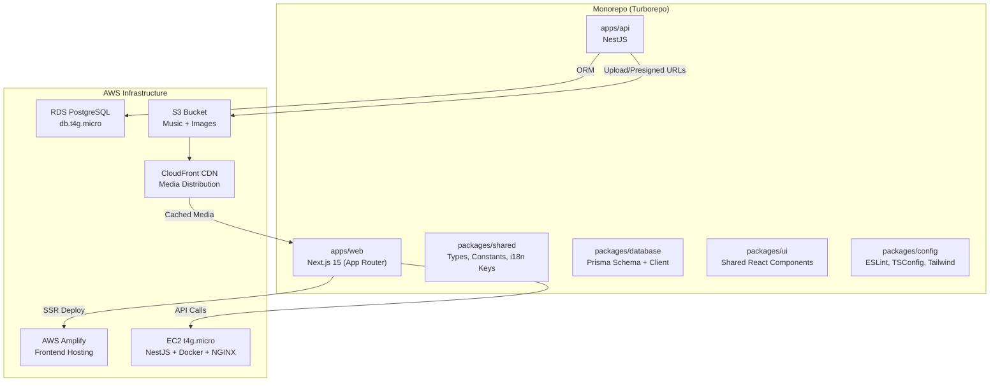
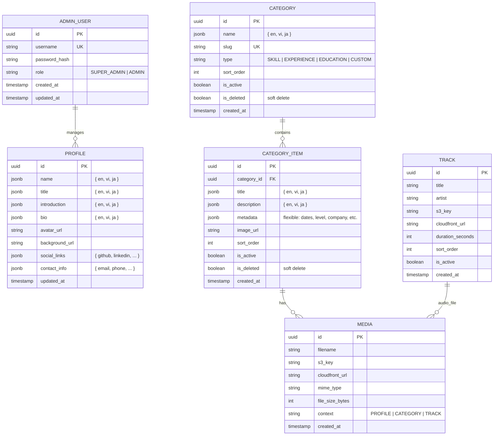
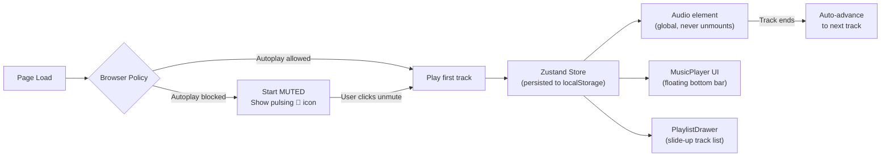

# Jazz Portfolio Monorepo — Implementation Plan

## Goal

Build a jazz-themed, multilingual portfolio website with an admin CMS, background music player, and CI/CD pipeline on AWS. The codebase is a **Turborepo monorepo** housing a Next.js frontend, NestJS backend, shared packages, and infrastructure-as-code.

---

## Architecture Overview



---

## Monorepo Folder Structure

```
d:\personal\
├── .github/
│   └── workflows/
│       ├── ci.yml                  # Lint + Test on PR
│       ├── deploy-api.yml          # Backend → EC2
│       └── deploy-web.yml          # Frontend → Amplify (auto)
├── apps/
│   ├── web/                        # Next.js 15 (App Router)
│   │   ├── public/
│   │   │   └── fonts/
│   │   ├── src/
│   │   │   ├── app/
│   │   │   │   ├── [locale]/       # i18n dynamic segment
│   │   │   │   │   ├── (portfolio)/  # Portfolio route group
│   │   │   │   │   │   ├── page.tsx
│   │   │   │   │   │   ├── layout.tsx
│   │   │   │   │   │   └── sections/
│   │   │   │   │   │       ├── HeroSection.tsx
│   │   │   │   │   │       ├── AboutSection.tsx
│   │   │   │   │   │       ├── ExperienceSection.tsx
│   │   │   │   │   │       ├── SkillsSection.tsx
│   │   │   │   │   │       └── ContactSection.tsx
│   │   │   │   │   └── admin/      # Admin panel (protected)
│   │   │   │   │       ├── layout.tsx
│   │   │   │   │       ├── page.tsx (dashboard)
│   │   │   │   │       ├── profile/
│   │   │   │   │       ├── categories/
│   │   │   │   │       ├── music/
│   │   │   │   │       └── settings/
│   │   │   │   └── api/            # Next.js API routes (auth only)
│   │   │   │       └── auth/
│   │   │   ├── components/
│   │   │   │   ├── layout/
│   │   │   │   │   ├── Header.tsx
│   │   │   │   │   ├── Footer.tsx
│   │   │   │   │   └── LanguageSwitcher.tsx
│   │   │   │   ├── music/
│   │   │   │   │   ├── MusicPlayer.tsx
│   │   │   │   │   ├── PlaylistDrawer.tsx
│   │   │   │   │   └── AudioVisualizer.tsx
│   │   │   │   ├── animations/
│   │   │   │   │   ├── JazzLoader.tsx
│   │   │   │   │   ├── ScrollReveal.tsx
│   │   │   │   │   ├── SmokeEffect.tsx
│   │   │   │   │   └── NoteParticles.tsx
│   │   │   │   └── ui/             # Primitive UI components
│   │   │   ├── hooks/
│   │   │   │   ├── useAudioPlayer.ts
│   │   │   │   └── useScrollAnimation.ts
│   │   │   ├── stores/
│   │   │   │   └── audioStore.ts   # Zustand global audio state
│   │   │   ├── i18n/
│   │   │   │   ├── request.ts
│   │   │   │   ├── routing.ts
│   │   │   │   └── messages/
│   │   │   │       ├── en.json
│   │   │   │       ├── vi.json
│   │   │   │       └── ja.json
│   │   │   ├── lib/
│   │   │   │   ├── api-client.ts   # Typed fetch wrapper
│   │   │   │   └── utils.ts
│   │   │   └── styles/
│   │   │       └── globals.css
│   │   ├── next.config.ts
│   │   ├── tailwind.config.ts
│   │   └── package.json
│   │
│   └── api/                        # NestJS Backend
│       ├── src/
│       │   ├── main.ts
│       │   ├── app.module.ts
│       │   ├── auth/
│       │   │   ├── auth.module.ts
│       │   │   ├── auth.controller.ts
│       │   │   ├── auth.service.ts
│       │   │   ├── strategies/
│       │   │   │   ├── jwt.strategy.ts
│       │   │   │   └── local.strategy.ts
│       │   │   └── guards/
│       │   │       └── jwt-auth.guard.ts
│       │   ├── profile/
│       │   │   ├── profile.module.ts
│       │   │   ├── profile.controller.ts
│       │   │   └── profile.service.ts
│       │   ├── categories/
│       │   │   ├── categories.module.ts
│       │   │   ├── categories.controller.ts
│       │   │   └── categories.service.ts
│       │   ├── music/
│       │   │   ├── music.module.ts
│       │   │   ├── music.controller.ts
│       │   │   └── music.service.ts
│       │   ├── media/
│       │   │   ├── media.module.ts
│       │   │   ├── media.controller.ts
│       │   │   └── media.service.ts  # S3 upload/presigned URLs
│       │   └── common/
│       │       ├── decorators/
│       │       ├── filters/
│       │       ├── interceptors/
│       │       └── pipes/
│       ├── test/
│       ├── Dockerfile
│       ├── docker-compose.yml
│       └── package.json
│
├── packages/
│   ├── database/                   # Prisma schema + generated client
│   │   ├── prisma/
│   │   │   ├── schema.prisma
│   │   │   ├── seed.ts
│   │   │   └── migrations/
│   │   ├── index.ts                # Re-export PrismaClient
│   │   └── package.json
│   ├── shared/                     # Shared types, constants, enums
│   │   ├── src/
│   │   │   ├── types/
│   │   │   ├── constants/
│   │   │   └── enums/
│   │   └── package.json
│   └── config/                     # Shared configs
│       ├── eslint/
│       ├── tsconfig/
│       └── tailwind/
│
├── infra/                          # Infrastructure as Code (optional)
│   └── docker/
│       ├── Dockerfile.api
│       └── docker-compose.prod.yml
├── docs/
│   └── PROJECT_BIBLE.md            # ← THE source of truth
├── turbo.json
├── package.json
├── pnpm-workspace.yaml
└── README.md
```

---

## The "Project Bible" — Single Source of Truth

> [!IMPORTANT]
> A file called `docs/PROJECT_BIBLE.md` will be created in **Phase 0** and maintained throughout the project. It will contain:
> - Every architectural decision and its rationale
> - Tech stack with exact versions pinned
> - Database schema (entity-relationship description)
> - API endpoint inventory (route, method, auth, purpose)
> - Environment variable registry (name, where used, how to set)
> - i18n key conventions and translation workflow
> - Color palette, typography, and design tokens
> - AWS resource inventory and cost estimates
> - CI/CD pipeline descriptions
> - Deployment runbook
>
> **Every phase will update this document.** This ensures no context is ever lost.

---

## Technology Stack (Pinned Versions)

| Layer | Technology | Version | Justification |
|---|---|---|---|
| **Monorepo** | Turborepo | latest | Incremental builds, task caching, parallel execution |
| **Package Manager** | pnpm | 9.x | Workspace protocol, disk-efficient |
| **Frontend** | Next.js (App Router) | 15.x | SSR/SSG, file-based routing, React Server Components |
| **React** | React | 19.x | Concurrent features, Suspense |
| **Styling** | Tailwind CSS | 4.x | Utility-first, tree-shaking, design tokens |
| **Animations** | Framer Motion | 12.x | Declarative animations, layout transitions, scroll-triggered |
| **i18n** | next-intl | 4.x | App Router native, no full page reloads, ICU message format |
| **State** | Zustand | 5.x | Lightweight global audio state, persist middleware |
| **Backend** | NestJS | 11.x | Modular architecture, decorators, DI, guards, interceptors |
| **ORM** | Prisma | 6.x | Type-safe queries, migrations, introspection |
| **Database** | PostgreSQL | 16.x | JSONB for flexible content, full-text search |
| **Auth** | Passport + JWT | latest | Industry standard, NestJS integration |
| **Validation** | class-validator + class-transformer | latest | DTO validation with decorators |
| **Storage SDK** | @aws-sdk/client-s3 | 3.x | Presigned URLs, multipart upload |
| **Linting** | ESLint + Prettier | latest | Consistent code style across monorepo |

---

## Database Schema Design



> [!NOTE]
> **Why JSONB for multilingual fields?** With exactly 3 languages (en, vi, ja), JSONB columns like `{ "en": "...", "vi": "...", "ja": "..." }` are cleaner than a separate translations table. Prisma supports JSONB natively, and PostgreSQL can index JSONB paths for queries.

> [!NOTE]
> **Dynamic Categories:** The `CATEGORY` + `CATEGORY_ITEM` pattern lets the admin create, reorder, soft-delete, and restore any section (Skills, Experience, Education, or custom ones) without schema changes. The `metadata` JSONB field on `CATEGORY_ITEM` handles varying shapes (date ranges for experience, skill levels for skills, etc.).

---

## Key Design Decisions

### 1. Jazz Aesthetic & Animations

| Element | Implementation |
|---|---|
| **Color Palette** | Dark smoky base (`#0a0a0f`, `#1a1a2e`), warm brass/gold accents (`#d4a574`, `#c9a96e`), cool blue undertones (`#16213e`) |
| **Typography** | `Playfair Display` (serif headings — EN/VI), `Noto Serif JP` (JA headings), `Inter` (body text), `Noto Sans JP` (JA body) |
| **Loading Animation** | Full-screen jazz intro: animated saxophone/piano silhouette with musical note particles rising like smoke, fading to reveal the site |
| **Scroll Animations** | Framer Motion `useInView` + `useScroll` for staggered section reveals, parallax backgrounds |
| **Hover Effects** | Subtle gold glow on interactive elements, smooth scale transforms, underline animations |
| **Page Transitions** | Framer Motion `AnimatePresence` for cross-fade between route changes |

### 2. Music Player Architecture



- The `<audio>` element lives in the root layout — it **never unmounts** during navigation
- Zustand store tracks: `currentTrack`, `isPlaying`, `isMuted`, `volume`, `playlist`, `currentTime`
- Playlist fetched from API on app load, cached with SWR/React Query

### 3. Admin Panel — Inside Next.js

The admin panel lives at `/[locale]/admin/*` as a route group with its own layout, protected by middleware:

- **Auth flow:** Login form → NestJS `/auth/login` → JWT returned → stored in httpOnly cookie → Next.js middleware validates on every `/admin` request
- **Features:**
  - Dashboard overview
  - Profile editor (avatar upload, multilingual text fields)
  - Category manager (drag-to-reorder, soft delete, add custom categories)
  - Music manager (upload tracks to S3, reorder playlist, toggle active)
  - Password change

### 4. AWS Infrastructure (Cost-Optimized)

| Resource | Spec | Est. Monthly Cost |
|---|---|---|
| **RDS PostgreSQL** | `db.t4g.micro`, 20GB gp3 | ~$15 (free tier year 1) |
| **EC2** | `t4g.micro`, ARM, Amazon Linux 2023 | ~$7 (free tier year 1) |
| **Amplify Hosting** | Build + deploy Next.js | ~$0-5 (low traffic) |
| **S3** | Standard, lifecycle rules | ~$1-2 |
| **CloudFront** | 1TB free tier/year | ~$0 (year 1) |
| **Route 53** | 1 hosted zone | ~$0.50 |
| **Total Year 1** | | **~$5-15/month** |

---

## Implementation Phases

> [!IMPORTANT]
> Each phase ends with a **checkpoint** — a verifiable deliverable that proves the phase is complete before moving on.

---

### Phase 0: Project Bible & Monorepo Scaffold ⏱️ ~2-3 hours

**Goal:** Create the empty monorepo skeleton and the Project Bible document. After this phase, every file and folder exists (empty or with boilerplate), and all architectural decisions are documented.

**Tasks:**
1. Initialize the Turborepo monorepo with pnpm workspaces
2. Create all folder structures (`apps/web`, `apps/api`, `packages/*`, `docs/`, `infra/`)
3. Configure shared `tsconfig`, ESLint, and Prettier across the monorepo
4. Write `docs/PROJECT_BIBLE.md` with all decisions from this plan
5. Initialize Git, create `.gitignore`, write `README.md`
6. Create placeholder `package.json` files for each workspace

**Checkpoint:** `turbo run build` passes (even if builds are empty). `PROJECT_BIBLE.md` exists with all sections populated.

---

### Phase 1: Database & Backend Foundation ⏱️ ~4-6 hours

**Goal:** Prisma schema is defined, migrations run, NestJS boots with health check, and basic module structure is in place.

**Tasks:**
1. Set up `packages/database` with Prisma schema (all entities from the ER diagram above)
2. Run initial migration against a local PostgreSQL (Docker Compose for dev)
3. Create seed script with sample admin user + sample data
4. Initialize NestJS app (`apps/api`) with module structure
5. Set up environment config (`.env` validation with `@nestjs/config` + Joi)
6. Create common infrastructure: exception filters, logging interceptor, validation pipe
7. Implement health check endpoint (`GET /api/health`)
8. Set up `packages/shared` with shared TypeScript types and enums

**Checkpoint:** `docker-compose up` starts PostgreSQL, `pnpm --filter api dev` boots NestJS, `curl localhost:3001/api/health` returns `{ status: "ok" }`.

---

### Phase 2: Authentication & Admin API ⏱️ ~4-6 hours

**Goal:** JWT auth works end-to-end. Admin can log in and all protected CRUD endpoints exist.

**Tasks:**
1. Implement `auth` module: local strategy (username+bcrypt), JWT strategy, login endpoint
2. Implement `profile` module: CRUD for profile data (multilingual JSONB fields)
3. Implement `categories` module: CRUD with soft delete, reordering
4. Implement `category-items` module: CRUD with soft delete, reordering, metadata
5. Implement `music` module: CRUD for tracks (metadata only — S3 comes in Phase 3)
6. Implement `media` module: placeholder for S3 upload (local storage fallback for now)
7. Add request validation (DTOs with `class-validator`)
8. Add Swagger/OpenAPI documentation (`@nestjs/swagger`)
9. Write integration tests for auth flow

**Checkpoint:** Swagger UI at `/api/docs` shows all endpoints. Login returns JWT. CRUD operations work via Swagger/Postman. Tests pass.

---

### Phase 3: S3 Integration & Media Pipeline ⏱️ ~3-4 hours

**Goal:** Files (images, audio) upload to S3, served through CloudFront, with presigned URLs for secure access.

**Tasks:**
1. Create S3 bucket with proper CORS and bucket policy
2. Create CloudFront distribution pointing to S3
3. Implement presigned URL generation in `media.service.ts`
4. Implement direct browser-to-S3 upload flow (presigned PUT URL)
5. Implement track upload: frontend gets presigned URL → uploads to S3 → sends metadata to API
6. Add file validation (type, size limits) in both API and frontend
7. Configure S3 lifecycle rules (cleanup orphaned uploads)

**Checkpoint:** Upload an image and an MP3 via API. Verify they're accessible through CloudFront URL. Track metadata saved in DB with correct `cloudfront_url`.

---

### Phase 4: Frontend Shell, i18n & Design System ⏱️ ~6-8 hours

**Goal:** Next.js app renders with the jazz theme, all 3 languages work, and the global layout (header, footer, music player shell) is in place.

**Tasks:**
1. Initialize Next.js 15 app with App Router (`apps/web`)
2. Configure Tailwind CSS with jazz design tokens (colors, fonts, spacing)
3. Set up `next-intl` with `[locale]` dynamic segment and middleware
4. Create translation JSON files (`en.json`, `vi.json`, `ja.json`) — start with navigation/UI strings
5. Load and configure fonts (Playfair Display, Noto Serif JP, Inter, Noto Sans JP)
6. Build global layout: `Header` (nav + language switcher), `Footer`
7. Build `LanguageSwitcher` component (flag icons for vi/en/ja)
8. Create the API client (`lib/api-client.ts`) — typed fetch wrapper for NestJS endpoints
9. Set up Zustand audio store (state shape, persist middleware)
10. Build `MusicPlayer` component shell (bottom floating bar — no audio logic yet)
11. Configure responsive breakpoints and test on mobile/tablet/desktop

**Checkpoint:** Site loads at `localhost:3000/en`, `/vi`, `/ja` with correct translations. Jazz color scheme visible. Header, footer, and music player bar render. Fully responsive.

---

### Phase 5: Jazz Loading Animation & Core Animations ⏱️ ~4-6 hours

**Goal:** The site feels alive — the jazz loading screen plays on first visit, scroll animations reveal content, and hover effects are polished.

**Tasks:**
1. Build `JazzLoader` component: full-screen intro animation
   - Animated saxophone/piano keys silhouette
   - Musical note particles floating upward (like smoke)
   - Smooth fade-out revealing the portfolio
   - Only plays on first visit (sessionStorage flag)
2. Build `ScrollReveal` wrapper component (Framer Motion `useInView`)
3. Build `SmokeEffect` ambient background component (CSS/Canvas)
4. Implement page transition animations (`AnimatePresence` in layout)
5. Add hover effects: gold glow on buttons, smooth underline on links, scale on cards
6. Add staggered reveal animations for lists (skills, experiences)
7. Performance audit: ensure animations don't cause layout shift or jank

**Checkpoint:** First visit shows the jazz loading animation. Scrolling reveals sections with smooth staggered animations. Hover effects feel polished. Lighthouse performance score > 90.

---

### Phase 6: Portfolio Content Sections ⏱️ ~6-8 hours

**Goal:** All portfolio sections render dynamic content from the API, fully translated, with beautiful animations.

**Tasks:**
1. Build `HeroSection`: name, title, animated intro text, CTA
2. Build `AboutSection`: profile picture, bio, background story
3. Build `ExperienceSection`: timeline layout, fetched from categories API
4. Build `SkillsSection`: skill cards/badges with levels, grouped by category
5. Build `ContactSection`: contact form or contact info display
6. Integrate all sections with API data (SWR or React Query for fetching)
7. Ensure all text content renders correctly in en/vi/ja (especially Japanese typography)
8. Add skeleton loaders for content fetching states
9. Test responsive layout for all sections

**Checkpoint:** Portfolio page displays real data from the API. All 3 languages render correctly with proper font fallbacks. Skeleton loaders show during fetch.

---

### Phase 7: Music Player — Full Implementation ⏱️ ~4-5 hours

**Goal:** Music plays continuously across navigation, with full controls and playlist management.

**Tasks:**
1. Implement the global `<audio>` element in root layout (never unmounts)
2. Wire Zustand store to audio element (play/pause/skip/volume/mute/seek)
3. Fetch playlist from API on app load
4. Implement auto-advance to next track
5. Build `PlaylistDrawer` (slide-up panel showing all tracks with play buttons)
6. Build `AudioVisualizer` (optional: subtle frequency bars in the player)
7. Handle browser autoplay policy: start muted, show unmute prompt
8. Persist player state (current track, volume, muted) to localStorage
9. Test: music continues playing when navigating between pages

**Checkpoint:** Music plays from CloudFront URLs. Player controls work (play/pause/skip/volume/mute). Playlist drawer shows all tracks. Music persists across navigation. Muted autoplay works correctly.

---

### Phase 8: Admin Panel ⏱️ ~6-8 hours

**Goal:** Admin can log in and manage all portfolio content through a clean dashboard UI.

**Tasks:**
1. Build admin login page (`/[locale]/admin/login`)
2. Set up Next.js middleware to protect `/admin/*` routes (validate JWT from httpOnly cookie)
3. Build admin layout (sidebar navigation, breadcrumbs)
4. Build **Profile Editor**: avatar upload, multilingual text fields (en/vi/ja tabs), social links
5. Build **Category Manager**: list view, create/edit modal, drag-to-reorder, soft delete/restore
6. Build **Category Item Manager**: nested under categories, CRUD + reorder + image upload
7. Build **Music Manager**: upload tracks, edit metadata, reorder, toggle active/inactive
8. Build **Settings Page**: change password, view account info
9. Add form validation and error handling
10. Add success/error toast notifications

**Checkpoint:** Admin can log in, edit profile, manage categories and items (with reordering), upload/manage music tracks, and change password. All changes reflect on the public portfolio.

---

### Phase 9: CI/CD & AWS Deployment ⏱️ ~4-6 hours

**Goal:** Push to `main` triggers automated testing, building, and deployment to AWS.

**Tasks:**
1. Provision AWS resources:
   - RDS PostgreSQL (`db.t4g.micro`)
   - EC2 (`t4g.micro`) with Docker + NGINX + Let's Encrypt SSL
   - S3 bucket + CloudFront distribution
   - Route 53 hosted zone (if custom domain)
2. Create `Dockerfile` for NestJS API (multi-stage build, ARM target)
3. Create `docker-compose.prod.yml` for EC2 (API + NGINX)
4. Write GitHub Actions workflow: **CI** (lint + test on every PR)
5. Write GitHub Actions workflow: **Deploy API** (SSH → EC2, pull, rebuild, restart)
6. Configure AWS Amplify to auto-deploy `apps/web` on push to `main`
7. Set up environment variables in Amplify and EC2
8. Configure NGINX reverse proxy with SSL termination
9. Run Prisma migrations against production RDS
10. Seed production database with initial admin user

**Checkpoint:** Push to `main` triggers: CI runs tests → API deploys to EC2 → Frontend deploys to Amplify. Site is live on a public URL with HTTPS. Admin can log in on production.

---

### Phase 10: Polish, Testing & Launch ⏱️ ~3-4 hours

**Goal:** Final QA, performance optimization, and launch readiness.

**Status (2026-07-20):** Refactor phases 1–6 shipped robots/sitemap/OG, error boundaries, CI build+test, and performance hardening. Rationale and ongoing practices: [refactor_and_performance.md](./refactor_and_performance.md). Measurement: [perf-notes.md](./perf-notes.md). Re-run Lighthouse on the deployed Amplify URL to fill scores.

**Tasks:**
1. End-to-end testing: all user flows (portfolio viewing, language switching, music, admin CRUD)
2. Lighthouse audit: target Performance > 90, Accessibility > 90, SEO > 95
3. Test Japanese typography rendering (line breaks, font fallbacks)
4. Test on real mobile devices (iOS Safari, Android Chrome)
5. Add `robots.txt`, `sitemap.xml`, OpenGraph meta tags — **done** (App Router `robots.ts` / `sitemap.ts` + metadata)
6. Add error boundaries and 404/500 pages — **done**
7. Security review: CORS config, rate limiting, input sanitization, CSP headers — cookie auth + CORS credentials landed; re-check CSP on deploy
8. Create deployment runbook in `PROJECT_BIBLE.md`
9. Final `PROJECT_BIBLE.md` update with all endpoints, env vars, and resource inventory — **updated for auth/env/CI/admin**

**Checkpoint:** Site is live, performant, secure, and fully functional. `PROJECT_BIBLE.md` is complete and accurate. Ready for public launch.

---

## Resolved Questions

| # | Question | Decision |
|---|---|---|
| 1 | Domain name? | Default AWS URLs for now. Custom domain can be added later via Route 53. |
| 2 | Blog feature? | **Portfolio + Admin only.** No blog/comments for v1. Architecture supports easy addition later. |
| 3 | Admin user count? | **Single admin.** Simplifies auth — no roles/permissions table needed. |
| 4 | Contact form? | **Display contact info + social links only.** No email form for v1. |
| 5 | Jazz music files? | **User has files ready.** Upload flow needed in admin panel. |

---

## Verification Plan

### Automated Tests
- `pnpm turbo run test` — runs all unit/integration tests across the monorepo
- `pnpm turbo run lint` — ESLint across all packages
- `pnpm turbo run type-check` — TypeScript compilation check
- NestJS e2e tests for auth flow and CRUD endpoints
- GitHub Actions CI on every PR

### Manual Verification
- Visual QA across 3 languages (en/vi/ja) on desktop + mobile
- Music player persistence test across page navigations
- Admin panel CRUD operations → verify public portfolio reflects changes
- Lighthouse performance audit
- SSL and security headers verification on production
